# Slop Shenzhen · Explore Shenzhen in Your Browser

**English** · [简体中文](README.zh.md)

**[Explore the live city · slop.sztechsafari.com](https://slop.sztechsafari.com/)**

**From the traffic on Shennan Boulevard to the waterfront of Shenzhen Bay and a sky lit up by drones.**

Slop Shenzhen is a browser-based 3D city exploration project built from geographic data at a **1:1 scale in meters**. Walk through neighborhoods, drive along major roads, cycle through coastal parks, or take a quadrotor into the sky to explore Shenzhen's towers, hills, coastline, and interchanges.

Discover the technology skyline of DJI Sky City, China Resources Tower, and the Shenzhen Bay Super Headquarters district alongside Nantou Ancient City, University Town, Window of the World, and Shenzhen North Station. Explore the city's structure by day, then return for building lights, drone formations, and fireworks at night. All images below are screenshots from the project.

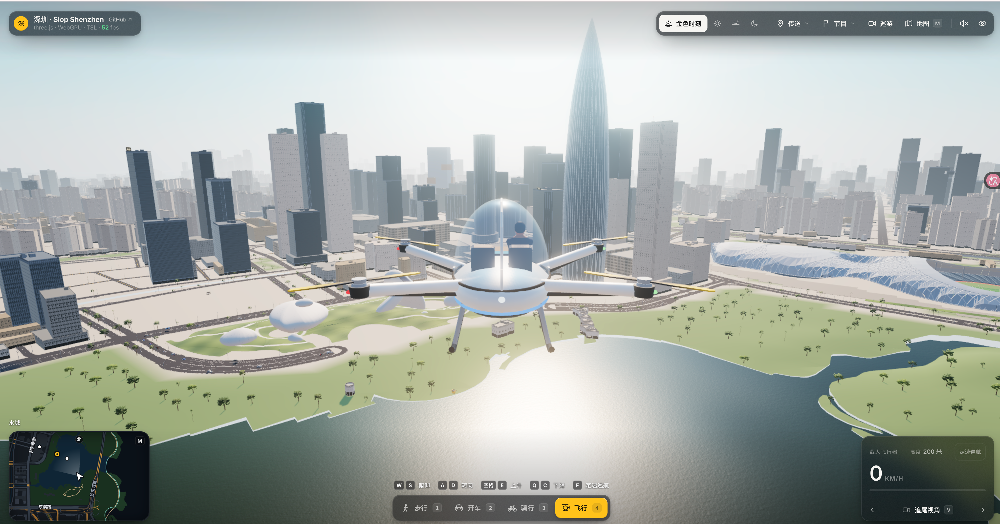

> This project is under active development. “1:1” describes its spatial scale, not complete coverage of Shenzhen's administrative area, every building, or every road. The scene centers on Nanshan and Futian, with extensions into Luohu, Bao'an, University Town, and Shenzhen North Station. See [HANDOFF](docs/HANDOFF.md) for current coverage and verification status.

## A 3D Map You Can Step Into

Buildings, roads, waterways, parks, hills, and transport infrastructure share one geographic coordinate system. Move from street level into the sky to understand how neighborhoods connect. The full map, minimap, place search, and category filters help you find landmarks, shopping districts, parks, and stations.

- **Full map and minimap:** locate yourself, explore city and transport layers, zoom and pan, and select places. Double-click or double-tap the map to travel to an available landing point.
- **Transport layers:** switch between metro lines, railway stations, drone routes, and driving plans to explore both destinations and connections.
- **Street and aerial views:** inspect facades, trees, and streetlights at ground level, or study the road network, coastline, and skyline from above. Switch between day and night.
- **Shared coordinates:** the geographic origin is **114.0545° E, 22.5463° N**. **One scene unit equals one meter**, with `x` pointing east, `z` south, and `y` up. New areas retain the same origin, keeping landmarks and routes in a common spatial frame.

Building footprints primarily come from OSM / Overture, combined with terrain data, verified landmark references, and height sources. Estimated, designed, and measured heights are recorded separately. The result is both an explorable procedural city and a model being continually checked against its sources.

## Shenzhen's Technology Skyline, in 360°

Use **landmark orbit** to view buildings and surrounding streets from different directions, or switch to chase and first-person cameras. Explore the Civic Center's central axis, the lawns and towers along Shennan Boulevard, and Houhai's waterfront skyline at different scales.

| DJI Sky City | Shenzhen Bay Super Headquarters District |
| --- | --- |
| 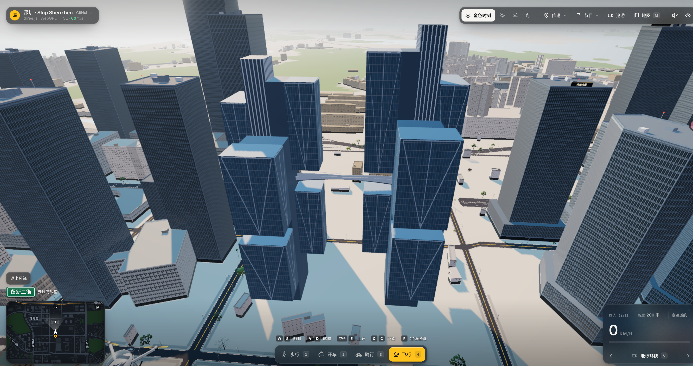 | 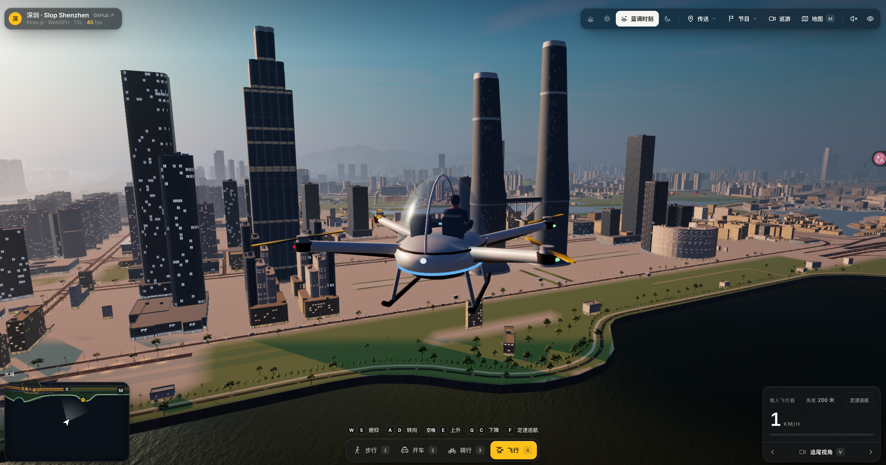 |
| Fly around the towers, cantilevered structures, and bridges to explore the architecture of Shenzhen's technology districts. | Follow the coastline past headquarters towers and see how the city opens onto Shenzhen Bay. |

| Spring Cocoon · Shenzhen Bay Sports Center | Luohu Skyline |
| --- | --- |
| 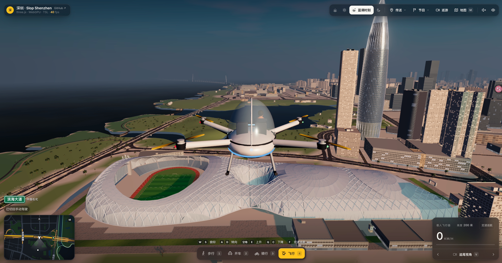 | 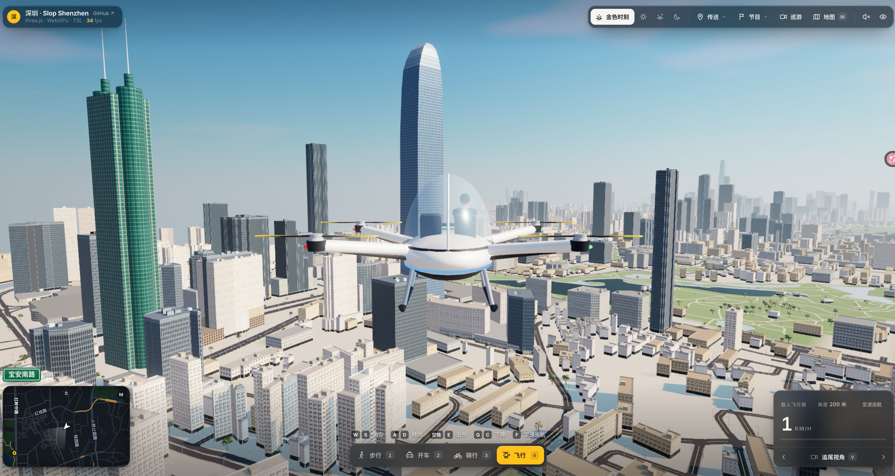 |
| Orbit the stadium's lattice shell, sports field, and coastal setting. | Discover layers of Shenzhen's development around Shun Hing Square and KK100. |

Other landmarks include Ping An Finance Center, Tencent Seafront Towers, the Shenzhen Stock Exchange, University Town Library, Qianhai Museum, and Shenzhen Bay Culture Park. Landmark identities are tied to verified source objects, with local forms and details expressed procedurally.

## APEC-Themed City Atmosphere

APEC-themed decorations connect roads, venues, and nighttime scenery. Streetlight poles along Shennan, Binhe, and Binhai Boulevards carry themed banners, while venue surroundings feature text signs, flower beds, and illustrative facilities.

| Street Banners | APEC-Themed Venue |
| --- | --- |
| 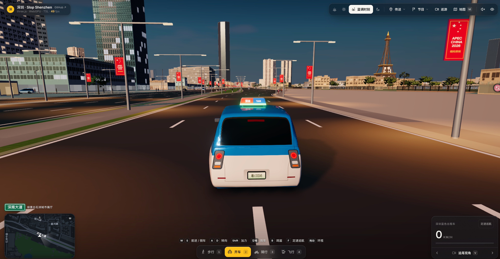 | 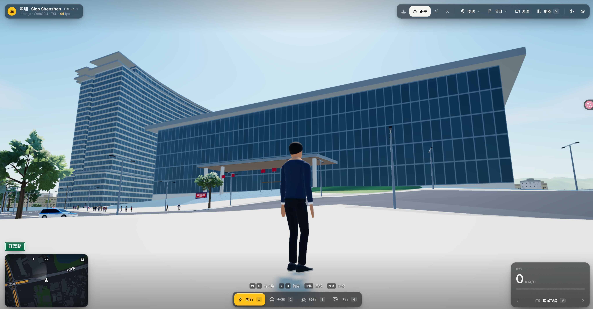 |
| Drive past APEC text banners, streetlights, green strips, and nearby buildings. | Explore the scale and public-facing spaces of venues such as the Shenzhen International Exchange Center. |

The project uses **APEC text and themed colors, without the official emblem**. Venue signs and some forecourt facilities are scene illustrations. The light and drone shows are original simulations, not official event schedules, reproductions of actual performances, or live opening information.

## After Dark: Light Shows, Drone Formations, and Fireworks

Look from Lianhua Hill toward the Civic Center and Futian CBD as buildings become a stage for light. At Shenzhen Talent Park, watch drone formations above the Houhai skyline from the waterfront viewing area.

| Light Show from Lianhua Hill | Drone Show at Shenzhen Talent Park |
| --- | --- |
| 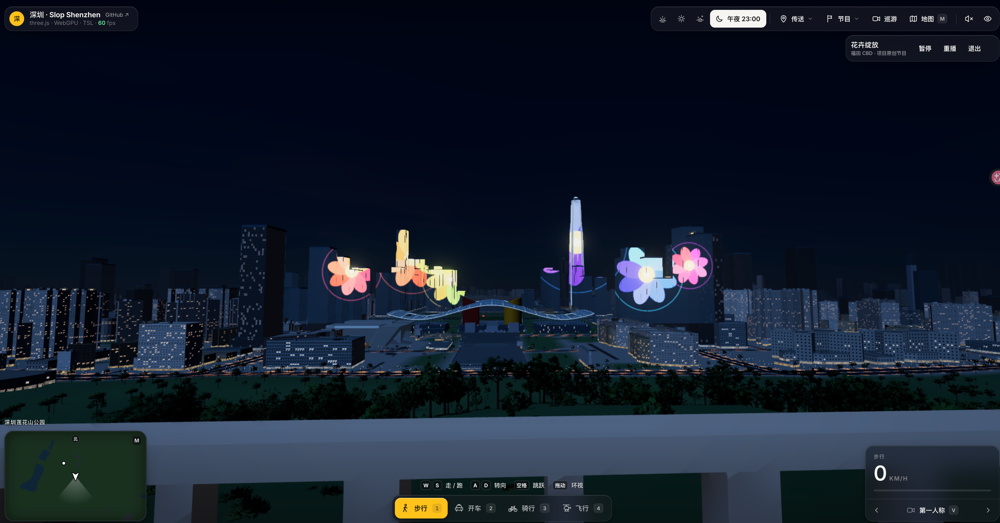 | 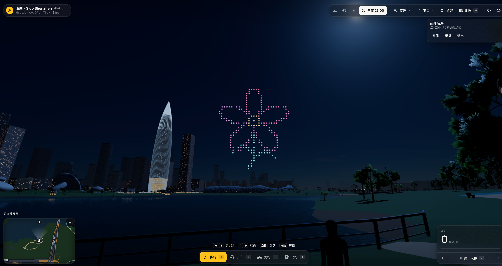 |
| Original sequences feature flowers, rockets, and themes of openness and cooperation, with pause, resume, and replay controls. | The original “Houhai Star Tide” simulation includes flowers, dolphins, rockets, and the Shenzhen skyline. |

| Convention Center and Ping An Finance Center | Futian at Night |
| --- | --- |
| 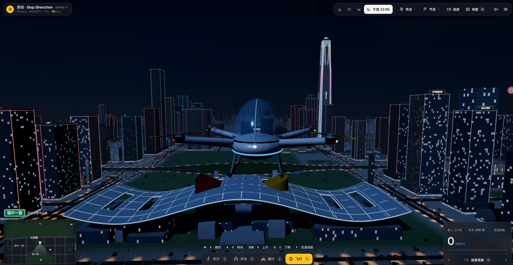 | 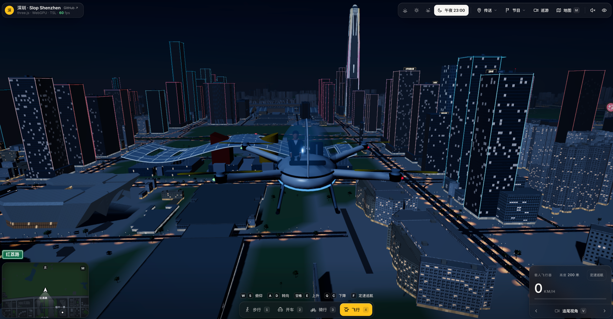 |
| Frame the venue roof and illuminated towers together from low altitude. | Change your distance and angle to explore streetlights, building outlines, and the depth of the city. |

Window of the World also features **simulated nighttime fireworks**, complementing its landmark structures, park lighting, and surrounding cityscape.

## Automatic Aerial Tours Along Three Major Roads

Choose the **Shennan, Beihuan, or Binhai tour** to fly automatically along a major urban corridor. Tours target roughly 80 meters above the ground-level road, with options to pause, adjust the view, and continue.

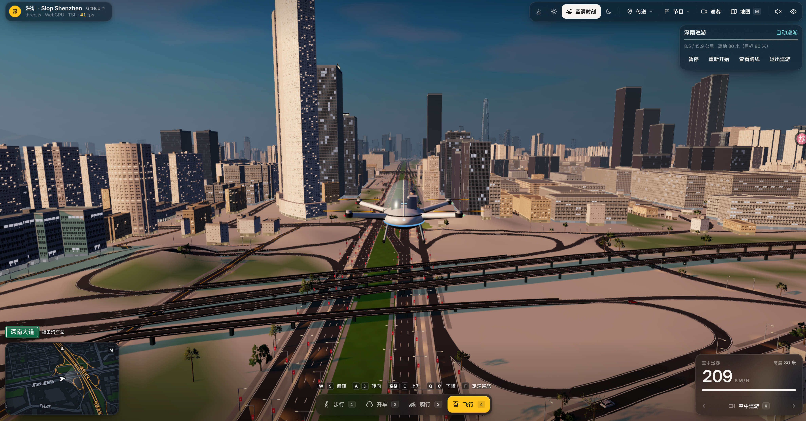

- **Shennan Boulevard:** the city's central corridor, roadside lawns, business districts, and landmarks.
- **Beihuan Boulevard:** expressways, interchanges, and the relationship between the city and its northern hills.
- **Binhai Boulevard:** Houhai, the coast, and the skyline along Shenzhen Bay.

These are aerial sightseeing tours. Ground-level automatic driving uses a separate road planner and vehicle controller.

## Drive Yourself, Plan a Route, or Set Cruise Control

Switch to car mode to explore Shenzhen at street level. Manual driving, map-based automatic driving, and cruise control offer different ways to travel.

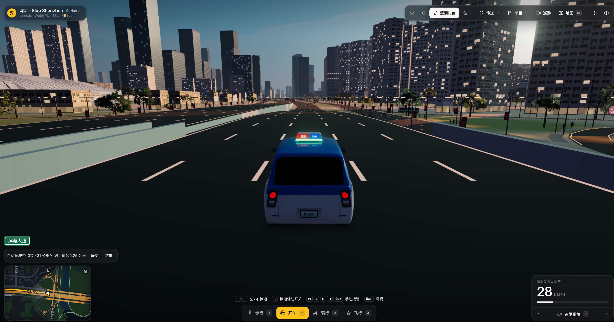

| Mode | What You Can Do |
| --- | --- |
| Manual driving | Accelerate, steer, and brake across connected roads, bridge decks, and ramps. |
| Map-based automatic driving | Select available start and destination points and road levels, preview a route, then depart. Pause, resume, end the trip, or take over manually. |
| Cruise control | Press `F` while driving to follow an available lane path. The car slows before curves and returns to its set speed afterward; braking exits cruise control. |
| Elevated roads and tunnels | Explore layered interchanges and connected sections around Chegongmiao, Nanping Expressway, and the Yanjiang Expressway–Dongbin Tunnel route. |

Along the coast, you can also view **Shenzhen Bay Bridge and the offshore viaducts of Yanjiang Expressway**. Distant bridge scenery, drivable decks, and fully connected interchanges have different completion states. Some bridge and tunnel sections have continuous driving demonstrations; others remain incomplete, so a visible bridge does not necessarily provide an end-to-end driving route.

## Low-Altitude Shenzhen: Quadrotor Flight and Delivery Drone Following

The **player-controlled quadrotor** lets you climb, descend, hover, and fly quickly above the city. Cross major roads and elevated highways, inspect the skyline, then return to the ground to keep exploring. Flight supports cruise control; high-speed flight settings are gameplay parameters, not claims about real aircraft performance.

**Delivery drone following** is an observation mode. Select a station or route in the map's drone panel to watch a simulated takeoff and flight through the city. Switch between normal and 10× speed, drag to orbit the camera, and stop to return to the player view.

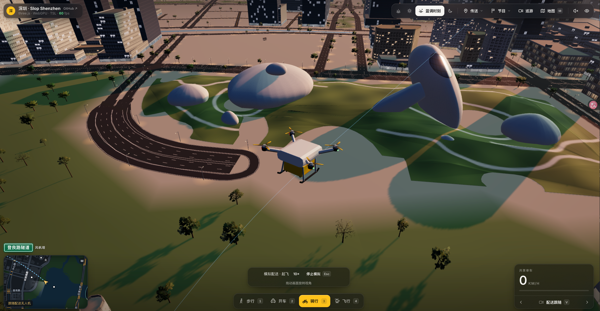

A simulated route is available in the Talent Park Tidal Plaza–Coastal City area. Routes, flight heights, and locker positions include illustrative estimates. This is a view of urban drone delivery, not a live order tracker or a replay of measured flight paths.

## High-Speed Trains and Shenzhen's Metro Network

The map's transport panel separates metro and railway views. Enable individual metro lines and inspect routes and entrances, or select a railway station to locate it, travel to an available nearby point, or use a viewing camera.

| Trains at Shenzhen North Station | Shenzhen North from Above |
| --- | --- |
| 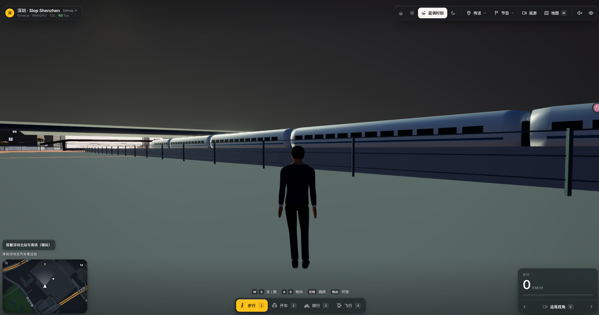 | 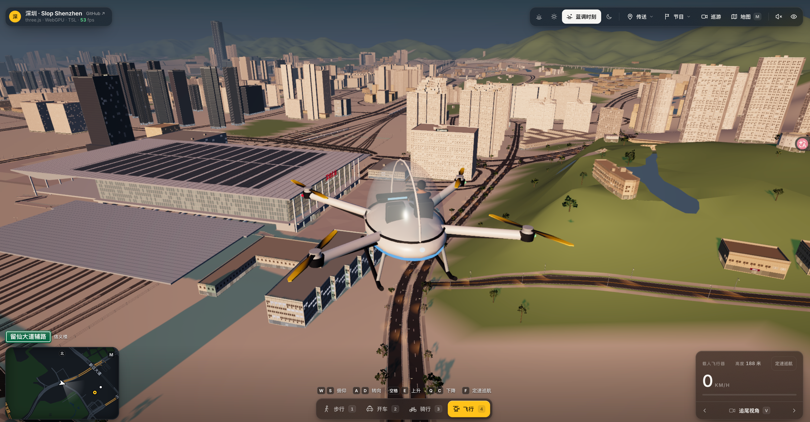 |
| Inspect the trains up close. The station includes source-based tracks and simulated train movement in both directions. | See the station building, track layout, and its relationship to the surrounding city. |

Shenzhen North, Futian, Xili, and Shenzhen Railway Station in Luohu have map locations and visit entry points. Their representations vary with the available data: Futian focuses on surface facilities, while Xili retains an illustrative construction-site perimeter. The current experience covers transport maps and station sightseeing, rather than complete train journeys or indoor transfers.

## Coastal Cycling, Parks, Historic Streets, and University Town

Switch to a bicycle and **ride along the seawall at Shenzhen Bay Park**, passing waterfront greenery, pedestrian bridges, and viewing spaces. Explore toward the Dasha River Greenway to see how the estuary and riverbanks connect with the city. Talent Park, Lianhua Hill, Lizhi Park, Honghu Park, Sihai Park, and Xiangmi Park offer different green spaces and lakeside settings.

| Window of the World | Nantou Ancient City |
| --- | --- |
| 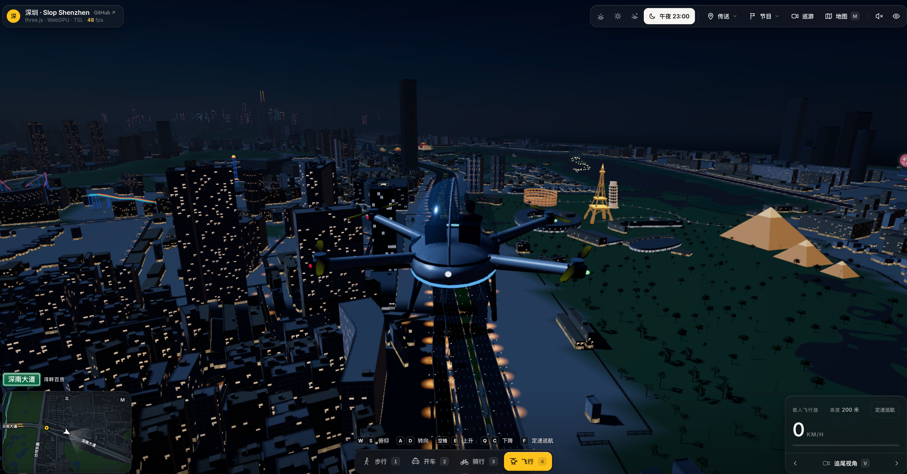 | 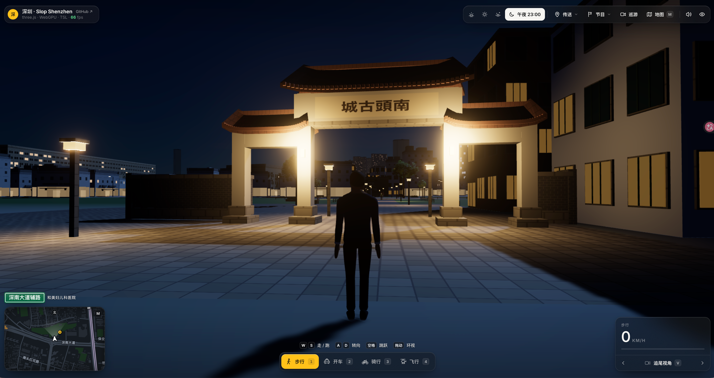 |
| Explore miniature landmarks, nighttime lighting, simulated fireworks, and nearby major roads. | Return to street level to see the contrast in scale between the gate, historic lanes, and modern neighborhoods. |

| Sea World | Bao'an Waterfront |
| --- | --- |
| 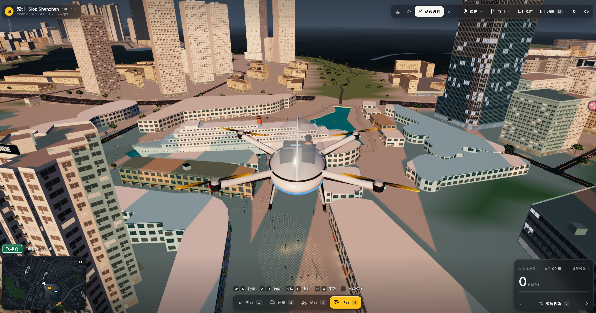 | 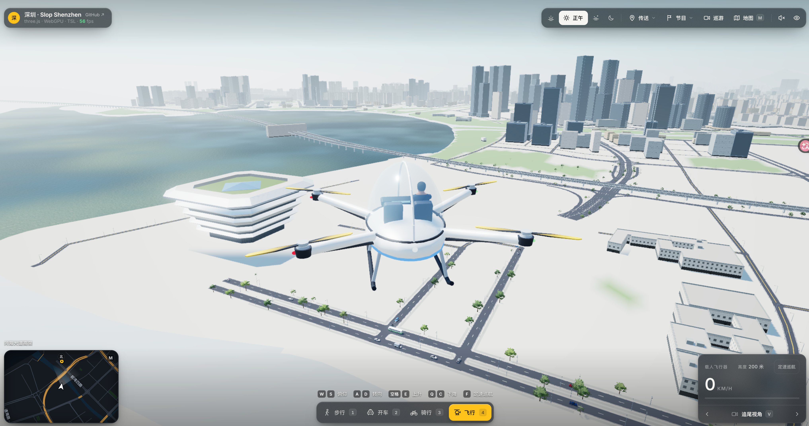 |
| Move between commercial streets, plazas, and coastal urban spaces. | Explore waterfront cultural architecture and distant offshore transport infrastructure toward Yanjiang. |

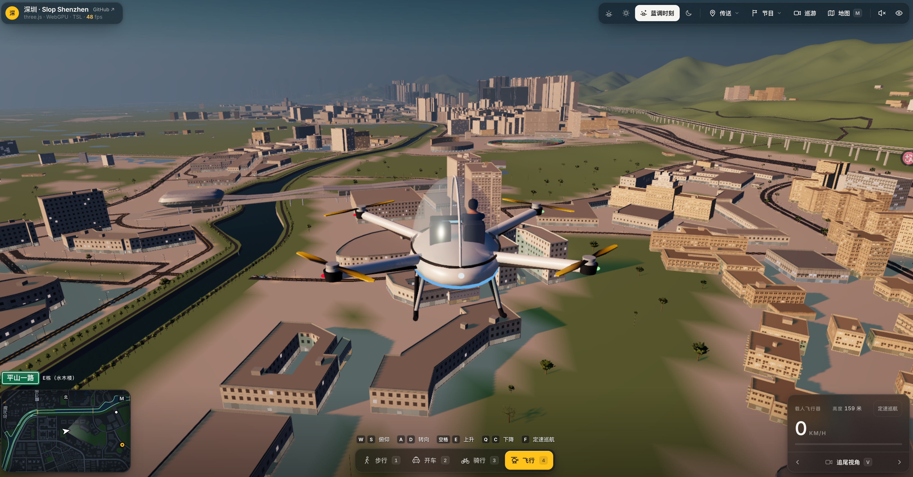

**University Town** offers another side of Shenzhen, where campuses, public buildings, sports facilities, hills, and greenery meet. Walking and cycling use the scene's actual ground and bridge surfaces. Complete greenway journeys, every bridge approach, and real-world public access remain under review.

## A Suggested First Visit

1. Open the map and find the Civic Center or Ping An Finance Center to get your bearings around Futian's central axis.
2. Switch to flight, orbit a landmark, then try a Shennan, Beihuan, or Binhai aerial tour.
3. Return to the ground and try automatic driving or `F` cruise control on an available road section.
4. Cycle through Shenzhen Bay Park, then follow a delivery drone at Talent Park.
5. After dark, watch the light show from Lianhua Hill and the drone show at Talent Park, then fly to Window of the World.
6. Finish with the trains at Shenzhen North, or explore Luohu, Bao'an, and University Town from above.

| Key | Action |
| --- | --- |
| `1` / `2` / `3` / `4` | Walk / Car / Bicycle / Flight |
| `M` | Open the map |
| `V` | Cycle cameras |
| `5` | Recenter the chase camera |
| `F` | Car or aircraft cruise control |
| `Space` | Car brake |
| `H` | Hide the interface for screenshots |
| `N` | Toggle sound |

Mode changes check the current position and available landing surfaces. Refer to the in-scene interface for complete controls.

## Run Locally

Use a browser with WebGPU support and start the project's built-in server:

```sh
git clone https://github.com/skyh24/slop-shenzhen.git
cd slop-shenzhen
python3 tools/sz/serve.py --port 8080
```

Open [http://127.0.0.1:8080/](http://127.0.0.1:8080/) and wait for the scene to finish loading. You can also [explore the hosted version](https://slop.sztechsafari.com/).

Built with **three.js 0.187.0, WebGPU / TSL, and native ES Modules**, with no bundler. Buildings, vehicles, and streetscape objects are modeled procedurally. City data is generated by an offline pipeline; the running scene does not request maps from geographic data services. README screenshots are presentation assets, not textures used by the 3D scene.

## Data, Development Status, and Credits

This is a city exploration and visualization experiment. Building heights, venue details, road profiles, flight routes, and performances include explicitly recorded estimates or original content. A working local route does not establish citywide traversability, and the scene is not a source of real-world navigation or opening information.

Project documentation is primarily in Chinese:

- [Current coverage, verified features, and limitations](docs/HANDOFF.md)
- [Component and feature documentation](docs/README.md)
- [Development checks](docs/25-FAST-CHECKS.md) · [Tasks and verification gaps](docs/TASKS.md)
- [Data attribution and licensing](data/source/ATTRIBUTION.md) · [Sources and snapshot inventory](data/source/sources.json)

Derived from [Slop New York](https://github.com/mrdoob/slop-newyork), with data organization informed by [Slop Wuhan](https://github.com/LightYearZh/slop-wuhan). Thanks to the original authors and the open geographic data community. Code retains the [MIT license](LICENSE) and original author attribution. Geographic data remains subject to the respective licenses and restrictions of OSM / Overture, GloBFP, Copernicus, FABDEM, and other sources.
