# Slop Shenzhen · 在浏览器里漫游深圳

[English](README.md) · **简体中文**

**[在线体验 · slop.sztechsafari.com](https://slop.sztechsafari.com/)**

**从深南大道的车流，到深圳湾的晚风，再到无人机点亮的夜空。**

Slop Shenzhen 是一个以真实地理数据为基础、按 **1:1 米制尺度**构建的深圳 3D 城市漫游项目。你可以步行穿过街区，驾驶汽车沿主干道前进，骑单车探索滨海公园，也可以坐上四旋翼飞行器，从空中观察深圳的楼群、山体、海岸与立交。

这里既有大疆天空之城、华润春笋和超级总部的科技天际线，也有南头古城、大学城、世界之窗和深圳北站；白天看城市结构，入夜看楼宇灯光、无人机编队与烟花。下面的图片均为项目场景截图。

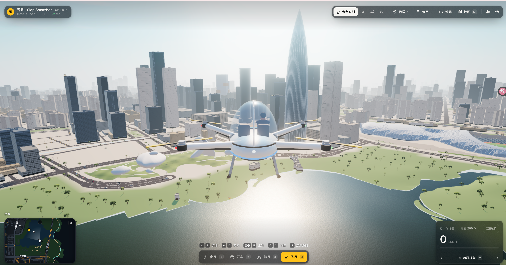

> 项目持续开发中。1:1 指场景的空间尺度，不代表深圳行政全域、每栋建筑或所有道路均已完整复原。当前以南山、福田为核心，并扩展到罗湖、宝安、大学城、深圳北站等区域；具体覆盖与验收状态见 [HANDOFF](docs/HANDOFF.md)。

## 一张可以走进去的深圳 3D 地图

城市不是孤立的地标展台：建筑、道路、水域、公园、山地和交通设施放在同一套地理坐标中，可以从街面一路切换到高空，观察街区之间的关系。全图和小地图辅助定位，地点搜索与分类入口帮助你找到地标、商圈、公园和车站。

- **全图与小地图**：查看当前位置、城市空间与交通图层，缩放、平移并选择地点；地图支持双击或双触前往可用落点。
- **交通专题**：切换地铁线路、高铁站、无人机线路和自动驾驶面板，把“在哪里”和“怎样去”放在一起。
- **地面与空中视角**：街面看立面、树木与路灯，高空看道路网、海岸线和楼群；支持日夜切换。
- **统一坐标**：地理原点为 **东经 114.0545°、北纬 22.5463°**，场景中 **1 单位 = 1 米**，`x` 向东、`z` 向南、`y` 向上。扩展区域沿用同一原点，地标与路线可以放到同一个空间里比较。

建筑轮廓主要来自 OSM / Overture，结合地形数据、已核实地标资料与楼高来源构建。估计高度、设计高度和实测数据分别记录；这是一座可探索的程序化城市，也是一份持续核对的城市模型。

## 深圳的科技天际线，360° 环绕看地标

飞近地标后，可以使用**地标环绕**从不同方向观察楼体与周边街区，也可以切换追尾、第一人称等视角。市民中心的中轴线、深南大道两侧草坪与楼群、后海的滨水天际线，各有不同的观看尺度。

| 大疆天空之城 | 深圳湾超级总部 |
| --- | --- |
| 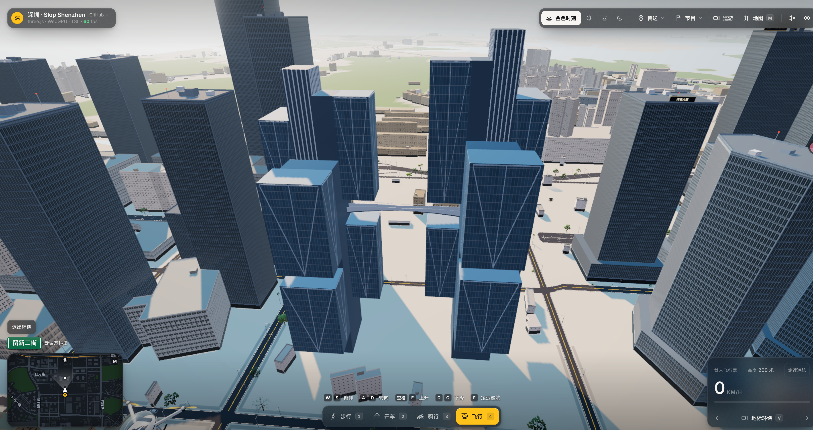 | 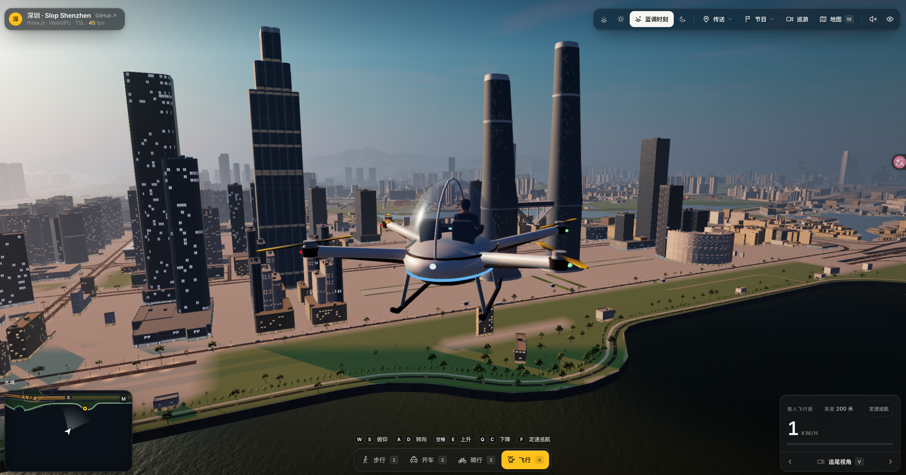 |
| 从空中观察塔楼、悬挑结构与连桥，感受深圳科技园区的建筑形态。 | 沿海岸观察高层建筑与总部街区，看看城市怎样向深圳湾展开。 |

| 春茧与深圳湾体育中心 | 罗湖天际线 |
| --- | --- |
| 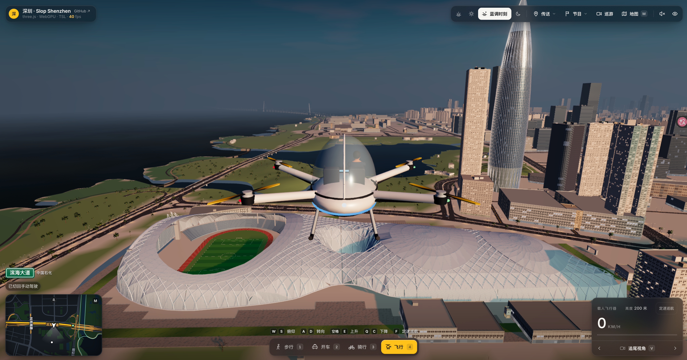 | 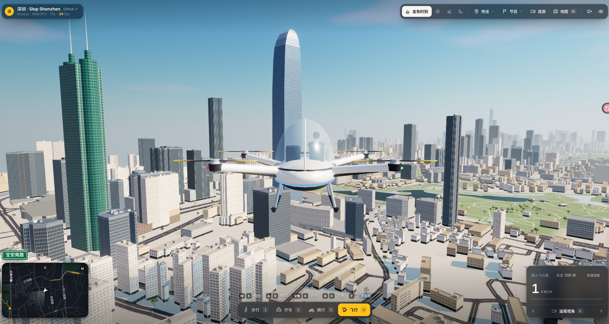 |
| 网壳体育场、内场和海岸同框，适合绕飞观察建筑轮廓。 | 从地王大厦、京基100到周边街区，看深圳不同时期的城市层次。 |

还可以探索平安金融中心、腾讯滨海大厦、深圳证券交易所、深圳大学城图书馆，以及前海博物馆、深圳滨海艺术中心等场馆。地标以核实对象绑定，局部体量和细节采用程序化表达。

## APEC 主题城市氛围

场景加入 APEC 主题装饰，让道路、场馆和夜景串联起来：深南大道、滨河大道、滨海大道沿线的灯杆挂有主题道旗，场馆周边设置文字标识、主题花坛与示意设施。

| 灯杆道旗与城市道路 | APEC 主题场馆 |
| --- | --- |
| 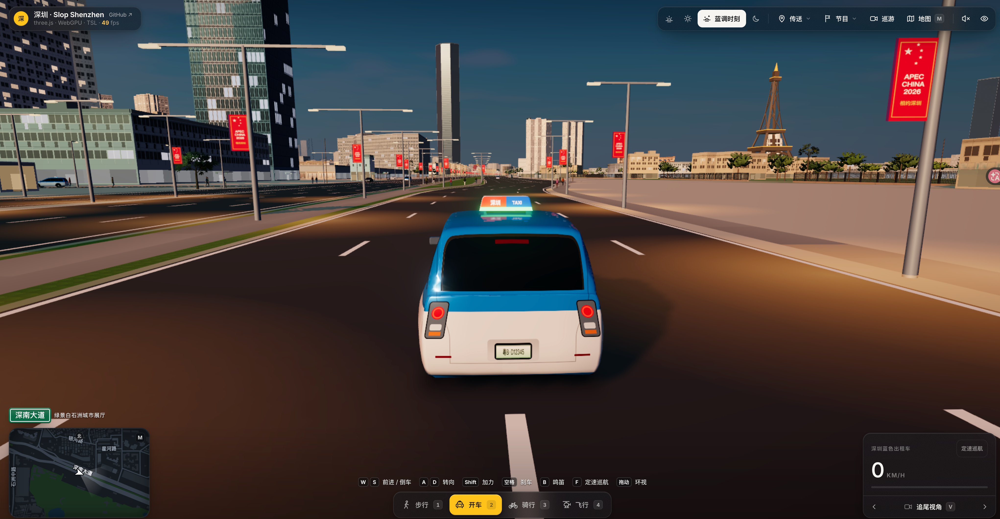 | 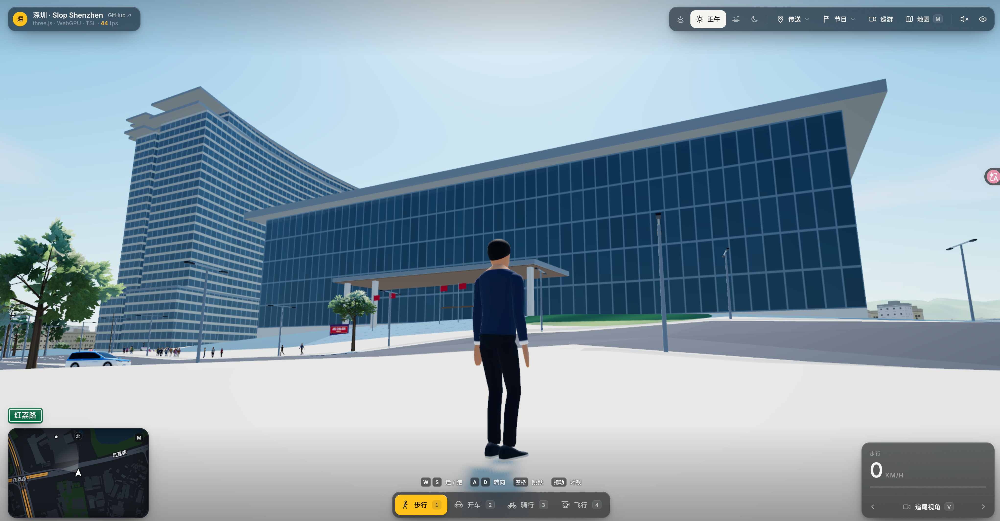 |
| 驾车穿过带有 APEC 文字标识的街道，观察灯杆、绿带和沿线建筑。 | 从街面观看深圳国际交流中心等场馆及主题布置，感受建筑尺度与前场空间。 |

项目使用 **APEC 文字与主题配色，不使用官方会徽**。场馆标识和部分门前设施属于场景展示；灯光、无人机节目为项目原创模拟，不代表官方活动安排、实际演出内容或实时开放状态。

## 入夜之后：灯光秀、无人机表演与烟花

在莲花山看向市民中心和福田 CBD，楼宇成为灯光舞台；到人才公园的滨水观演区，抬头看无人机在后海天际线上编队。

| 莲花山看灯光秀 | 人才公园看无人机表演 |
| --- | --- |
| 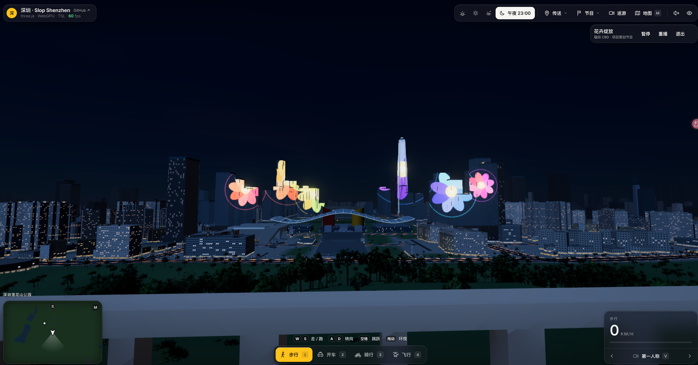 | 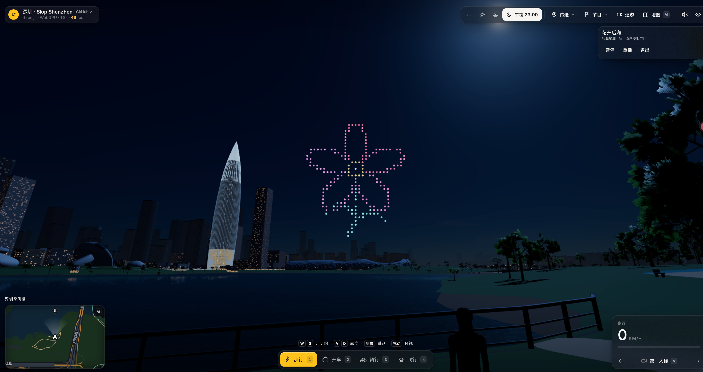 |
| 原创节目包含花卉、火箭与开放合作主题，支持暂停、继续和重播。 | “后海星潮”模拟节目包含花开后海、海豚、火箭、深圳天际线等编队段落。 |

| 会展中心与平安金融中心 | 福田城市夜景 |
| --- | --- |
| 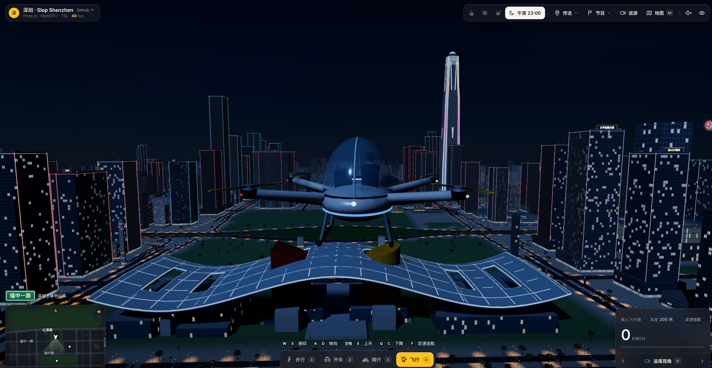 | 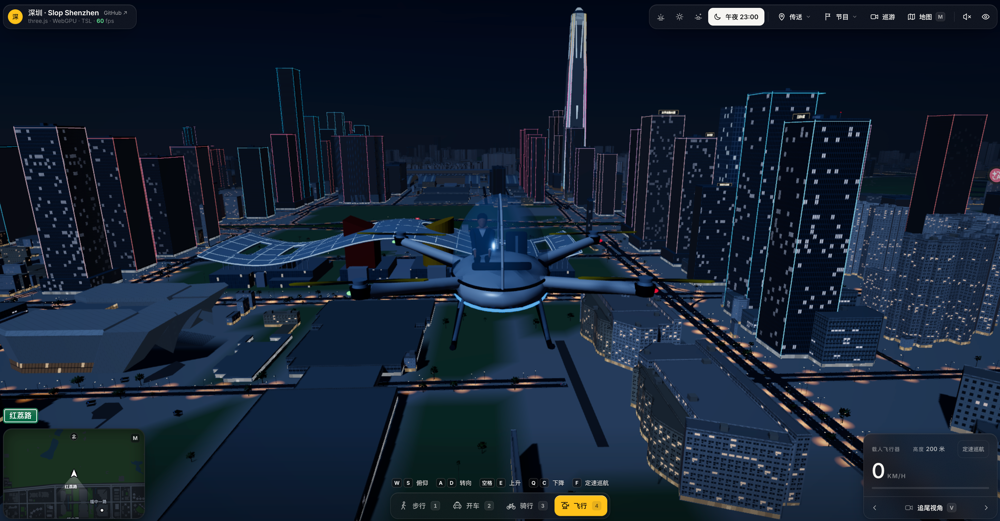 |
| 从低空把场馆屋顶与高楼灯带一起收入画面。 | 换一个距离和角度，观察道路灯光、楼宇轮廓与城市纵深。 |

世界之窗还加入了**夜间模拟烟花**，与园区标志建筑、照明和周边夜景共同构成另一处观景场景。

## 三条主干道自动空中巡游

选择**深南巡游、北环巡游、滨海巡游**，沿城市主干道自动飞行。巡游目标高度约为地面道路上方 80 米，可以暂停观看、调整观察角度，再继续前进。

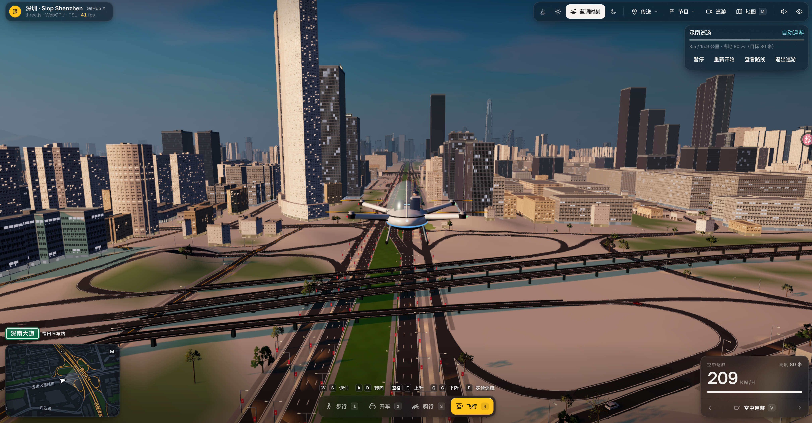

- **深南大道**：看城市中轴、道路两侧草坪、商务楼群与沿线地标。
- **北环大道**：从空中观察快速路、立交和城市北侧的山地关系。
- **滨海大道**：沿深圳湾方向观看后海、海岸与城市天际线。

这三条是自动空中观景路线；地面的汽车自动驾驶使用独立的道路规划与控制。

## 自己开车，也可以交给自动驾驶

切到汽车模式，从街道尺度穿行深圳。项目提供手动驾驶、地图选点自动驾驶和定速巡航，三种方式适合不同的探索节奏。

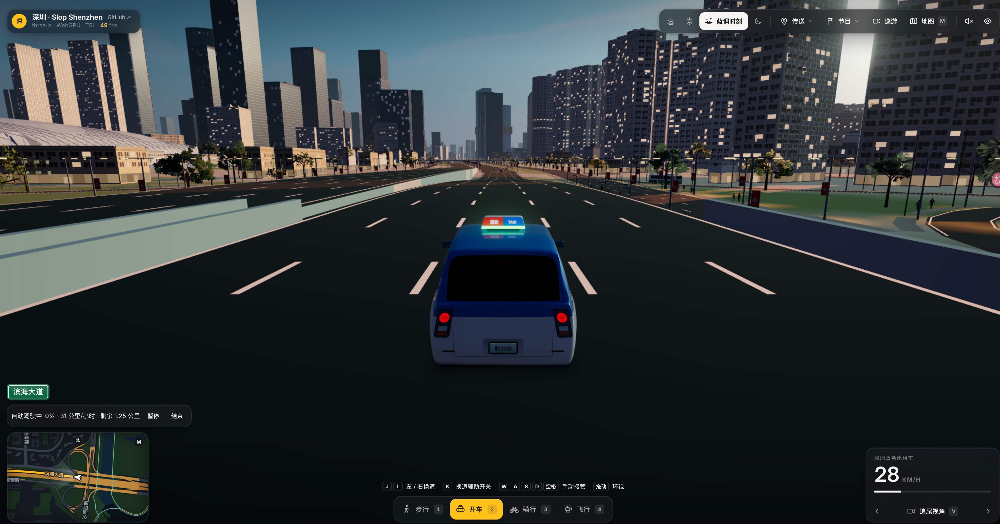

| 玩法 | 可以做什么 |
| --- | --- |
| 手动驾驶 | 加减速、转向、刹车，在已接入的道路、桥面和匝道间移动。 |
| 地图自动驾驶 | 在地图选择可用起终点与道路层级，预览路线后发车；可暂停、继续、结束或手动接管。 |
| 定速巡航 | 汽车行驶时按 `F` 开启，沿可用车道轨迹循道，弯前减速、出弯恢复设定速度；刹车可退出。 |
| 高架与桥隧探索 | 观察立交的上下层关系，体验车公庙高架、南坪快速路，以及沿江高速—东滨隧道等已接入区段。 |

沿海还可以观赏**深圳湾大桥与沿江高速海上高架**。桥梁远景、可行驶桥面和完整互通是不同的完成范围：部分桥隧已有连续驾驶样段，其他路段仍在补齐，不能把地图上可见的每座桥都视为已经全程通车。

## 低空深圳：四旋翼飞行与外卖无人机跟拍

**玩家四旋翼**让你自由穿梭于楼群上空。可以升降、悬停、高速平飞，越过主干道和高架观察城市，再回到地面继续探索。飞行器支持定速巡航；高速飞行属于游戏参数，不对应现实载具性能。

**配送无人机跟拍**则是一种观察玩法：在地图无人机面板中选择站点或线路，进入模拟跟飞，观察起飞、巡航与沿途景观。支持普通速度和 10 倍速、拖动环绕取景，停止后恢复玩家视角。

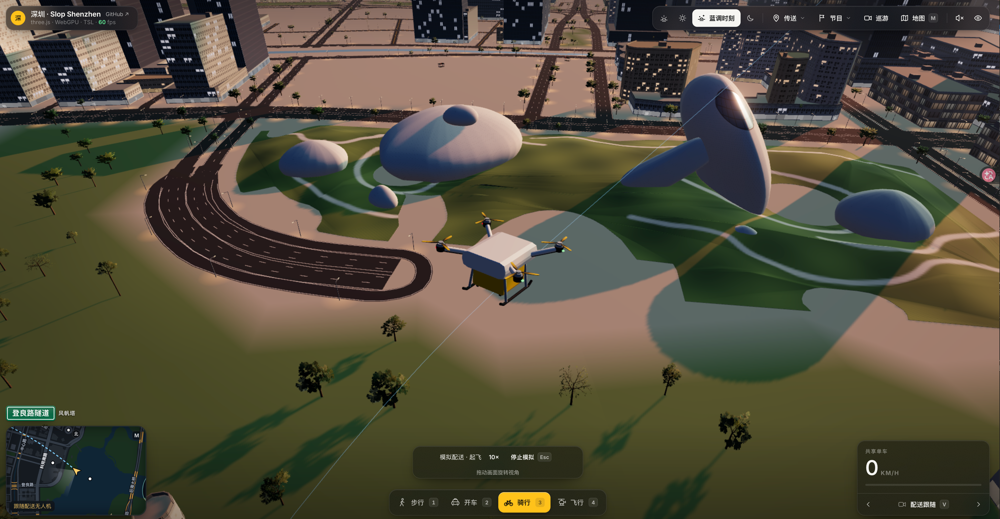

人才公园潮汐广场—海岸城方向已有模拟跟飞样段；航线、飞行高度与柜位含展示估计。这里呈现的是低空配送的城市视角，不是实时外卖订单或真实航迹回放。

## 深圳北站的高铁，以及城市里的地铁线路

全图的交通面板把地铁与高铁分开呈现：可以按线路开启地铁图层，查看线路和出入口，也可以选择高铁站定位、前往附近可用落点或切换观景机位。

| 深圳北站列车近景 | 深圳北站空中全景 |
| --- | --- |
| 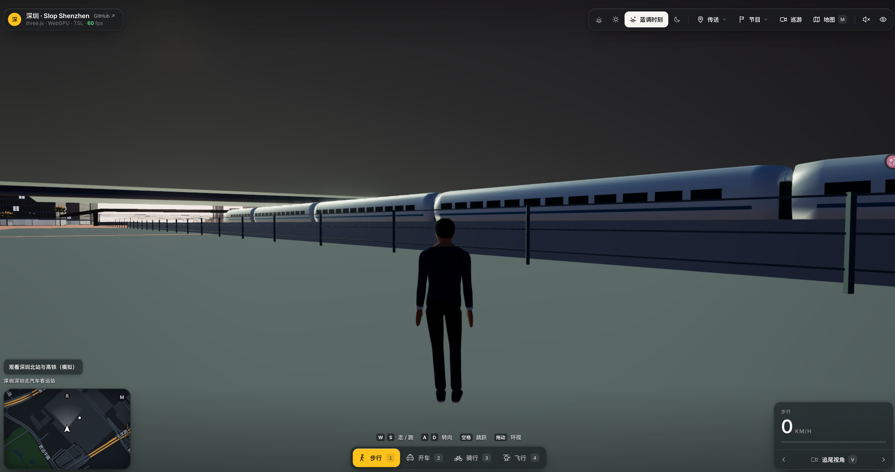 | 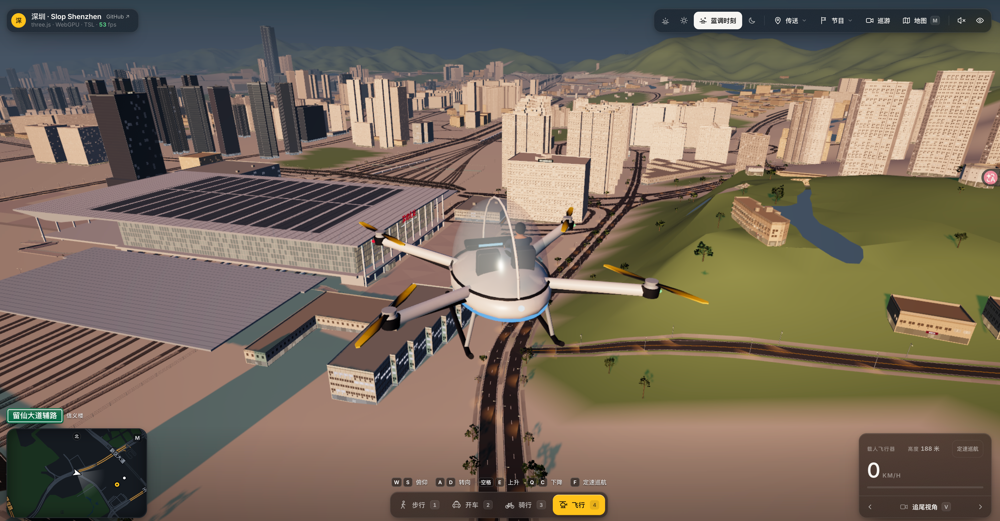 |
| 靠近观察高铁列车；站区已加入源股道与双向列车模拟。 | 从上空看站房、轨道走向和车站与城市之间的关系。 |

深圳北站、福田站、西丽站和深圳站（罗湖）均有地图定位与参观入口，表达方式随现有资料而不同：例如福田以地面设施为主，西丽保留工地外围示意。当前以交通地图和站区观景为主，不包含完整的乘车、站内换乘流程。

## 从滨海骑行到公园、古城与大学城

切换到单车，在**深圳湾公园沿海堤骑行**，经过滨水绿地、慢行桥和观景空间；也可以向大沙河绿道延伸，从河口观察两岸与城市内部的连接。人才公园、莲花山、荔枝公园、洪湖、四海公园和香蜜公园提供不同的绿地与环湖探索场景。

| 世界之窗 | 南头古城 |
| --- | --- |
| 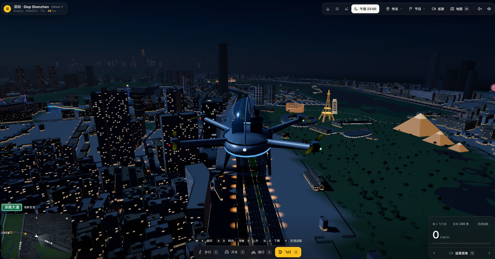 | 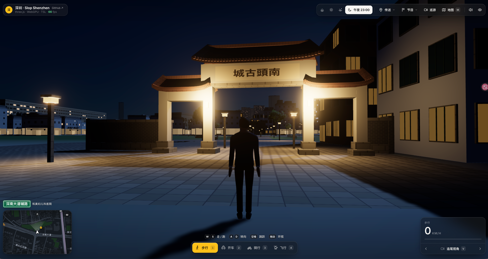 |
| 看园区内的标志建筑、夜间照明与模拟烟花，也能观察周边主干道。 | 从高空回到街面，看看城门、街巷与现代城区之间的尺度变化。 |

| 海上世界 | 宝安滨海 |
| --- | --- |
| 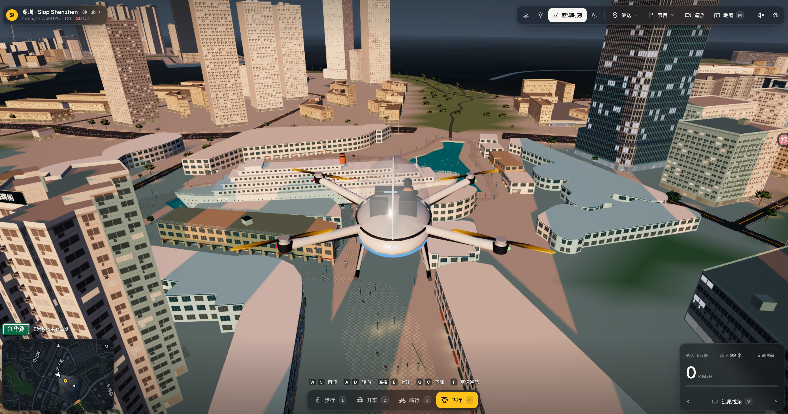 | 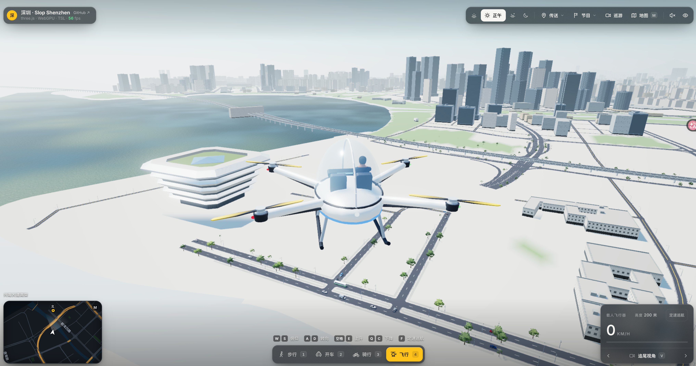 |
| 在商业街区、广场和滨海城市空间之间切换观察位置。 | 看滨海文化建筑与海岸，远眺沿江方向的海上交通景观。 |

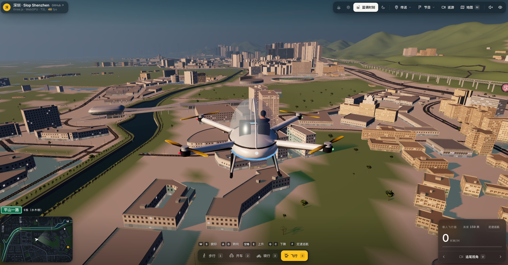

**大学城**提供另一种深圳印象：校园、公共建筑、体育场地、山体和绿地交织。骑行和步行以场景中的实际地面、桥面承托为基础；绿道全线、所有桥口和真实公共开放范围仍在逐段核对。

## 第一次来，可以这样玩

1. 打开地图，先找市民中心或平安金融中心，认识福田中轴线与周围道路。
2. 切到飞行模式，绕地标一圈，再选深南、北环或滨海自动巡游。
3. 回到地面，选择一段可用道路体验汽车自动驾驶或 `F` 定速巡航。
4. 去深圳湾公园骑单车，到人才公园跟拍配送无人机。
5. 入夜到莲花山看灯光秀、人才公园看无人机表演，再飞往世界之窗看夜景。
6. 最后去深圳北站观察高铁，或飞到罗湖、宝安、大学城，换一种城市尺度。

| 快捷键 | 操作 |
| --- | --- |
| `1` / `2` / `3` / `4` | 步行 / 汽车 / 单车 / 飞行 |
| `M` | 打开地图 |
| `V` | 循环切换相机 |
| `5` | 追尾视角回中 |
| `F` | 汽车或飞行器定速巡航 |
| `空格` | 汽车刹车 |
| `H` | 隐藏界面，方便取景 |
| `N` | 切换声音 |

模式切换会检查当前位置与可用落点；完整操作提示以场景界面为准。

## 本地运行

使用支持 WebGPU 的浏览器，通过项目自带服务器启动：

```sh
git clone https://github.com/skyh24/slop-shenzhen.git
cd slop-shenzhen
python3 tools/sz/serve.py --port 8080
```

打开 [http://127.0.0.1:8080/](http://127.0.0.1:8080/)，等待场景加载完成即可探索。

技术栈为 **three.js 0.187.0、WebGPU / TSL、原生 ES Modules**，无打包工具。建筑、载具与街景采用程序化建模；城市数据由离线管线生成，运行时不向地理数据服务请求地图数据。README 中的截图用于展示，不作为三维场景贴图。

## 数据、开发状态与致谢

本项目是城市漫游与可视化实验。楼高、场馆细节、道路纵断面、航线及演出中含有明确标记的估计或原创内容；局部可操作不等于全城通行验收通过，也不作为现实导航与开放信息。

- [当前覆盖、已验证功能与限制](docs/HANDOFF.md)
- [组件与功能文档索引](docs/README.md)
- [开发检查流程](docs/25-FAST-CHECKS.md) · [任务与验收缺口](docs/TASKS.md)
- [数据署名与许可](data/source/ATTRIBUTION.md) · [数据来源与快照清单](data/source/sources.json)

派生自 [Slop New York](https://github.com/mrdoob/slop-newyork)，数据组织参考 [Slop Wuhan](https://github.com/LightYearZh/slop-wuhan)。感谢原作者与开放地理数据社区。代码保留 [MIT 许可](LICENSE) 与原作者署名；地理数据另遵守 OSM / Overture、GloBFP、Copernicus 和 FABDEM 等来源的各自许可与限制。
