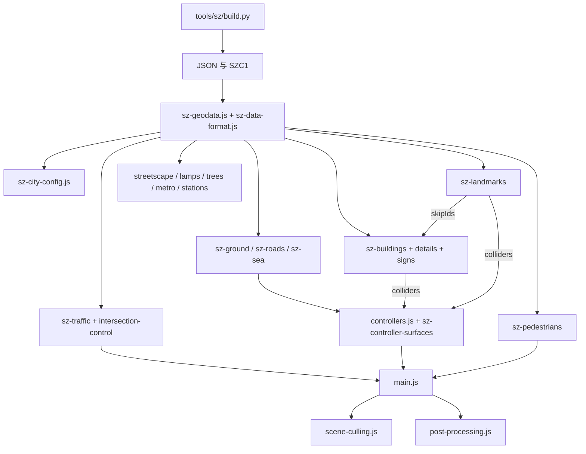

# 01 架构：纽约原版怎么改成深圳

2026-11-12 复核。专题实现顺序与派工见 [29 号](29-SHENZHEN-REFINEMENT-PLAN.md) 与 [30 号](30-REFINEMENT-WORKTREE-PROMPTS.md)。

## 原则

纽约原版大约 3.6 万行，`main.js` 按固定顺序搭场景：光照、地面（`city-grid.js`）、周边区（`boroughs.js`）、地标、普通建筑、街道细节、交通、路面标线、控制器、剔除、后期。各文件的职能和关键函数行号见 [16-NY-REFERENCE.md](16-NY-REFERENCE.md)。武汉参考仓库的现行入口、旧运行时、数据管线和函数行号见 [17-WUHAN-REFERENCE.md](17-WUHAN-REFERENCE.md)。

深圳版保留这条启动流程，以及成熟的引擎系统：控制器、相机、车身、人物、物理、音频、光照、剔除、后期。和曼哈顿方格网绑死的部分（地面、路网、交通、建筑、街道细节、地图、材质）都由深圳模块重写，而不是改造纽约文件。纽约的运行时代码只剩正式入口实际加载的引擎文件（音频、碰撞与物理、车辆、人物、控制器、相机、光照、剔除、后期）；没有接入的 27 个纽约文件加两份 `.bin.gz` 数据包已在 2026-11-10 从 `js/` 删除，纽约代码只在只读的 `ref/slop-newyork/` 里，见 [22-OPTIMIZATION-REVIEW.md](22-OPTIMIZATION-REVIEW.md) A1。

正式入口：`index.html`（import map 加 modulepreload）加载 `js/main.js`，`js/` 下的模块通过正式入口可达；`tests/runtime-reachability.test.cjs` 从 `js/main.js` 遍历相对 import，再出现不可达模块就会失败。

## 模块矩阵

下表左列的纽约文件只作模块对照，副本在 `ref/slop-newyork/`；除“保留”行里的引擎文件外，`js/` 里已没有这些文件。

| 纽约文件 | 深圳处理 | 深圳模块 |
| --- | --- | --- |
| `main.js` | 改造 | `main.js`：启动顺序不变；`helicopter` 模式改为四旋翼；中文提示；深圳机位；无人机、灯光秀、APEC 的更新 |
| `nyc-geodata.js`、`building-geodata.js`、`tree-geodata.js`、`subway-geodata.js` | 替换 | `sz-geodata.js` 用顶层 `await` 读 `js/sz-city.json.gz`（gzip JSON，由 `tools/sz/build.py` 生成）；`sz-data-format.js` 校验并解码成 `GEO` 和 `REAL_BUILDINGS` |
| `city-config.js` | 重写，导出同名接口 | `sz-city-config.js`：`signalPhase`、`walkSignal`、`isTypingInField` 等；纽约专有的街号函数直接抛错 |
| `city-grid.js` | 替换 | `sz-ground.js`（地形块）、`sz-ground-surface.js`、`sz-terrain.js`（三角面高度查询）、`sz-roads.js`（路面）、`sz-sea.js`（海面） |
| `boroughs.js` | 未替换（文件已删） | 远景天际线没有做 |
| `landmarks.js` | 替换 | `sz-landmarks/`：每个地标一个文件，`index.js` 汇总，`layout.js` 负责源足迹接管，`parts.js`、`render.js`、`materials.js` 共用部件、渲染和材质 |
| `buildings.js`、`building-footprints.js`、`building-details.js`、`fire-escapes.js` | 替换 | `sz-buildings.js`（2.4 km 合批，塔楼加裙房、屋顶设备）、`sz-building-layout.js`、`sz-materials.js`（立面材质）、`sz-building-details.js`（近景阳台、空调、雨棚）、`sz-building-signs.js`（楼名和小区门牌） |
| `street-details.js`、`street-props.js`、`trees.js`、`tree-placements.js` | 替换 | `sz-streetscape.js`、`sz-street-lamps.js`、`sz-road-frontage.js`（路口信号和路侧设施）、`sz-trees.js`（树干加近冠和远冠 LOD） |
| `subway-entrances.js` | 替换 | `sz-metro-entrances.js`；高铁站和西丽工地在 `sz-station-sites.js` |
| `road-network.js`、`traffic.js` | 替换 | `sz-traffic.js`（自建车道图，地面路网加已接入的高架边）、`sz-intersection-control.js`、`sz-drive-route.js`（地图规划驾车）、`sz-auto-drive.js` |
| `road-paint.js` | 替换 | `sz-road-markings.js`（布局）加 `sz-road-paint.js`（着色） |
| `cars.js` | 改造 | 增加 `shenzhen` locale：蓝白出租、粤B 绿牌和蓝牌、顶灯；车型和车轮在 `sz-vehicles.js` |
| `bus.js`、`helicopter.js` | 替换 | 公交和四旋翼载人飞行器都在 `sz-vehicles.js`（`createEvtolMesh`） |
| `pedestrian-system.js`、`pedestrian-routes.js` | 替换 | `sz-pedestrians.js` 加 `sz-pedestrian-tracks.js`（模拟步行带），复用纽约 `pedestrians.js` 的 `PersonCrowd` 和 `PersonRig` |
| `nyc-map.js` | 替换 | `sz-map.js`、`sz-map-layers.js`；传送和地铁菜单在 `sz-ui.js` |
| `tsl-materials.js` | 未使用（文件已删） | 深圳材质在 `sz-materials.js`；时段 uniform 取自 `city-lighting-materials.js`（`cityUniforms`） |
| `controllers.js` | 改造 | 出生点、活动范围、海面判断、地形高度、四旋翼；高架接触面由 `sz-controller-surfaces.js` 提供 |
| `cameras.js` | 改造 | 景点机位在 `sz-camera-presets.js` |
| `audio-*`、`post-processing.js`、`scene-culling.js`、`vehicle-physics.js`、`vehicles.js`、`vehicle-lights.js`、`lighting.js`、`pedestrians.js`、`building-collision.js`、`touch-controls.js`、`gamepad-controls.js` | 保留 | — |

## 深圳新增模块

| 文件 | 作用 |
| --- | --- |
| `sz-elevated-roads.js` | 车公庙、深南广深和竹子林立交桥面与匝道；来源层级与估计高程分开，显示和接触共用三角面 |
| `sz-startup.js` | GPU 首帧等待与超时处理 |
| `sz-tunnels.js` | 隧道计划、三维表面和净空检查；正式入口目前接入核对清单 |
| `sz-apec.js`、`sz-apec-city.js` | APEC 道旗、会场标识、花坛、转播车、路侧大屏、巡逻机器人、围挡广告；不用官方会徽 |
| `sz-light-show.js` | 福田中心区 ≥150 m 普通高层的夜间灯带 |
| `sz-drone-routes.js` | 无人机配送：端点只用 `data/source/air-routes.json` 里有来源的站点，航迹是示意 |
| `sz-park-arrivals.js` | 公园传送落点 |
| `sz-spatial.js`、`sz-geometry.js` | 多边形空间查询；`GeoBuilder` 和平面、墙、条带几何 |
| `sz-strings.js` | 全部界面文字 |
| `tools/sz/*.py` | 数据管线，见 [02-DATA-PIPELINE.md](02-DATA-PIPELINE.md) |

出租车接单（参考武汉 `taxi-*.js`）还没有做，规则见 [09-UI-GAMEPLAY.md](09-UI-GAMEPLAY.md)。

## 运行时数据流

所有构建模块拿到的是同一份解码后的数据；显示几何和碰撞体来自同一份轮廓或部件。

## 迁移边界

开发入口沿用纽约的 import map 和本地静态服务器。场景全部程序化建模。武汉现行运行时供城市数据、分层表面和出租车流程参考，文件位置见 [17 号](17-WUHAN-REFERENCE.md)。接单流程属于后续计划，发布产物的对照口径见 [10 号](10-PERF-QA.md#6-加载数据与发布专项)。
