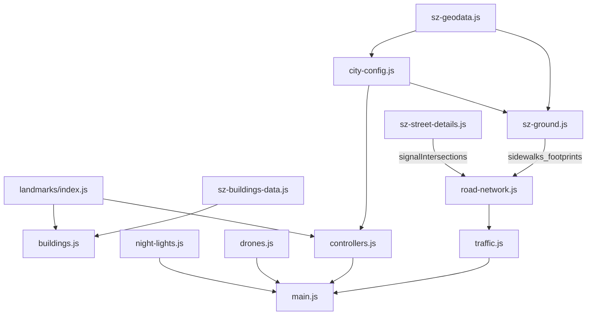

# 01 架构：纽约原版怎么改成深圳

## 原则

纽约原版大约 3.6 万行，`main.js` 按固定顺序搭场景：光照、地面（`city-grid.js`）、周边区（`boroughs.js`）、地标、普通建筑、街道细节、交通、路面标线、控制器、剔除、后期。各文件的职能和关键函数行号见 [16-NY-REFERENCE.md](16-NY-REFERENCE.md)。武汉参考仓库的现行入口、旧运行时、数据管线和函数行号见 [17-WUHAN-REFERENCE.md](17-WUHAN-REFERENCE.md)。

深圳版保留这条启动流程，也保留各模块之间的接口（函数名、返回字段），只替换和曼哈顿方格网绑死的实现。这样交通、行人、控制器、相机、后期、音频这些成熟的系统可以少改甚至不改。

判断依据来自代码本身：

- `road-network.js` 有一条“中心线道路”分支（代码里的 4b 段）。大道列表 `ALL_AVENUES` 和横街列表 `ALL_STREETS` 都为空时，它只读 `GEO.roadGraph`，照样生成车道、路口、转向曲线，并只保留最大的强连通部分。深圳的路网全部走这条分支。
- `traffic.js` 只通过 `buildRoadNetwork(sidewalks, obstacles, signalIntersections)` 拿路网，不碰方格网。
- `controllers.js` 从 `city-config.js` 只拿活动范围、海岸、人行道判断几个函数。
- `buildings.js` 的普通建筑只依赖按楼存储的轮廓加高度数据（`REAL_BUILDINGS`）。

## 模块矩阵

| 纽约文件 | 深圳处理 | 说明 |
| --- | --- | --- |
| `main.js` | 改造 | 启动顺序不变；换模块名、移动方式（`helicopter` 改为 `evtol`）、中文提示、深圳相机快捷键；加无人机和灯光秀的更新 |
| `nyc-geodata.js` | 替换为 `sz-geodata.js` | 由 `tools/sz/build.py` 生成；用顶层 `await` 读压缩包 `sz-geodata.json.gz` |
| `building-geodata.js` | 替换为 `sz-buildings-data.js` | `SZB1` 二进制格式，在纽约 `NYB1` 基础上加用途、立面类型、高度来源 |
| `tree-geodata.js`、`subway-geodata.js` | 树点并入 `sz-geodata.js`；`trees.js` 的生成和实例化保留 | 深圳没有全市行道树普查。点位用 OSM 单株和有证据的树列、植被面，不按固定间距铺满。树种和棕榈见 [06](06-STREETSCAPE.md#纽约树木是怎么生成的) |
| `city-config.js` | 重写，导出同名接口 | `ISLAND_BOUNDS` 改为地图范围；`getIslandBoundsAtZ` 返回范围边界；`blockAt` 查街区多边形；`signalPhase`、`walkSignal` 原样保留；新增 `isWater`、`terrainHeight`、地名和地标表 |
| `city-grid.js` | 替换为 `sz-ground.js` | 陆地、海面、路面、人行道街区、公园、地形山体，按 500 米分块合批 |
| `boroughs.js` | 替换为 `sz-skyline.js` | 远景天际线（前海、宝安、香港元朗）、远山 |
| `landmarks.js` | 替换为 `js/landmarks/` | 每个地标一个文件，`index.js` 统一按 OSM 轮廓对位 |
| `buildings.js` | 改造 | 去掉时代广场、消防梯、水塔；加深圳立面类型、空调外机、中文招牌、楼顶灯带 |
| `street-details.js` | 替换为 `sz-street-details.js` | 行道树、路灯、信号灯、地铁出入口、天桥、公交站 |
| `road-network.js` | 小改 | “是否在陆地上”从曼哈顿东西岸线改为海岸多边形；其余不动 |
| `traffic.js` | 改造 | 车型配比：蓝色出租车、国产车体型、公交、外卖电单车；车牌 |
| `cars.js` | 改造 | 按 [07](07-VEHICLES.md#车型) 改 `BODY_SPECS`：蓝色出租车、国产电动车轮廓、新增 `hatch`、皮卡槽改为小厢货。不写品牌名、不画车标。绿牌和蓝牌图集仍由车牌模块生成 |
| `bus.js` | 改造 | 深圳纯电公交涂装 |
| `helicopter.js` | 替换为 `evtol.js` | 四旋翼载人飞行器模型；控制器沿用直升机的飞行模型并重新调参 |
| `controllers.js` | 改造 | 出生点、活动范围、海面判断、山体地面高度、飞行器 |
| `cameras.js` | 改造 | 景点相机换成深圳机位 |
| `nyc-map.js` | 替换为 `sz-map.js` | 中文地图、路名搜索、地标传送 |
| `tsl-materials.js` | 小改 | 水面岸线距离和天空遮挡改读深圳海岸；新增深圳立面参数 |
| `fire-escapes.js` | 删除 | 深圳没有外挂消防梯 |
| `audio-*` | 小改 | 电动车为主，引擎声降低，突出胎噪和低速提示音 |
| `post-processing.js`、`scene-culling.js`、`vehicle-physics.js`、`pedestrians.js`、输入控制 | 保留 | |

## 新增模块

| 文件 | 作用 |
| --- | --- |
| `js/sz-ground.js` | 地面、海、路面、街区、山体 |
| `js/sz-skyline.js` | 远景 |
| `js/sz-street-details.js` | 街道设施 |
| `js/landmarks/*.js` | 各地标 |
| `js/evtol.js` | 载人飞行器模型 |
| `js/drones.js` | 无人机配送航线 |
| `js/plates.js` | 车牌图集 |
| `js/night-lights.js` | 楼体灯光秀 |
| `js/taxi-jobs.js` | 出租车接单 |
| `js/sz-map.js` | 中文地图 |
| `tools/sz/*.py` | 数据管线 |

## 运行时数据流

## 不做的事

- 不引入打包工具，沿用纽约原版的 import map 加本地静态服务器
- 不整套搬武汉（台北）运行系统；只移植数据管线做法和出租车接单逻辑。文件位置见 [17-WUHAN-REFERENCE.md](17-WUHAN-REFERENCE.md)
- 不导入外部三维模型
