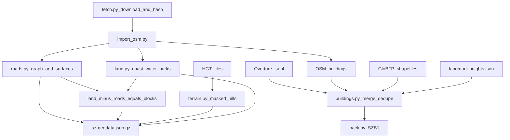

# 02 数据管线

## 原则

- 原始快照锁定版本，记录下载地址、日期和 SHA-256，原始大文件不进 Git
- 运行时不联网拉数据，浏览器只读生成好的压缩包
- 每栋楼的高度都带来源标签，推断值不冒充实测值
- 生成文件不手改；要改就改规则或 `data/source/` 下的人工核对表，再重新生成

## 数据源

| 数据 | 来源 | 版本 | 用途 |
| --- | --- | --- | --- |
| OpenStreetMap | Geofabrik 广东切片 `guangdong-latest.osm.pbf` | 下载时的快照，时间戳和哈希见 `data/source/sources.json` | 道路、海岸线、水系、公园、绿地、地铁出入口、树点、地名、一部分建筑 |
| Overture Maps Buildings | `s3://overturemaps-us-west-2/release/2026-10-21.0/theme=buildings` | `2026-10-21.0`（下载时的最新版） | 补全建筑轮廓，自带部分高度和层数 |
| 3D-GloBFP | figshare 文章 28904453（第 IX 部分），网格 `2265`、`2269`（下载地址见 `sources.json`） | 参考年份 2020 | 缺高度时的遥感估算高度 |
| Terrain Tiles | `elevation-tiles-prod/skadi/N22/N22E113.hgt.gz`、`N22E114.hgt.gz` | Mapzen / Tilezen，底图来自 USGS SRTM | 莲花山、塘朗山等山体起伏 |
| 地标高度 | `data/source/landmark-heights.json`，人工核对 | 每条附出处 | 地标总高 |

### APEC 时间点

用户要求“APEC 前后最新的数据”。APEC 2026 由中国主办，领导人会议周在深圳举行（2026 年 11 月）。本项目的做法：

1. 使用 2026 年 11 月下载的 Geofabrik 广东快照（时间戳见 `sources.json`）和当时最新的 Overture `2026-10-21.0`
2. APEC 会场如果在关外（例如宝安），只在 `00-SCOPE.md` 记为范围外，不扩图
3. 会后如果 OSM 有明显更新（新开道路、新竣工楼），重新下载快照，跑同一条管线，对比建筑和道路数量写进 `data/source/build-report.json`

官方日期和会场以 APEC 官网公告为准，待核实后写进 `00-SCOPE.md`。

## 处理步骤



### 1. 坐标

原点 `114.0596E, 22.5431N`。用和纽约 `geo-base.mjs`、武汉 `build-wuhan.py` 相同的椭球局部切平面公式：

```
KX = (π/180) · N(φ0) · cos φ0
KY = (π/180) · M(φ0)
x =  (lon − lon0) · KX
z = −(lat − lat0) · KY
```

### 2. 道路

- 可驾驶道路：`motorway`（地面段）、`trunk`、`primary`、`secondary`、`tertiary`、`unclassified`、`residential`、`living_street` 和各级 `_link`
- 不进可驾驶路网：`service`、`footway`、`cycleway`、`path`、`steps`，以及 `bridge=yes`、`tunnel=yes`、`layer≠0` 的段（一期高架和隧道只做外观）
- 宽度：OSM `width`；没有就按 `lanes × 3.25 m`；再没有就按等级估算（trunk 22、primary 16、secondary 12、tertiary 9、residential 7、link 6 米）
- 输出纽约 `roadGraph` 格式：`nodes [x, z, ...]`、`links [a, b, 名称序号, 宽度, 车道数, 方向, 内部形状点]`、`names`
- 路口：度数大于等于 3、且至少两条主次干道相交的节点设信号灯

### 3. 陆地、海、街区

- 海：OSM `natural=coastline` 闭合成陆地多边形，范围框内其余为海
- 内陆水体：`natural=water`、`waterway=riverbank`
- 公园和绿地：`leisure=park`、`landuse=grass`、`natural=wood` 等
- 路面：可驾驶道路中心线按宽度缓冲后合并
- 街区（人行道抬高面）：陆地减去路面、减去水体，抬高 0.18 米
- 全部按 500 米网格裁切，方便剔除

### 4. 建筑合并与楼高

1. 读 OSM 建筑（保留 `height`、`building:levels`、`building`、`name`）
2. 读 Overture，和 OSM 轮廓重叠超过 25% 的丢掉
3. 楼高按顺序取第一个可用值：
   1. `landmark-heights.json` 里核实过的值（只对地标）
   2. OSM `height`
   3. OSM `building:levels × 3.2 m`
   4. Overture `height`
   5. Overture `num_floors × 3.2 m`
   6. 3D-GloBFP：交并比至少 0.6、面积比至少 0.65、中心距不超过 12 米，且没有相近的第二候选
   7. 按用途和占地估算，标 `estimate`
4. 每栋楼记录 `heightSource`、`category`、`facade`
5. 面积小于 16 平方米或大半在水里的轮廓丢掉

### 5. 地形

HGT 取样到 25 米网格，3×3 中值滤波去掉楼顶回波，只在声明的山体掩膜（莲花山、塘朗山、笔架山等公园多边形）里抬高地面，边缘羽化到零。路面和建筑不压到山上。

### 6. 打包

- `js/sz-geodata.json.gz`：路网、陆地、海、街区、公园、山体、地标、地名、树点、地铁出入口
- `js/sz-buildings.bin.gz`：`SZB1` 格式，沿用纽约 `NYB1` 的元数据流加 X、Z 坐标差分流（zigzag varint），每栋多存用途、立面类型、高度来源三个字节
- 浏览器读到字节后看 gzip 魔数判断是否还需解压，兼容服务器自动解压的情况

## 许可

- OSM 及由其派生的合并数据：ODbL 1.0
- Overture Buildings：ODbL（保留每条的上游数据集标签）
- 3D-GloBFP：CC BY 4.0，引用 Che, Y. et al., 2024, ESSD 16, 5357–5374
- Terrain Tiles：Mapzen / Tilezen，地形数据来自 USGS
- 代码：MIT，沿用纽约原版
