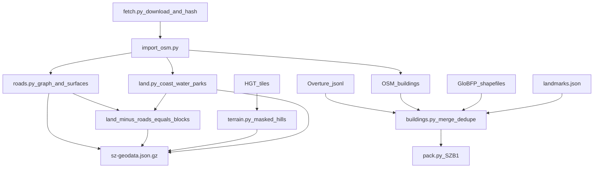

# 02 数据管线

## 原则

- 原始快照锁定版本，记录下载地址、日期和 SHA-256，原始大文件不进 Git
- 运行时不联网拉数据，浏览器只读生成好的压缩包
- 每栋楼的高度都带来源标签，推断值不冒充实测值
- 生成文件不手改；要改就改规则或 `data/source/` 下的人工核对表，再重新生成

## 数据源

| 数据 | 来源 | 版本 | 用途 |
| --- | --- | --- | --- |
| OpenStreetMap | Geofabrik 广东切片 `guangdong-latest.osm.pbf` | 下载时的快照，时间戳和哈希见 `data/source/sources.json` | 道路、海岸线、水系、公园、绿地、地铁出入口、树点、地名、一部分建筑 |
| Overture Maps Buildings | `s3://overturemaps-us-west-2/release/2026-10-21.0/theme=buildings` | `2026-10-21.0`（下载时的最新版） | 补全建筑轮廓，自带部分高度和层数 |
| 3D-GloBFP | figshare 文章 28904453（第 IX 部分），网格 `2265`、`2269`（下载地址见 `sources.json`） | 参考年份 2020 | 缺高度时的遥感估算高度 |
| Copernicus GLO-30 | AWS `copernicus-dem-30m`，N22E113/N22E114 GeoTIFF | AWS 2021 发布，点注册、1 角秒，EGM2008；不是最新实测地面 | 当前默认地形，保留 DSM 局限 |
| Terrain Tiles | `elevation-tiles-prod/skadi/N22/N22E113.hgt.gz`、`N22E114.hgt.gz` | Mapzen / Tilezen，底图来自 USGS SRTM | 莲花山、塘朗山等山体起伏 |
| 地标高度 | `data/source/landmarks.json`，人工核对 | 每条附出处 | 地标总高 |

### APEC 时间点

用户要求“APEC 前后最新的数据”。已核实（2026-11-09）：

- 第三十三次领导人非正式会议：**2026 年 11 月 18 日至 19 日**，深圳；工商领导人峰会 11 月 17 日至 18 日
- 主会场：**深圳国际交流中心**，福田区香蜜湖（OSM way `1080860977`，`amenity=conference_centre`，中心约 `22.5473N, 114.0241E`），在一期范围内
- 出处：外交部与新华社公告（日期、城市），深圳市政府外事办 2026-09-23《深圳APEC氛围持续升温》（道旗、公交涂装），多家媒体报道会场；官方领导人公告只写城市，没写具体建筑

快照策略：

1. **会前快照（已锁定）**：Geofabrik `guangdong-261108.osm.pbf`（2026-11-08）、Overture `2026-10-21.0`，哈希见 `data/source/sources.json`。M1 到 M9 都用这一套
2. **会后快照（见 [TASKS.md](TASKS.md) 的 M1 数据）**：11 月 20 日之后重新下载 Geofabrik，跑同一条管线，把建筑、道路、地名数量的差异写进 `data/source/build-report.json`。有实质变化（新开道路、竣工楼、香蜜湖片区改造）才切换
3. **会期氛围**：深南大道、滨河大道、滨海大道的双语道旗，公交 APEC 主题涂装，平安金融中心、京基100、华润大厦的 APEC 主题灯光秀，都做成可开关的“APEC 周”主题（见 [06-STREETSCAPE.md](06-STREETSCAPE.md)），默认开启

## 处理步骤



### 1. 坐标

原点 `114.0545E, 22.5463N`（市民中心主楼）。用和纽约 `geo-base.mjs`、武汉 `build-wuhan.py` 相同的椭球局部切平面公式：

```
KX = (π/180) · N(φ0) · cos φ0
KY = (π/180) · M(φ0)
x =  (lon − lon0) · KX
z = −(lat − lat0) · KY
```

### 2. 道路

- 路网道路：`motorway`、`trunk`、`primary`、`secondary`、`tertiary`、`unclassified`、`residential`、`living_street` 和各级 `_link`
- 不进可驾驶路网：`service`、`footway`、`cycleway`、`path`、`steps`，以及明确禁止车辆通行的道路。桥梁、隧道和非零层路段保留拓扑与来源标签；标高未核实前为 `unresolved`，不能当成已建好的可通行结构。
- 按 OSM 共享节点连接，不把平面交叉或相近的跨层道路拼接。`oneway=-1`、显式双向和环岛保留方向；按机动车访问标签优先级过滤。转向限制与条件通行仍待导入。
- 实现入口：`tools/sz/roadgraph.py`，输出 nodes/links/names 以及 nodeIds/metadata；构建报告列强连通统计和宽度来源。
- 宽度：OSM `width`；没有就按 `lanes × 3.25 m`；再没有就按等级估算（trunk 22、primary 16、secondary 12、tertiary 9、residential 7、link 6 米）
- 输出纽约 `roadGraph` 格式：`nodes [x, z, ...]`、`links [a, b, 名称序号, 宽度, 车道数, 方向, 内部形状点]`、`names`
- 路口：度数大于等于 3、且至少两条主次干道相交的节点设信号灯

### 3. 陆地、海、街区

- 海：OSM `natural=coastline` 闭合成陆地多边形，范围框内其余为海
- 内陆水体：`natural=water`、`waterway=riverbank`
- 公园和绿地：`leisure=park`、`landuse=grass`、`natural=wood` 等
- 路面：可驾驶道路中心线按宽度缓冲后合并
- 街区（人行道抬高面）：陆地减去路面、减去水体，抬高 0.18 米
- 全部按 500 米网格裁切，方便剔除

### 4. 建筑合并与楼高

1. 读 OSM 建筑（保留 `height`、`building:levels`、`building`、`name`）。Overture/GloBFP 补充楼只保留可信足迹，OSM 标注楼永远保留。过滤分两轮，丢弃项全部写进构建报告：
   - 误识别过滤（`filter_misidentified_footprints`，报告段 `globfpMisidentified` / `overtureMisidentified`）：面积 <300 m²、和 OSM 楼没有相交，并且落在 OSM 广场和绿地里的比例 ≥60%，或落在车行道（半宽加 1 m）里的比例 ≥80% 的，丢弃。80% 这一档会放过中心线已经穿过、重叠约 58.5%（加缓冲约 74.6%）的楼；福中三路那栋约 94 m²、估高 7.3 m 的白楼就是这样留下的。中心线穿越和车行道占比改由下一条占道暂缓门槛处理，见 [23 号](23-BUILDING-AND-STREET-PLAN.md)。
   - 占道暂缓门槛（`filter_road_conflicts`，报告段 `globfpRoadConflicts` / `overtureRoadConflicts`，汇总段 `deferredFootprints`）：只作用于遥感补充轮廓（GloBFP 独有、Overture 独有），OSM 已标注的楼永不自动删，也不缩窄道路来躲楼。道路中心线穿入轮廓超过 0.5 m，或轮廓有 ≥50% 的面积落在按估算宽度生成的车行道（半宽，不再额外加 1 m 缓冲）里，就暂缓出正式场景，逐条写进 `build-report.json`：每条带触发道路的 `roadId` 和 `roadWidthM`，并标明 `roadWidthSource: "estimated"`、`imageryChecked: false`。路宽是估算值，没有用影像否定这个轮廓；存在性确认不了的留待人工核对，不写成“现实中不存在”。
   - 足迹可信度过滤（`buildingFootprintFilter`）：水面/湿地重叠 >20%、绿地 >60% 且 60m 内无 OSM 楼、面积 <60m² 且 50m 内无 OSM 楼的，丢弃。
   - `--footprint-source osm` 可只保留地图标注楼。
2. 读 Overture，和 OSM 轮廓重叠超过 25% 的丢掉
3. 楼高按顺序取第一个可用值：
   1. `landmarks.json` 里核实过的值（只对地标）
   2. OSM `height`
   3. OSM `building:levels × 3.2 m`
   4. Overture `height`
   5. Overture `num_floors × 3.2 m`
   6. 3D-GloBFP：只看严格同楼匹配——交并比 ≥0.6、面积比 ≥0.65、中心距 ≤12 m，多个候选取交并比最高的一个。没有第二套后备规则，原“盖住一半就按重叠面积加权继承高度”的 `globfp-overlap` 已删除。尺寸不相称的候选保持高度未知，落到第 7 步 `estimate` 或进待核清单。福中三路约 4.6×7.5 m 的底面不再得到 118.5 m，见 [23 号](23-BUILDING-AND-STREET-PLAN.md)
   7. 按用途和占地估算，标 `estimate`
   8. `data/source/building-height-overrides.json` 里逐个公开资料核实的值（最后应用，标 `published`；必须带来源链接，构建报告记录原值和未使用项）
4. 每栋楼记录 `heightSource`、`category`、`facade`
5. 面积小于 16 平方米或大半在水里的轮廓丢掉

### 5. 地形

按用户 2026-11-09 的要求尽量采用真实高程：校验高程快照 SHA-256 后，对整个范围包围盒双线性重采样为 25 米网格，分米量化。不平滑、不按公园掩膜压平低地、不羽化到零、不按目标山高缩放；负高程保留。缺失文件、哈希不符、参与插值的空值均让构建失败，不能用虚构高度填补。

输出记录源文件哈希、原生角秒间距与处理参数。25 米是输出间距，不代表新增测量精度；DEM/DSM 可能包含树冠或建筑回波，不宣称为最新实测地面。陆地和水体在渲染时按真实面裁切，不通过改写 DEM 高程解决；道路、建筑、控制器接入时共用三角面高度。桥面标高另查来源，OSM layer 只表示上下关系，不当作测量高度。

### 6. 打包

- `js/sz-geodata.json.gz`：路网、陆地、海、街区、公园、山体、地标、地名、树点、地铁出入口
- `js/sz-buildings.bin.gz`：`SZB1` 格式，沿用纽约 `NYB1` 的元数据流加 X、Z 坐标差分流（zigzag varint），每栋多存用途、立面类型、高度来源三个字节
- 浏览器读到字节后看 gzip 魔数判断是否还需解压，兼容服务器自动解压的情况

## 许可

- OSM 及由其派生的合并数据：ODbL 1.0
- Overture Buildings：ODbL（保留每条的上游数据集标签）
- 3D-GloBFP：CC BY 4.0，引用 Che, Y. et al., 2024, ESSD 16, 5357–5374
- Terrain Tiles：Mapzen / Tilezen，地形数据来自 USGS
- 代码：MIT，沿用纽约原版

### 高程产品切换（2026-11-09）

默认改用 Copernicus GLO-30；`--terrain-source hgt` 可重现旧结果。对照工具为 `.venv/bin/python tools/sz/audit_terrain.py`，输出 `data/source/terrain-audit.json`。原 HGT 的显著负高程尾部未在第二套产品重现；不采用统一偏移修补、不压平负值。Copernicus 仍是 DSM，可包含建筑、树冠和旧 DEM 填补，接入道路时不能宣称为实测裸地。来源与许可见 [高程数据署名](../data/source/ATTRIBUTION.md)。
