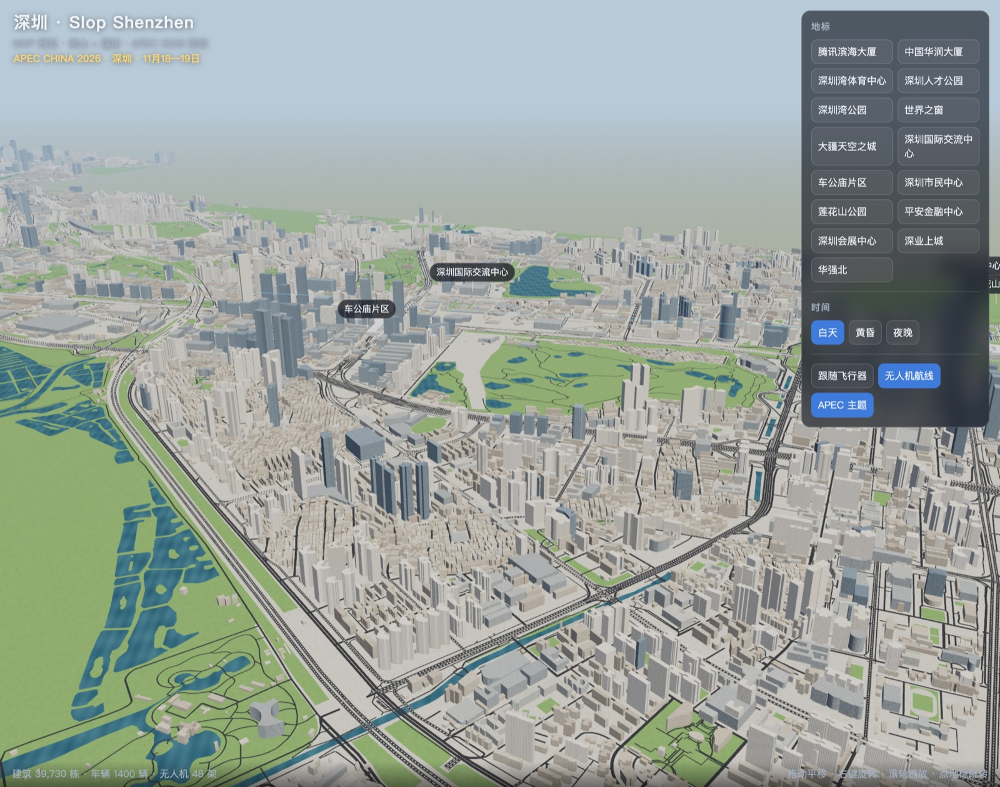
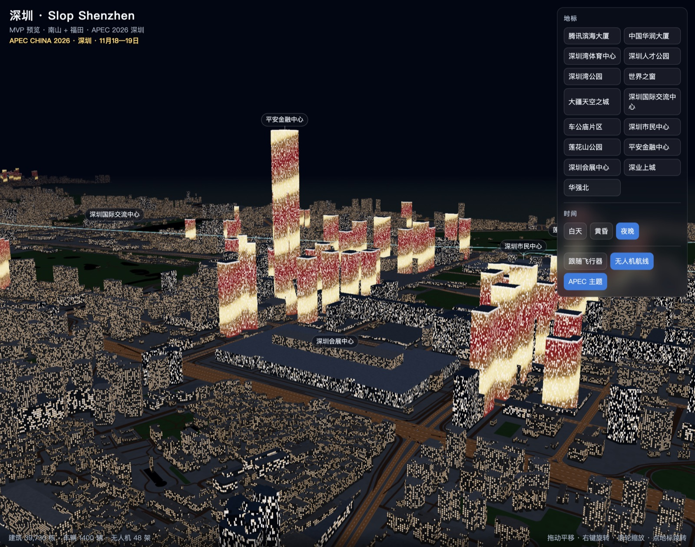

# 11 MVP 现状与接手要求

更新：2026-11-09。本文件写给接手的执行者：MVP 做到了哪里、哪里粗糙、正式版必须达到什么要求。**第 3 节的六条要求是硬性要求**，每条都有验收标准，做完一条在 [TASKS.md](TASKS.md) 勾一条。

## 1. MVP 是什么

一个独立的预览页 `mvp.html`，用真实数据画出一期范围（南山加福田，`113.920–114.085E, 22.495–22.588N`）：

| 项目 | 数量 |
| --- | --- |
| 建筑 | 39,730 栋（OSM 12,934 + Overture 补 18,931 + GloBFP 补 8,027） |
| 道路 | 16,493 条，共 2,674 公里 |
| 陆地 / 海面 | 113.4 / 24.7 平方公里 |
| 水体 / 湿地 / 绿地 | 622 / 120 / 2,140 块 |
| 车辆 | 1,400 辆，32% 蓝色出租车，85% 绿牌 |
| 无人机 / 飞行器 | 48 架 / 1 架 |
| 数据包 | `js/sz-mvp/data/sz-mvp.json.gz`，1.4 MB，生成用时 12 秒 |

楼高来源分布：地标 6、OSM 实测高度 955、OSM 层数 4,219、Overture 2 + 24、GloBFP 26,228、估计值 8,298。

### 运行

```sh
python3 -m http.server 8080 --bind 127.0.0.1     # 常驻后台
open http://127.0.0.1:8080/mvp.html               # 加 ?time=night 或 ?time=dusk
.venv/bin/python tools/sz/build.py                # 重建数据（读缓存）；加 --no-cache 重新解析 PBF
```

调试对象挂在 `window.__sz`（`camera`、`controls`、`applyTime(name)`）。

### 截图





### 代码

| 路径 | 内容 |
| --- | --- |
| `tools/sz/geo.py` | 投影、一期范围框 |
| `tools/sz/osm.py` | 读 PBF：道路、海岸线、建筑、水体、湿地、绿地，缓存到 `data/raw/cache/` |
| `tools/sz/buildings.py` | OSM、Overture、GloBFP 合并去重，楼高优先级，立面类型 |
| `tools/sz/land.py` | 海岸线切面后按建筑密度判陆地 |
| `tools/sz/roads.py` | 8 级道路和路宽 |
| `tools/sz/build.py` | 串起来，写数据包和 `data/source/build-report.json` |
| `js/sz-mvp/*.js` | 预览渲染器：地面、建筑着色器、车流、无人机、飞行器、相机 |
| `mvp.html`、`css/sz-mvp.css`、`js/sz-strings.js` | 预览页 |

## 2. 哪里粗糙

| 方面 | 现状 | 差距 |
| --- | --- | --- |
| 地标 | 只是 OSM 轮廓挤出，平安、春笋、腾讯都是棱柱 | 7 个地标没绑上建筑：春茧（深圳湾体育中心）、深圳国际交流中心、莲花山、深圳湾公园、海上世界、京基 100、地王 |
| 普通建筑 | 平顶棱柱，立面只靠着色器画窗 | 塔楼、裙房不分，没有屋顶形状、退台、顶冠 |
| 地形 | 全平，莲花山、塘朗山都是平地 | 地形数据（HGT）已下载，没用 |
| 海岸 | 海面是一个平面 | 没有红树林、滩涂、潮间带，河道没有河岸 |
| 道路 | 平铺的色带 | 没有高架、立交、路面标线、人行天桥 |
| 无人机 | `air-routes.json` 里的 8 条航线是**编的** | 站点和航线不真实 |
| 地铁 | 没有 | |
| 交互 | MapControls 自由相机，右侧一个按钮面板 | 和纽约原版完全不同：不能步行、开车、飞行，没有地图、小地图、读数 |
| 夜景 | 窗灯太亮太密，灯光秀所有超高层同一种图案 | 白天、夜晚的过渡生硬 |
| 树木和街道设施 | 没有 | |

**MVP 的定位**：验证数据管线和渲染路线可行。`tools/sz/` 管线要保留并继续完善；`js/sz-mvp/` 渲染器是**临时的**，正式版走纽约引擎（下面第 3.5 节），MVP 里的建筑着色器、车流、无人机可以移植过去再删掉 `sz-mvp/`。

## 3. 正式版硬性要求

### 3.1 建筑还原

**地标**：`landmarks.json` 里的每一个都要单独程序化建模，外形对照实景照片，按 [05-LANDMARKS.md](05-LANDMARKS.md) 的卡片做。具体要求：

- 体量比例对：高度误差 3% 以内，平面轮廓和 OSM 对齐
- 标志性特征必须有：平安金融中心的四角钢柱和尖顶，春笋的斜网格外壳和收分，腾讯滨海大厦的南北双塔加三条连接体，大疆天空之城的双塔和悬挑连桥，市民中心的大屋顶，会展中心的长条屋顶，深业上城的塔楼和小镇街区，春茧的白色网壳，世界之窗的埃菲尔铁塔和金字塔，人才公园的湖面和步道，国际交流中心的屋面和香蜜湖
- 夜景灯光按实景分开做（平安顶部、春笋整体亮、腾讯不做灯光秀），不要所有塔楼一个图案
- 先补上第 2 节列出的 7 个没绑定建筑的地标

**普通建筑**：

- 有 `building:part` 的用部件建模，塔楼和裙房分开；没有部件的，150 米以上的超高层按轮廓自动生成裙房（高 15 到 30 米）
- 屋顶：住宅坡顶或设备层，写字楼顶冠和停机坪，城中村平顶加水箱
- 立面类型按片区：科技园玻璃幕墙、福田中心区石材加玻璃、华强北老式窗墙、城中村（白石洲、岗厦、上沙下沙、皇岗）密窗加防盗网
- 楼高来源不变，但估计值的楼要标出来，在地图调试层里能看到

**验收**：从深南大道车公庙往东看、从深圳湾公园看后海、从莲花山顶看中轴线，三张截图和实景照片并排放进 `docs/qa/`，轮廓能一眼认出。

### 3.2 城市地貌

- **地形**：用 `data/raw/terrain/` 的 HGT 生成高程网格，山体至少要有莲花山、塘朗山、笔架山、银湖山（福田北）、大南山（二期蛇口）。道路、建筑底面贴合地形，不悬空不埋地
- **海岸**：深圳湾是填海形成的人工岸线，岸边要有步道、护栏和红树林带（福田红树林、深圳湾公园沿线）；福田红树林保护区外面有滩涂
- **河流**：大沙河、新洲河、福田河、深圳河要有河岸和河道，不是只画一片蓝
- **交通设施**：OSM `bridge=yes` 和 `layer` 的路做成高架，滨海大道、沙河西路、北环大道的立交要能看出层次；人行天桥按 OSM `highway=footway` + `bridge=yes` 建
- **远景**：一期范围外按真实轮廓画香港元朗山体、前海和宝安天际线

**验收**：莲花山顶（约 106 米）能开车或步行上去，高度读数和 DEM 一致；从深圳湾大桥方向看过来，海岸线、红树林、后海天际线层次分明。

### 3.3 无人机航线真实

现在的 `data/source/air-routes.json` 是占位数据，**必须整个换掉**。规则：

- 只用有公开来源的真实站点和航线，每条记下来源网址和核实日期
- 站点坐标从 OSM 或卫星图核对，误差 30 米以内
- 航线：起飞垂直爬升，按直线或绕开超高层的折线平飞，到达后垂直降落；巡航高度按公开资料，查不到就写明是估计值
- 美团无人机**在 2026 年 11 月 11 日至 21 日暂停深圳配送**（覆盖 APEC 会期），APEC 主题打开时无人机停在机库里、站点显示停运

目前查到的真实点位（2026-11-09 检索，都要再核实）：

| 站点 / 航线 | 区 | 来源 |
| --- | --- | --- |
| 人才公园—海岸城（2023 年 9 月开航，人才公园站在潮汐广场） | 南山 | [美团新闻](https://www.meituan.com/news/NN230904058001287)、[240hoursinchina](https://www.240hoursinchina.com/en-us/guangzhou/guide/shenzhen-drone-delivery-guide) |
| 世界之窗、锦绣中华 | 南山 | 同上美团新闻 |
| 深圳湾公园三处：北湾鹭港、海风运动公园、深圳湾海滨生态公园 | 南山 | [mychina.guide](https://mychina.guide/blog/shenzhen-drone-delivery-guide) |
| 深业上城—中心公园 | 福田 | [Tripadvisor](https://www.tripadvisor.com/ShowTopic-g297415-i7681-k15490303-Which_park_has_drone_delivery-Shenzhen_Guangdong.html) |
| 莲花山公园（南门、露营区） | 福田 | 同上 |
| 笔架山体育公园 | 福田 | mychina.guide |
| 南山共 26 个运营点位；11 月 11 至 21 日停运 | 南山 | [搜狐 2026-11-07](https://www.sohu.com/a/1098411987_121106875) |

顺丰丰翼等其他运营方在一期范围内的航线没查到，查到再加。政策背景见《深圳市低空基础设施高质量建设方案（2024—2026 年）》。

**验收**：`air-routes.json` 每条航线都有 `source` 和 `verifiedAt` 字段，测试里检查不能缺；在人才公园潮汐广场能看到无人机降落到取餐柜。

### 3.4 地铁线路

数据在已下载的 PBF 里，**必须用 `network=深圳地铁` 过滤**：PBF 是全广东的，广州地铁也有 1 到 14 号线，只看 `ref` 会混进去。按这个条件过滤后有 17 条线（1–14、16、20、6B），`colour` 标签就是官方线路色（例如 1 号线 `#00AB39`、4 号线 `#DC241F`）。

要求：

- 管线新增 `tools/sz/metro.py`：线路几何（`route=subway` 关系里的轨道成员）、车站（`railway=station` + `station=subway`）、出入口（`railway=subway_entrance`，带 `ref` 口号），按一期范围裁切
- 场景里：每个出入口按真实位置建模，顶棚和标牌用线路色，写站名和出入口编号；地面以上的线段（如有）做高架和列车
- 地图和小地图上画线路，用官方颜色，可以开关
- 地下线段不用建隧道，但可以加“地铁视图”：半透明地面下显示线路和列车位置（选做）

**验收**：车公庙站（1、7、9、11 号线换乘）的出入口位置、数量、编号和 OSM 一致；地图上 1 号线沿深南大道走向正确。

### 3.5 交互和界面还原纽约原版

正式版入口是 `index.html`，**沿用纽约原版的界面结构、元素 ID、布局、快捷键和操作手感**，只把文字换成中文（放在 `js/sz-strings.js`）、内容换成深圳。`mvp.html` 的右侧按钮面板不保留。

纽约原版要保留的部分（见根目录 `index.html`、`js/main.js`、`js/nyc-map.js`）：

| 部分 | 纽约原版 | 深圳版 |
| --- | --- | --- |
| 加载界面 | `loading-overlay`，进度条加状态文字 | 同样，文字中文 |
| 顶部工具栏 | 四个时段按钮（金色时刻、正午、蓝调时刻、午夜 23:00）、传送、地图 `M`、声音 `N`、隐藏界面 `H` | 时段保留四个；传送列表换成深圳地标 |
| 移动方式 | `1` 步行、`2` 黄色出租车、`3` 自行车、`4` 直升机 | `1` 步行、`2` 蓝色出租车、`3` 共享单车、`4` 四旋翼载人飞行器 |
| 操作提示 | 每种方式一行键位：`W/S`、`A/D`、`Space`、`E/Q/C`、`B` 鸣笛、拖动环视 | 键位不变，说明文字中文 |
| 读数 | 速度（mph）、速度条、高度、当前地名 | 速度改 km/h；地名显示“区 · 路名” |
| 相机 | `V` 循环，`5` 追尾、`6` 动作、`7` 第一人称，`8`/`9`/`0` 三个固定景点机位，有弹出菜单 | `8` 深圳湾公园看后海，`9` 市民中心看中轴线，`0` 人才公园看春笋 |
| 小地图 | 左下雷达，点开全图 | 同样 |
| 全图 | 搜索框、指北针、缩放、回到玩家、看全图、悬停信息、计数 | 同样；搜索支持中文和拼音首字母；加地铁和无人机图层开关 |
| 手柄和触屏 | `gamepad-controls.js`、`touch-controls.js` 摇杆 | 原样保留 |
| 声音 | 车流、直升机、鸣笛 | 电动车低速提示音、飞行器电机声 |

**验收**：把纽约原版和深圳版并排打开，同一套键盘操作在两边做同样的事；每个界面元素都能一一对上；手机竖屏能用摇杆开车。

### 3.6 观感

- 夜景窗灯密度降到现在的一半左右，按楼的用途分：写字楼冷白、住宅暖黄、城中村零散
- 白天加天空、雾和阴影，晚上有路灯光晕；时段切换要平滑过渡
- 树木按 [06-STREETSCAPE.md](06-STREETSCAPE.md)：榕树、凤凰木、宫粉紫荆、大王椰
- 帧率：一期全范围地面 60 帧、飞行 50 帧以上（预算见 [10-PERF-QA.md](10-PERF-QA.md)）

## 4. 建议顺序

1. 地形和海岸（3.2），因为建筑和道路的高度都要贴地形
2. 换纽约引擎和界面（3.5），把 MVP 的数据接进纽约的地面、路网、车辆、相机模块
3. 地标建模（3.1），按每个地标一个文件
4. 地铁（3.4）和真实无人机航线（3.3）
5. 观感（3.6）和性能
