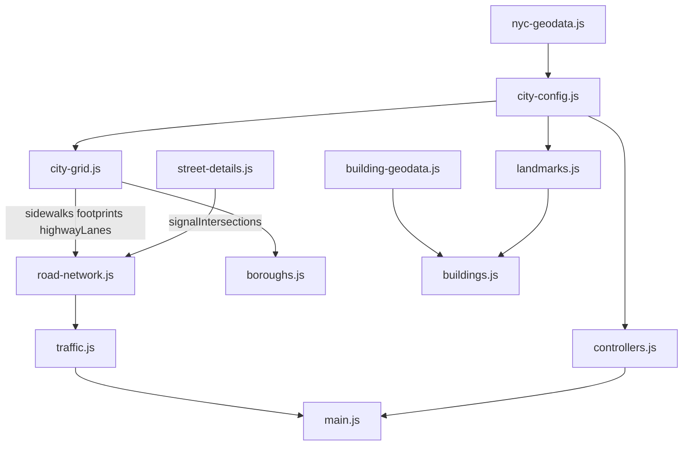

# 16 纽约原版模块地图

`ref/slop-newyork` 的运行时结构。深圳怎么保留、改造或替换这些模块，见 [01-ARCHITECTURE.md](01-ARCHITECTURE.md)。

行号对应当前只读副本。原版不打包：`index.html` 用 import map 加载 three.js `0.187.0`（WebGPU + TSL），入口是 `js/main.js`。`js/` 大约 3.4 万行。

坐标系：1 单位 = 1 米。原点在第五大道与 42 街中心线交点。x 沿方格网向东，z 沿方格网向南（相对真北转了约 29°），y 向上。

## 启动顺序

`initApp()`（`js/main.js` 第 25 行）按固定阶段搭场景。后面的系统只消费前面返回的字段。

| 阶段 | 调用 | 位置 |
| --- | --- | --- |
| 渲染器 | `WebGPURenderer`，`reversedDepthBuffer`，`ClusteredLighting(256, 32, 28, 48)` | `main.js` 80–104 |
| 光照 | `new LightingSystem` | 108–111 |
| 地面 | `buildCityGrid` | 115 |
| 周边 | `buildBoroughs(scene, { sidewalks })` | 118 |
| 地标 | `buildLandmarks` | 121 |
| 普通楼 | `buildCityBlocks(scene, landmarkColliders)` | 124 |
| 街道 | `buildStreetDetails(scene, allColliders)` | 129 |
| 交通 | `createTrafficSystem`、`createHighwayTraffic` | 135–141 |
| 标线 | `buildRoadPaint(scene, trafficSystem.network, cityGrid.roadPaint)` | 143 |
| 玩家 | `ThirdPersonControllerManager`、`CameraSystem`、`TouchControls`、`GamepadControls`、`CityAudioSystem` | 148–174 |
| 剔除 | `setupSceneCulling` | 199–202 |
| 后期 | `pass` + `mrt` + `ssr` + `createPostProcessing` + `RenderPipeline` | 221–261 |

碰撞体在 126 行合成：`landmarkColliders`、`cityBlocks.colliders`、`boroughs.colliders`、`cityGrid.colliders`。交通障碍另外拼 `cityGrid.footprints`、`streetDetails.footprints`，以及 `minY < 3.5` 且不是有向包围盒的碰撞体（132–139 行）。架空且净空够一辆公交通过的部分不挡地面交通。

每帧循环在 695–792 行：手柄、控制器、相机、信号灯时钟、市区交通、滨河高速交通、缆车、建筑细节、路灯池、日照阴影、地图、音频、剔除，然后 `renderPipeline.render()`。第一帧关掉视锥剔除做着色器预热（731–749），GPU 提交完成后再揭开加载层（758–764）。玩家位置每 5 秒写入 `localStorage` 键 `nyc-player-state`。

快捷键在 539 行：1–4 切换步行、开车、自行车、直升机，V 切相机，H 藏 HUD，M 地图，N 静音。

## 1. 数据与空间配置

| 文件 | 规模 | 职责 | 关键符号 |
| --- | --- | --- | --- |
| `js/nyc-geodata.js` | 生成文件，约 1.1 MB | `tools/build-geodata.mjs` 产出。海岸、街区、大道、街道、`roadGraph` | 第 7 行 `export const GEO` |
| `js/building-geodata.js` | 63 行 | 流式读 `building-geodata.bin.gz`（NYB1） | `stream` 19，`REAL_BUILDINGS` 42 |
| `js/tree-geodata.js` | 44 行 | 流式读树点二进制 | `REAL_TREES` 37 |
| `js/subway-geodata.js` | 6 行 | 站名，出入口 `[x, z, stationIndex]` | `SUBWAY_STATIONS` 5，`SUBWAY_ENTRANCES` 6 |
| `js/city-config.js` | 778 行 | 把 `GEO` 变成街道库、海岸、街区、地名、信号配时 | 见下表 |

`city-config.js` 被其他模块直接调用的函数：

| 函数 | 行 | 作用 |
| --- | --- | --- |
| `streetZ` | 29 | 第 n 街的真实 z |
| `getIslandBoundsAtZ` | 174 | 某一 z 上曼哈顿东西岸 |
| `getBroadwayX` | 188 | 百老汇中心线在该 z 的 x |
| `nearestRoads` | 436 | 最近的路，给路名牌和人行道判断 |
| `blockAt` | 503 | 点落在哪一块人行道岛 |
| `districtAt` | 521 | 片区，决定立面风格 |
| `getLocationLabel` | 647 | HUD 路名牌：「地名 · 大道与横街」 |
| `isTypingInField` | 703 | 输入框聚焦时不抢快捷键 |
| `signalPhase` | 715 | 大道 / 横街红灯相位 |
| `walkSignal` | 723 | 行人绿灯 |

导出表在第 729 行，还包括 `ALL_AVENUES`、`ALL_STREETS`、`MANHATTAN_COASTLINE`、`BLOCKS`、`NYC_LANDMARKS`、`TELEPORT_LOCATIONS`、`ROADS`、`ISLAND_BOUNDS`。岸线高速（West Side Highway、FDR）作为 `isHighway` 大道补进 `ALL_AVENUES`（93–96 行），几何由 `city-grid.js` 沿海岸生成。

数据工具在 `tools/`：`build-geodata.mjs`、`geo-base.mjs`、`geo-streets.mjs`、`geo-blocks.mjs`、`geo-roadgraph.mjs`、`geo-extra.mjs`、`build-buildings.py`、`build-trees.py`、`build-subway-entrances.mjs`、`overpass.sh`。原始快照在 `tools/data/`。

## 2. 地面：`js/city-grid.js`（3544 行）

`buildCityGrid(scene)` 在第 1492 行，场景组名 `ManhattanCityGrid`。

| 段 | 行 | 内容 |
| --- | --- | --- |
| 1 | 1505 | 港口水面，`createWaterMaterial()` |
| 2 | 1515 | 花岗岩海堤和整岛沥青路面（Y = 0） |
| 3 | 1537 | 公园草坪材质 |
| 4 | 1543 | 每块真实路缘岛的抬高人行道和花岗岩路缘 |
| 6 | 1622 | 时报广场、达菲广场 TKTS 红台阶、先驱广场、熨斗广场 |
| 7 | 1807 | 中央公园（59 街到 110 街） |
| 6′ | 1995 | 大军广场、哥伦布圆环 |
| 8 | 2531 | 码头，几何在 `buildWaterfrontPiers` 780 |
| 11 | 2540 | 滨水步道、岸线高速、河滨公园，`buildManhattanWaterfrontEdge` 2577 |

| 函数 | 行 | 作用 |
| --- | --- | --- |
| `getStreetGroundHeight` | 79 | 高架、下穿处的路面高度 |
| `addStoneArchBridge` | 95 | 石拱人行桥 |
| `buildManhattanSchistGeometry` | 151 | 曼哈顿片岩露头 |
| `batchStaticGroupMeshes` | 180 | 按材质合并静态网格 |
| `buildWaterfrontPiers` | 780 | 码头、船只和船棚 |
| `buildSouthStreetViaduct` | 3095 | 南街高架 |
| `buildUnderpassPortal` | 3441 | 炮台公园下穿 |

导出在 3534 行：`buildCityGrid`、`getStreetGroundHeight`、`batchStaticGroupMeshes`，以及 `centralParkClearings`、`parkTreeSites`、`parkLampSites`、`pavedPlazaRects`、`sidewalkBlocks`、`fdrViaduct`。`buildCityGrid` 的返回值还包括 `sidewalks`、`footprints`、`colliders`、`highwayLanes`、`roadPaint`。路网和交通只吃这些字段。

## 3. 周边与桥梁：`js/boroughs.js`（3367 行）

精细网格以外的陆地、天际线、港口岛和桥。`buildBoroughs` 在 3317 行，必须在 `buildCityGrid()` 之后调用，桥墩只落在人行道块上。

| 函数 | 行 | 作用 |
| --- | --- | --- |
| `paintLandUse` / `zoneAt` | 545 / 776 | 用地栅格 |
| `buildLandGeometries` | 1057 | 陆地顶面和驳岸 |
| `ridgeHeightAt` / `buildRidgeGeometry` | 1363 / 1373 | 帕利塞兹崖壁。`ridgeHeightAt` 供飞行碰撞使用 |
| `generateBoroughBuildings` | 1787 | 外围批量楼块 |
| `buildBuildingChunks` | 1831 | 按块实例化 |
| `buildStatueOfLiberty` | 1978 | 自由女神 |
| `buildEllisIsland` / `buildGovernorsIsland` | 2050 / 2085 | 埃利斯岛、总督岛 |
| `buildRooseveltTram` | 2166 | 罗斯福岛缆车，返回每帧 `update` |
| `buildSuspensionBridge` | 2886 | 威廉斯堡桥、曼哈顿桥 |
| `buildBrooklynBridge` | 2974 | 布鲁克林桥 |
| `buildQueensboroBridge` | 3052 | 皇后区大桥 |
| `buildGWBTower` / `buildVerrazzanoTower` | 3116 / 3170 | 桥塔 |
| `buildOuterBridge` | 3204 | 乔治·华盛顿桥、维拉扎诺桥 |

导出（3367）：`buildBoroughs`、`ridgeHeightAt`、`landAt as boroughLandAt`。返回 `{ group, ridgeHeightAt, landAt, colliders, update }`。

## 4. 地标：`js/landmarks.js`（1070 行）

`buildLandmarks(scene)` 在第 16 行。每个地标在局部原点建模，再按 `city-config.js` 里的 OSM 轮廓用 `fitToSite` 平移、缩放到真实高度。碰撞盒跟着轮廓走。

| 序号 | 地标 | 行 |
| --- | --- | --- |
| 1 | 帝国大厦，高 443 m | 191 |
| 2 | 克莱斯勒大厦，高 319 m | 314 |
| 3 | 范德比尔特一号 | 403 |
| 4 | 中央车站、公园大道高架、大都会人寿 | 461 |
| 5 | 布莱恩特公园、纽约公共图书馆 | 584 |
| 6 | 时报广场一号和百老汇灯墙 | 701 |
| 7 | 洛克菲勒中心 | 757 |
| 8 | 花旗集团中心 | 807 |
| 9 | 熨斗大厦，高 87 m | 860 |
| 10 | 西格拉姆大厦和花岗石广场 | 910 |
| 11 | 世贸中心一号，高 541 m | 951 |

盒子部件在 1036 行改成「立面盒子」，窗格对齐墙角。旋转体（熨斗棱柱、世贸反棱柱）保留世界空间窗格。导出 `buildLandmarks` 和 `bryantParkLawn`（1070）。`bryantParkLawn` 给布莱恩特公园机位用。

## 5. 普通建筑

| 文件 | 行数 | 入口 | 职责 |
| --- | --- | --- | --- |
| `js/buildings.js` | 915 | `buildCityBlocks` 148 | 读 `REAL_BUILDINGS`，按片区选立面，挤出体块，近处流式屋顶细节和店铺灯 |
| `js/building-footprints.js` | 102 | `createBuildingFootprints` 24 | 共墙高度，挤出真实轮廓。`partyWallHeight` 5 |
| `js/building-details.js` | 123 | `addBuildingDetails` 31 | 水塔、女儿墙、屋顶设备 |
| `js/building-collision.js` | 214 | `polygonContains` 1，`polygonBoxOverlaps` 14，`polygonContact` 41，`circleContact` 162，`polygonSegmentFraction` 191 | 多边形与盒子、圆、线段的碰撞。控制器和路网共用 |
| `js/fire-escapes.js` | 352 | 由 `buildings.js` 的 `addSurveyedFireEscapes`（312）调用 | 外挂消防梯 |

`buildings.js` 的 `Quadtree` 在 57 行。四种立面预设从 162 行起：战前石灰石、赤陶砖、玻璃幕墙等，材质工厂来自 `tsl-materials.js`。`update`（700）按相机位置流式屋顶细节；`updateLights`（843）把最近的店铺招牌射灯放进固定灯池。返回（906）：`{ group, colliders, allBlocks, update, updateLights }`。

## 6. 街道、树、地铁口

`buildStreetDetails(scene, colliders)` 在 `js/street-details.js` 第 104 行。

| 段 | 行 | 内容 |
| --- | --- | --- |
| 1 | 177 | 悬臂信号灯、路名牌、行人灯。`createTrafficSignalLensMaterial` 52，`createWalkSignalMaterial` 90，`createStreetSignBladeTexture` 28 |
| 2 | 337 | 橡果灯和眼镜蛇路灯 |
| 3 | 547 | 蒸汽井、路障 |
| 4 | 695 | 地铁口，数据来自 `createSubwayEntrances` |
| 5 | 718 | 热狗和清真餐车 |
| 6 | 776 | 消防栓、邮箱 |
| 7 | 816 | 公园树和行道树，调用 `createTreeField` |
| 8 | 995 | 近处路灯池。`update` 1074 |

返回（1134）：`{ group, footprints, signalClock, signalIntersections, audioSignals, treeField, update }`。`signalIntersections` 交给路网，决定哪些路口有灯。

| 文件 | 关键函数 | 行 |
| --- | --- | --- |
| `js/subway-entrances.js` | `createSubwayEntrances` | 36 |
| `js/street-props.js` | `createSubwayEntranceParts`、`createFoodCartParts` | 43、120 |
| `js/tree-placements.js` | `placeStreetTrees` | 9 |
| `js/trees.js` | `createLeafAtlas` 181，`growBranch` 437，`growTree` 473，`buildTreeGeometries` 755，`createTreeClearance` 823，`createTreeField` 865 | 程序化树枝和叶片卡片，按距离换 LOD |

`trees.js` 导出（1238）：`createTreeField`、`createLeafAtlas`、`buildTreeGeometries`、`SPECIES as TREE_SPECIES`。

## 7. 路网与路面标线

`buildRoadNetwork(sidewalks, obstacles, signalIntersections)` 在 `js/road-network.js` 第 26 行。北是 −z，东是 +x。有向边带单位方向 `(dx, dz)` 和右法线 `(rx, rz) = (-dz, dx)`。车道是中心线右侧的横向偏移，从左到右排序。

| 步骤 | 行 | 做什么 |
| --- | --- | --- |
| 1 | 27 | 人行道和障碍的空间哈希 |
| 2 | 108 | 大道走廊：路缘之间的宽度和畅通段 |
| 3 | 199 | 横街：相邻大道之间的空隙 |
| 4 | 235 | 路口，6 米内合并 |
| 4b | 251 | 非方格网：下城、百老汇、弯曲大道，读 `GEO.roadGraph` |
| 5 | 433 | 有向边，只留全程无障碍的车道。`addEdge` 435，`addEdgeGeneral` 483 |
| 6 | 771 | 路口转向，禁止掉头。弯道 `makeCurve` 1122，`curvePoint` 1166 |
| 7 | 984 | `largestComponent`（1064）只留最大强连通分量 |
| 8 | 1024 | 有信号灯头的路口才算信控 |
| 9 | 1030 | 每个节点的侧向和路权 |

导出 `buildRoadNetwork` 和 `CROSSWALK`（1183）。大道列表和横街列表都为空时，仍走 4b，只读 `GEO.roadGraph`。深圳路网用的就是这条分支。

`js/road-paint.js`：`createRoadPaintChunkBuilder` 20 按格子合批，`buildRoadPaint` 107 画车道线、人行横道和停止线。标线跟着路网，不跟着方格网。

## 8. 交通与车模

`createTrafficSystem` 在 `js/traffic.js` 第 107 行。它自己调用 `buildRoadNetwork`，再创建行人系统。返回（2011）：`{ group, update, setCollisionListener, cars, buses, peds, network }`。`update` 在 1879 行。

| 函数 | 行 | 作用 |
| --- | --- | --- |
| `createBusDestinationTexture` | 66 | 公交目的地牌 |
| `spawnCollisionSparks` | 341 | 碰撞火花 |
| `spawnVehicle` | 1553 | 在相机附近、不挡视线的空档生成 |
| 跟车和红灯 | 677–717 | 车道内前车和信号 |
| 换道加速度 | 1042 | |
| 碰撞位移 | 1353–1408 | 沿路径分解冲量 |
| `createHighwayTraffic` | 2041 | 西侧公路和 FDR。不进市区路网，用 IDM 跟车 |

滨河高速的 LOD：170 m 内完整车身和车轮，450 m 内无轮车身，更远用约 250 三角面的代理，1600 m 外或相机身后不画（2035–2037 行）。车道尽头车辆沉入路面以下，再从另一端冒出，用来接炮台公园下穿。返回 `{ group, update, cars, lanes }`（2465）。

车身：

| 文件 | 关键位置 | 内容 |
| --- | --- | --- |
| `js/vehicles.js` | `part` 7，`mirrorSection` 17，`roundedRectShape` 25，`roundedBox` 40 | 零件和圆角盒 |
| `js/cars.js` | `CAR_PARTS` 51，`BODY_SPECS` 65，`smoothCurve` 354，`bodyProfile` 401，`carLayout` 450，`buildBodyLoft` 658，`buildCarBody` 699，`buildCarGeometry` 1045，`carStyleCode` 1177 | 放样车身。导出在 1893 |
| `js/bus.js` | `buildLoftedBusBodyGeometry` 81，`buildBusSignGeometry` 173，`buildBusWheelGeo` 203，`createLoftedBusMaterial` 316 | 公交。导出在 656 |
| `js/vehicle-lights.js` | `createVehicleHeadlight` 18，`placeVehicleHeadlight` 22 | 近光灯 |
| `js/vehicle-physics.js` | `vehicleContact` 3，`resolveVehicleContact` 70，`sweptVehicleContact` 114 | 平面刚体接触。法线从 b 指向 a |

`BODY_SPECS` 的车型：`sedan`（66）、`suv`（116）、`taxi`（167，轿车加顶灯）、`pickup`（169）、`van`（228）、`minivan`（295）。

## 9. 行人

| 文件 | 入口 | 行 | 职责 |
| --- | --- | --- | --- |
| `js/pedestrians.js` | `buildPersonGeometry` | 566 | 放样人体。`createPersonMaterial` 746 |
| `js/pedestrians.js` | `PersonCrowd` | 967 | 实例化人群。`begin` 990，`add` 994，`end` 1001 |
| `js/pedestrians.js` | `PersonRig` | 1187 | 步态和 IK。`update` 1312，`updateGait` 1559，`solveLeg` 1983，`solve` 2039，`ride` 2166 |
| `js/pedestrian-routes.js` | `createPedestrianRoutes` | 3 | 人行道轨道。过街轨道单独一条，进入前由系统查信号 |
| `js/pedestrian-system.js` | `createPedestrianSystem` | 14 | 生成、走路、等灯、避车。由 `traffic.js` 的 `update` 在 2000 行调用 |

`pedestrians.js` 导出（2213）：`BONE as PERSON_BONES`、`buildPersonGeometry`、`createPersonMaterial`、`PersonCrowd`、`PersonRig`、`PEDESTRIAN_DIVE_DURATION`。

## 10. 玩家、相机、输入

`ThirdPersonControllerManager` 在 `js/controllers.js` 第 194 行。

| 方法 | 行 | 作用 |
| --- | --- | --- |
| `constructor` | 195 | 创建四种实体并绑定键盘 |
| `setMode` | 326 | 切换当前控制对象 |
| `getActiveEntity` | 341 | |
| `teleportActiveTo` | 345 | 传送 |
| `findTeleportPosition` | 403 | 找不穿进楼体的落点 |
| `createPersonEntity` | 466 | 步行。HUD 标称上限约 8.2 m/s |
| `createCarEntity` | 509 | 开车。约 36 m/s |
| `createCyclistEntity` | 629 | 自行车。约 19 m/s |
| `createHelicopterEntity` | 788 | 直升机。约 52 m/s |
| `isPointOnSidewalk` | 871 | |
| `getGroundHeight` | 876 | 地面高度，含水面和山脊 |
| `nearColliders` | 894 | |
| `resolveHorizontalCollision` | 931 | 对 `allColliders` 推开 |
| `poseCharacters` | 1023 | 写骨骼姿态 |
| `update` | 1099 | 分发到下面四个 |
| `updatePerson` | 1157 | |
| `updateCar` | 1228 | |
| `updateCyclist` | 1321 | |
| `updateHelicopter` | 1388 | |

输入混合：`_blendInput` 284，`setTouchInput` 300，`setGamepadInput` 304。触摸和键盘分开，松手不会放开按住的键。

直升机模型在 `js/helicopter.js`：`buildHelicopterBodyGeometry` 106，`buildHelicopterMainRotorGeometry` 248，`buildHelicopterTailRotorGeometry` 282，`createLoftedHelicopterMaterial` 308。控制器只引用这套几何。

`CameraSystem`（`js/cameras.js` 20）。预设表在第 6–18 行：

| id | 名称 | 类别 |
| --- | --- | --- |
| `chase` | 第三人称跟随 | follow |
| `action` | 低角度 | follow |
| `pov` | 第一人称 / 座舱 | follow |
| `centralPark` | 中央公园 | scenic |
| `fifthAve` | 第五大道和帝国大厦 | scenic |
| `timesSquare` | 时报广场 | scenic |
| `chryslerGCT` | 42 街、克莱斯勒和中央车站 | scenic |
| `observatory` | 帝国大厦 86 层观景台 | scenic |
| `bryantPark` | 布莱恩特公园和图书馆 | scenic |
| `waterfront` | 东河天际线 | scenic |
| `drone` | 自动航拍 | scenic |

`bindPointerControls` 55 处理拖拽环绕和双指缩放。`setCameraPreset` 117，`update` 169 平滑跟随。导出 `CAMERA_PRESETS` 和 `CameraSystem`（365）。

`js/touch-controls.js` 导出 `TouchControls`（167）。`js/gamepad-controls.js` 把摇杆合成油门和转向，并循环模式和相机。

## 11. 材质、光照、后期、剔除

`js/tsl-materials.js`（3498 行）是共享 TSL 材质库。`cityUniforms` 把时刻、室内发光和路面湿润交给所有材质。

| 函数 | 行 | 用在 |
| --- | --- | --- |
| `facadeCell` | 423 | 窗格坐标 |
| `createStorefront` | 530 | 橱窗和招牌 |
| `createBuildingEntrance` | 637 | 入口 |
| `createCurtainWallMaterial` | 695 | 玻璃幕墙 |
| `createPreWarBuildingMaterial` | 878 | 战前砌体 |
| `createFacadeBoxes` | 1229 | 立面盒子 |
| `createChryslerCrownMaterial` | 1249 | 克莱斯勒冠 |
| `createCarPaintMaterial` | 1335 | 车漆 |
| `createTreeMaterial` | 1409 | 树。`TreeNodeMaterial` 1374，`FoliageLightingModel` 1361 |
| `createRoadSurfaceMaterial` | 1913 | 沥青和积水。`roadPuddleField` 1775 |
| `createRoadPaintMaterial` | 2113 | 标线 |
| `createSidewalkMaterial` | 2182 | 人行道 |
| `createCurbMaterial` | 2331 | 路缘 |
| `createBillboardMaterial` | 2685 | 广告牌 |
| `createWaterMaterial` | 2894 | 水面。波浪贴图 `getWaterWaveTexture` 2777 |
| `createParkLawnMaterial` | 3132 | 草坪 |
| `createSteamMaterial` | 3302 | 蒸汽 |
| `createGodRayMaterial` | 3378 | 体积光 |
| `createContactShadowMaterial` | 3409 | 车底接触阴影 |
| `createCarFlareMaterial` | 3446 | 车灯光晕 |

完整导出在 3468 行，另外还有公园铺装、围栏、路灯球、隧道遮光、TKTS 台阶、大理石和树池盖。

`LightingSystem`（`js/lighting.js` 130）。`TIME_PRESETS` 从 28 行起：`golden`、`midday`、`twilight`、`midnight`。`applyPreset` 266 改太阳、雾、室内发光和路面湿润。`createAerialFogNode` 234，`bakeEnvironmentMap` 252，`update` 309 让阴影相机跟着视野。

`createPostProcessing`（`js/post-processing.js` 32）接半分辨率 SSR、泛光和胶片调色。`main.js` 221–261 行组装 MRT：颜色、法线、金属度/粗糙度。粗糙度高于 0.75 的表面不进反射。

`js/scene-culling.js`：`setupSceneCulling` 149 把静态小组件切块并按距离剔除，大投影体用 `SHADOW_PROXY_LAYER` 的阴影替身。`chunkInstancedMesh` 77，`updateSceneCulling` 352。`main.js` 205–216 行把车流、玩家和集群灯标成动态根，然后关掉 `scene.matrixWorldAutoUpdate`。

## 12. 音频

程序化合成，没有采样文件。

| 文件 | 关键符号 | 行 | 职责 |
| --- | --- | --- | --- |
| `js/audio-synthesis.js` | `createSynthResources`、`createMotorVoice` | 221、300 | 发动机、旋翼、链条的循环缓冲 |
| `js/audio-events.js` | `createEventResources`、`playEvent`、`createWindVoice` | 290、312、409 | 脚步、喇叭、碰撞、人声碎片、行人灯 |
| `js/audio-sources.js` | `CityAudioSources` | 导出 232 | 把车、直升机和玩家写成空间声源 |
| `js/audio-acoustics.js` | `CityAcoustics`、`thickness` | 导出 102，函数 5 | 沿射线量墙厚，做遮挡 |
| `js/audio-system.js` | `CityAudioSystem` | 类 78 | 混音。`SpatialEmitter` 15，`unlock` 123，`initialize` 141，`update` 393，`honk` 386，`crash` 344 |

## 13. 地图与页面

`NYCMapSystem`（`js/nyc-map.js` 428）画小地图和全屏地图。

| 符号 | 行 | 作用 |
| --- | --- | --- |
| `TiledLayer` | 160 | 按瓦片取路网。`pathFor` 166 |
| `MapView` | 340 | 世界坐标和屏幕坐标。`world` 355，`screen` 361 |
| `constructor` | 429 | |
| `search` | 644 | 搜路名和地标 |
| `toggleFullMap` | 687 | |
| `screenToWorld` | 724 | 点击地图得到世界坐标 |
| `clampToManhattan` | 732 | |
| `drawRoadLabels` | 878 | |
| `update` | 938 | |
| `renderMinimap` | 950 | |
| `renderFullMap` | 1076 | |
| `drawScaleBar` | 1235 | |

点击地图调用控制器的 `teleportActiveTo`。

`index.html` 的界面对应关系：加载层 `#loading-overlay`（108），视口 `#canvas-container`（117），时间按钮 `data-time`（137），传送 `data-teleport`（171），小地图 `#minimap-canvas`（185），模式按钮 `data-mode`（196 起）。样式在 `css/style.css`。

## 测试

`tests/` 用 `node --test`，和运行时模块对应。覆盖路网交通（`traffic.test.cjs`、`traffic-performance.test.cjs`）、控制器和传送（`controllers.test.cjs`、`teleports.test.cjs`）、相机、行人路线和信号、建筑碰撞与轮廓、树木、车轮和车灯、车辆物理、水面材质、地图和触摸。
