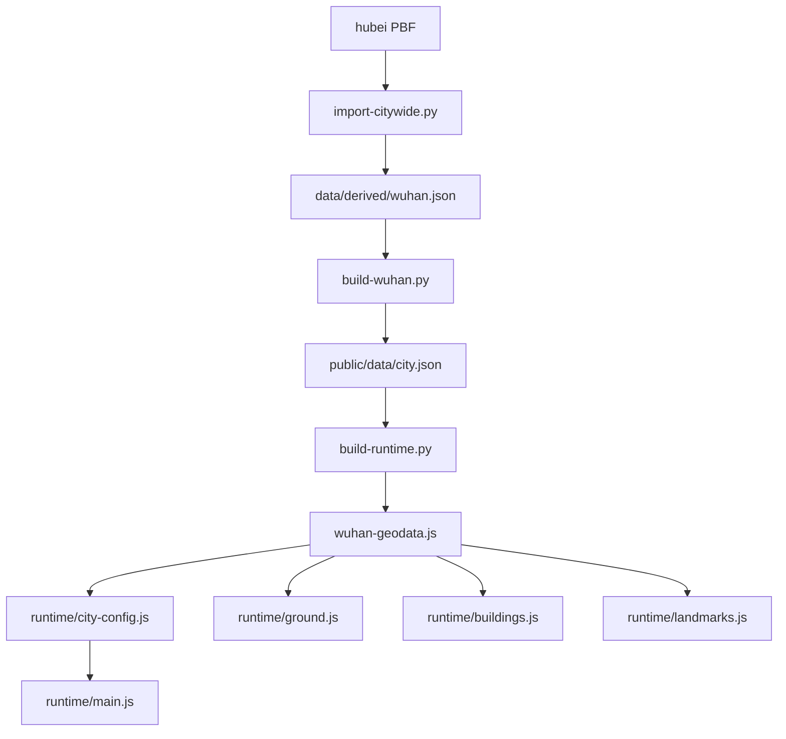

# 17 武汉参考模块地图

`ref/slop-wuhan`（LightYearZh，当前副本版本 **0.10.0**）的模块、数据流和关键函数。深圳怎么用这些做法，见 [01-ARCHITECTURE.md](01-ARCHITECTURE.md)：沿用纽约运行时，移植数据管线做法和出租车接单，不整套搬武汉（台北）运行系统。地形与建筑的可移植边界见 [RESEARCH.md 第 8 节](RESEARCH.md#8-武汉地形与建筑的可移植经验2026-11-09-代码复核)。

行号对应当前只读副本（2026-11-10）。`ref/` 只读，不在里面改。

坐标系：1 单位 = 1 米。原点 `114.293E, 30.585N`，写在 `config/wuhan-core.json` 第 5 行和 `tools/build-wuhan.py` 第 25 行。x 向东，z 向南，y 向上，不旋转坐标轴。范围大约东西 8.06 公里、南北 6.01 公里（`config/wuhan-core.json` 的 `boundsWgs84`）。

仓库里有两套运行时代码。`index.html` 第 40 行加载的是 `js/runtime/main.js`。顶层 `js/main.js` 是更早的上海分块运行时，文件还在，不是现在的入口。

## 数据怎么进画面

```text
湖北 OSM PBF + Overture + 3D-GloBFP + Terrain Tiles
        │  tools/import-citywide.py
        ▼
data/derived/wuhan.json
        │  tools/build-wuhan.py
        ▼
public/data/city.json                 源层，留审计字段
        │  tools/build-runtime.py
        ▼
js/runtime/wuhan-geodata.js           3 行加载器
js/runtime/wuhan-geodata.bin.gz       WUH1 gzip
        │  index.html → js/runtime/main.js
        ▼
地面、楼、桥隧、车、人、地图
```

已有生成数据时只浏览：`npm ci` 然后 `npm run dev`，打开 <http://127.0.0.1:4799/>。重建：

```sh
npm run data:build     # build-wuhan.py，然后 build-runtime.py
npm run data:runtime   # 源层已更新，只重做运行适配
npm run verify         # JS 测试 + Python 规则 + 空间审计 + vite build
```

`js/runtime/wuhan-geodata.js` 由 `tools/build-runtime.py` 写出，不手改：

```1:3:ref/slop-wuhan/js/runtime/wuhan-geodata.js
// GENERATED by tools/build-runtime.py. Geography: OSM / Overture (ODbL).
import {loadGeodata} from './geodata-loader.js';
export const GEO = await loadGeodata(new URL('./wuhan-geodata.bin.gz', import.meta.url),{"decodedBytes":8708472});
```



## 启动顺序

`initApp()`（`js/runtime/main.js` 第 33 行）按固定阶段搭场景。调试查询参数 `?skip=landmarks,props,traffic,elevated,paint` 可以跳过对应阶段（84 行）。

| 阶段 | 调用 | 位置 |
| --- | --- | --- |
| 让出加载帧 | `yieldLoadingStage` | `startup-yield.js` 3；`main.js` 48 |
| 渲染器 | `WebGPURenderer`，`reversedDepthBuffer`，`ClusteredLighting(256, 32, 28, 48)` | `main.js` 54–63 |
| 光照 | `new LightingSystem` | 79 |
| 地面 | `buildGround` | 86 |
| 普通楼 | `buildCityBlocks` | 89 |
| 高架和隧道 | `buildElevated`、`buildTunnels(scene, TUNNELS)` | 92–93 |
| 标线 | `buildRoadPaint` | 95 |
| 地标 | `buildLandmarks` | 98 |
| 街具 | `buildStreetProps` | 101 |
| 交通 | `createTrafficSystem` | 106 |
| 玩家和出租 | `ThirdPersonControllerManager`、`createTaxiService` | 110–112 |
| 相机和输入 | `CameraSystem`、`TouchControls`、`GamepadControls` | 136、137、281 |
| 声音 | `CityAudioSystem` | 139 |
| 剔除 | `setupSceneCulling` | 163–166 |
| 后期 | `pass` + `mrt` + `ssr` + `createPostProcessing` + `RenderPipeline` | 180–220 |

碰撞体在 103 行合成：`landmarkColliders`、`cityBlocks.colliders`、`elevated.colliders`、`streetProps.colliders`。玩家位置写入 `localStorage` 键 `wuhan-taipei-runtime-player-v1`（115–133 行）。

快捷键由页面和 `main.js` 接上：1–4 步行、开车、骑行、飞行；V 切相机；M 地图；N 声音；H 藏界面；汽车模式 T 接单。

## 1. 启动、地理契约、加载

| 文件 | 规模 | 职责 | 关键符号 |
| --- | --- | --- | --- |
| `js/runtime/main.js` | 795 行 | 正式入口。串场景、HUD、模式、传送、存档 | `initApp` 33；`selectMode` 319；`selectCamera` 341；`selectTime` 359 |
| `js/runtime/city-config.js` | 587 行 | 把 `GEO` 适配成台北运行时要的路网、地面、建筑、信号、地名 | 见下表。文件头 6–8 行写明契约：米、x 东、z 南、街道 y=0 |
| `js/runtime/wuhan-geodata.js` | 3 行 | 生成的加载器 | `GEO` 3 |
| `js/runtime/geodata-loader.js` | 38 行 | 拉 gzip 并解码 | `loadGeodata` 3 |
| `js/runtime/geodata-codec.js` | 37 行 | WUH1：变长整数 + gzip，从纽约 NYB1 改来 | `decodeGeodata` 4；`unpackGeodata` 29 |
| `js/runtime/startup-yield.js` | 9 行 | 加载阶段让出一帧；后台标签页不等 `requestAnimationFrame` | `yieldLoadingStage` 3 |
| `js/runtime/travel-state.js` | 10 行 | 传送保留当前载具 | `TRAVEL_MODES` 1；`travelMode` 4；`travelAltitude` 7 |
| `js/runtime/destination-order.js` | 34 行 | 传送菜单和地图里的代表地点用同一份排序 | `orderedCoreDestinations` 5；`teleportMenuDestinations` 24 |

`city-config.js` 被其他模块直接调用的函数：

| 函数 | 行 | 作用 |
| --- | --- | --- |
| `TUNNELS` | 10 | `createTunnelSystem(GEO.tunnels, GEO.rampCuts)` |
| `linkPointAt` | 51 | 沿一条路链取点 |
| `nearestLink` | 98 | 最近路链 |
| `deckHeightAt` | 134 | 桥面高度 |
| `PolygonSet` | 170 | 多边形集合查询 |
| `hillHeight` | 273 | 龟山、蛇山采样 |
| `groundHeightAt` | 278 | 地面接触高度 |
| `buildingAt` | 349 | 点落在哪栋楼 |
| `signalPhase` / `signalCountdown` / `walkSignal` | 396、405、414 | 信号配时 |
| `districtAt` | 434 | 汉口、汉阳、武昌 |
| `getLocationLabel` | 481 | HUD：「片区 地名 · 路 & 交叉路」 |
| `isTypingInField` | 527 | 输入框聚焦时不抢快捷键 |

导出表在第 547 行，还包括 `BOUNDS`、`ROAD_LINKS`、`ROAD_NAMES`、`BUILDINGS`、`TELEPORT_LOCATIONS`、`BRIDGE_SURFACES`。

## 2. 地面、路、桥、隧道

显示和接触用同一套三角面。`js/runtime/terrain-surface.js` 的 `sampleTerrain`（第 3 行）和 `tools/build-runtime.py` 的 `terrain_polys`（第 51 行）用同一条 NW/SE 对角线；注释写明双线性插值不是 GPU 画出来的那个面。

| 文件 | 规模 | 职责 | 关键符号 |
| --- | --- | --- | --- |
| `js/runtime/ground.js` | 271 行 | 裸地、车行道、人行道、公园、水面、山体 | `flatLayer` 33；`edgeWalls` 97；`buildMountains` 169；`buildGround` 219 |
| `js/runtime/terrain-surface.js` | 9 行 | 山体三角面采样 | `sampleTerrain` 3 |
| `js/runtime/road-paint.js` | 209 行 | 双黄线、车道线、斑马线、停止线 | `PaintBuilder` 18；`buildRoadPaint` 105 |
| `js/runtime/elevated.js` | 526 行 | 高架桥面、护栏、桥墩。文湖线高架是台北遗留 | `buildRoadDecks` 109；`buildMRT` 294；`buildElevated` 510 |
| `js/runtime/bridge-surfaces.js` | 51 行 | 两条单向车行道合成一块桥面，渲染和接触共用 | `triangleHeight` 8；`createBridgeSurfaces` 15 |
| `js/runtime/tunnels.js` | 34 行 | 长江隧道：连续路面、挡墙、洞身、顶灯 | `buildTunnels` 5 |
| `js/runtime/tunnel-surfaces.js` | 44 行 | 洞内三角面，给车和相机用 | `createTunnelSystem` 7 |
| `js/runtime/surface-barriers.js` | 10 行 | 路面离开街道之后才加侧向护栏 | `SURFACE_CONNECTION_HEIGHT` 3；`barrierSpan` 5 |
| `js/runtime/paving-coordinates.js` | 13 行 | 沿步行街折线量横向、纵向坐标 | `pavingCoordinates` 2 |

## 3. 普通建筑、历史立面、门洞

| 文件 | 规模 | 职责 | 关键符号 |
| --- | --- | --- | --- |
| `js/runtime/buildings.js` | 454 行 | 按外环和内院拉升，600 米级分块合批。碰撞用同一轮廓 | `styleOf` 73；`orientedBox` 93；`buildCityBlocks` 130；`buildRooftops` 283；`buildTempleRoofs` 372 |
| `js/runtime/hankou-heritage.js` | 266 行 | 有身份记录的汉口历史立面：柱廊、拱窗、阳台、檐口。不按街区随机欧式 | `heritageMaterials` 39；`facadeEdges` 74；`recessRing` 88；`buildHeritageBuilding` 105 |
| `js/runtime/heritage-roofs.js` | 34 行 | 轮廓内坡屋顶加内收亭子。尺寸是显示估计 | `appendHeritageRoof` 4 |
| `js/runtime/roof-layout.js` | 40 行 | 屋顶矩形能不能放进轮廓 | `roofRectangle` 4；`roofRectangleFits` 14；`fitRoofShed` 25 |
| `js/runtime/passage-gates.js` | 61 行 | 门洞：看见的开口和碰撞切片是同一份 | `buildPassageGate` 7 |
| `js/runtime/collision-footprint.js` | 13 行 | 带内院的圆与轮廓碰撞，适配台北的法向/深度接口 | `circleFootprint` 4 |
| `js/footprint-buildings.js` | 64 行 | 多环占地几何。江汉关和旧上海场景都用 | `footprintRings` 5；`buildingColliders` 7；`createFootprintGeometry` 35；`createFootprintMeshes` 44 |
| `js/building-frontages.js` | 33 行 | 沿源墙边贴通用立面，不占人行道、不造店名 | `createFrontageDetails` 5 |
| `js/building-materials.js` | 23 行 | 外观预设。用途来自城市数据，颜色是示意 | `createBuildingMaterials` 5 |

`buildCityBlocks` 第 135 行使用 `createWuhanBuildingMaterial()`，定义在 `js/runtime/tsl-materials.js` 第 2972 行。

## 4. 地标

`js/runtime/landmarks.js` 的 `buildLandmarks`（第 7 行）把整组下移 2 米：旧模型地面在 y=2，台北运行时街道在 y=0。然后分别调用江汉关和核心地标。碰撞盒在 15–19 行从占地生成。

| 文件 | 规模 | 做什么 | 关键符号 |
| --- | --- | --- | --- |
| `js/wuhan-landmarks.js` | 120 行 | 只建江汉关。平面来自 OSM，细部尺寸是目测 | `buildWuhanLandmarks` 6；八柱循环 39 |
| `js/runtime/core-landmarks.js` | 191 行 | 其余地标，以及三座桥的外观。桥面仍由 `bridge-surfaces.js` 负责，这里不加阻挡碰撞 | `buildCoreLandmarks` 7 |
| `js/runtime/yellow-crane.js` | 803 行 | 黄鹤楼。文件头写明总高 51.4 米、五层可见、翘角和琉璃瓦；装饰尺寸仍是估计 | `eaveRoof` 191；`crownRoof` 316；`dormer` 372；`buildYellowCrane` 478 |
| `js/runtime/red-house.js` | 29 行 | 红楼 | `buildRedHouse` 5 |
| `js/runtime/landmark-craft.js` | 46 行 | 地标共用的程序化贴图和曲屋顶 | `craftTexture` 5；`modelBuilder` 19；`curvedRoof` 30 |

`core-landmarks.js` 按 `l.type` 分发（53–83 行）：

| `type` | 行 | 模型 |
| --- | --- | --- |
| `jianghanguan` | 53 | 跳过，交给 `js/wuhan-landmarks.js` |
| `yellow-crane` | 56 | `buildYellowCrane` |
| `red-house` | 58 | `buildRedHouse` |
| `tv-tower` | 60–75 | 龟山电视塔，独立夜景材质 |
| `qingchuange` | 76–83 | 晴川阁，两层歇山 |
| 武汉长江大桥钢桁架 | 88–106 | 只画桥面以下桁架 |
| 晴川桥钢拱 | 139–158 | `pairRoute('晴川桥')` |
| 江汉桥钢桁架 | 160–182 | `pairRoute('江汉桥')` |

夜间发光在 `update`（184 行）。

## 5. 街具、树、人、车

`js/runtime/` 里的 `actor-models.js`、`pedestrians.js`、`trees.js`、`vehicle-lights.js` 和顶层 `js/` 同名文件几乎是同一份。正在跑的是 `js/runtime/` 那份。

| 文件 | 规模 | 职责 | 关键符号 |
| --- | --- | --- | --- |
| `js/runtime/street-props.js` | 577 行 | 路灯、信号灯、招牌、停放踏板车、行道树候选 | `treeSites` 91；`buildLamps` 164；`buildSignals` 225；`buildSignAtlas` 353；`buildSigns` 439；`buildParkedScooters` 502；`buildStreetProps` 546 |
| `js/runtime/prop-colliders.js` | 19 行 | 街具碰撞用模型尺寸，不用摆放预留半径 | `streetPropCollider` 2；`streetPropColliders` 14 |
| `js/spatial-placement.js` | 50 行 | 候选点躲开建筑、水面、路和其他街具 | `SpatialIndex` 12；`SpatialPlacement` 18。`street-props.js` 555 行传给街景 |
| `js/wuhan-streetscape.js` | 61 行 | 江汉关附近人工校正过的街具，不是全市普查 | `buildWuhanStreetscape` 6 |
| `js/runtime/trees.js` | 994 行 | 程序化树：树干管、叶卡、树冠法线。树种规则来自纽约 | `growTree` 481；`buildTreeGeometries` 764；`createTreeField` 829 |
| `js/runtime/pedestrians.js` | 1498 行 | 人体放样、骨骼、人群实例 | `buildPersonGeometry` 572；`PersonCrowd` 894；`PersonRig` 1009 |
| `js/runtime/actor-models.js` | 1969 行 | 出租车、巴士、直升机放样车身 | `buildCarGeometry` 813；`buildLoftedBusBodyGeometry` 1283；`buildHelicopterBodyGeometry` 1582 |
| `js/runtime/scooter-model.js` | 193 行 | 踏板车，一辆一个合并几何，交通用实例绘制 | `buildScooterGeometry` 76；`createScooterMaterial` 166 |
| `js/runtime/vehicle-lights.js` | 37 行 | 近光灯，走集群光照 | `createVehicleHeadlight` 18；`placeVehicleHeadlight` 22 |
| `js/runtime/traffic.js` | 841 行 | 车道图。出租车、巴士、踏板车、行人一起更新 | `buildLaneGraph` 59；`createTrafficSystem` 117 |
| `js/runtime/garbage-truck.js` | 150 行 | 傍晚垃圾车和《致爱丽丝》喇叭，台北遗留 | `createGarbageTruckMesh` 47；`GarbageTruckMusic` 69。`main.js` 151 行目前是空的 `update`，没有接上 |

`buildStreetProps` 的返回值（562–574 行）带 `colliders`、`audioSignals`、`signalClock` 和 `update`。

## 6. 操作、相机、地图、出租车

| 文件 | 规模 | 职责 | 关键符号 |
| --- | --- | --- | --- |
| `js/runtime/controllers.js` | 1160 行 | 步行、出租车、踏板车、直升机。碰撞和贴地 | 类 `ThirdPersonControllerManager` 162 |
| `js/runtime/touch-controls.js` | 168 行 | 触摸摇杆。松手不会松开键盘 | `TouchControls` 5 |
| `js/runtime/gamepad-controls.js` | 166 行 | 手柄：模式、相机、地图 | `GamepadControls` 26 |
| `js/runtime/cameras.js` | 370 行 | 跟随、低机位、驾驶视角、景点机位 | `CameraSystem` 44 |
| `js/runtime/wuhan-map.js` | 674 行 | 雷达小地图和全屏地图。搜索、点击传送、出租车导航 | `WuhanMapSystem` 57 |

`ThirdPersonControllerManager` 的方法：

| 方法 | 行 | 作用 |
| --- | --- | --- |
| `setMode` | 306 | 切换步行 / 车 / 踏板车 / 直升机 |
| `teleportActiveTo` | 316 | 传送当前角色，保留朝向和高度 |
| `findTeleportPosition` | 360 | 找可站立或可停的点 |
| `createPersonEntity` / `createCarEntity` / `createScooterEntity` / `createHelicopterEntity` | 428、466、583、647 | 四种实体 |
| `getGroundHeight` | 731 | 贴地 |
| `resolveHorizontalCollision` | 778 | 水平推出 |
| `pushOutOfTraffic` | 847 | 躲开交通车辆 |
| `keepOutOfWater` | 883 | 不进水面 |
| `updatePerson` / `updateCar` / `updateScooter` / `updateHelicopter` | 956、991、1065、1105 | 每帧 |

`CameraSystem`：`setCameraPreset` 141，`update` 193。`WuhanMapSystem`：`drawVectors` 119，`baseMap` 213，`setTaxiNavigation` 349，`search` 595，`toggleFullMap` 639，`update` 668。

出租车是 0.10.0 的全图随机接送。玩法说明在参考仓库 `docs/TAXI.md`；深圳自己的规则见 [09-UI-GAMEPLAY.md](09-UI-GAMEPLAY.md)。

| 文件 | 规模 | 职责 | 关键符号 |
| --- | --- | --- | --- |
| `js/runtime/taxi-network.js` | 59 行 | 可开车的路和合法路边停靠。隧道按 OSM 洞口节点拼接 | `taxiTunnelLinks` 7；`createTaxiNetwork` 39 |
| `js/runtime/taxi-routing.js` | 78 行 | 沿真实节点寻路。不把邻近路口并成一点，也不直线补路 | `pointAt` 4；`pathLength` 9；`projectPath` 10；`TaxiRoadRouter` 19 |
| `js/runtime/taxi-dispatch.js` | 32 行 | 随机一对合法上下客点 | `createTaxiDispatcher` 2 |
| `js/runtime/taxi-trip.js` | 35 行 | 状态机。车费是玩法数字，文件头写明不是武汉运价 | `TAXI_STOP` 2；`taxiFare` 3；`TaxiTrip` 4 |
| `js/runtime/taxi-fare.js` | 127 行 | 接到场景：乘客、导航带、面板、T 键 | `createTaxiService` 14。`main.js` 112 行创建 |

`TaxiTrip` 的阶段：`idle` → `offer` → `pickup` → `boarding` → `ride` → `alighting` → `complete`。`offer` 5 行，`accept` 6，`cancel` 7，`update` 8。停车判定用 `TAXI_STOP`：半径 7 米、车速 1.1 m/s、停留 1.8 秒、高度差 2.2 米。`createTaxiService` 在下单前用 `roadIsClear` / `stopIsClear`（17–33 行）沿实际车宽检查场景碰撞，画出来但被楼挡住的路不会派单。

## 7. 光照、材质、剔除、声音

`js/runtime/tsl-materials.js`（3399 行）是共享 TSL 材质库。武汉相对台北副本多出来的主要是建筑、人行道和地面。

| 函数 | 行 | 用在 |
| --- | --- | --- |
| `facadeCell` | 373 | 窗格坐标 |
| `createCurtainWallMaterial` | 476 | 玻璃幕墙 |
| `createPreWarBuildingMaterial` | 672 | 砌体立面 |
| `createFacadeBoxes` | 1060 | 立面盒子 |
| `createTreeMaterial` | 1250 | 树。`TreeNodeMaterial` 1215，`FoliageLightingModel` 1202 |
| `createHeritagePavingMaterial` | 1424 | 历史街区铺装 |
| `createRoadSurfaceMaterial` | 1673 | 沥青。`roadPuddleField` 1643 |
| `createRoadPaintMaterial` | 1776 | 标线 |
| `createSidewalkMaterial` | 1826 | 人行道 |
| `createWaterMaterial` | 2468 | 水面。波浪贴图 `getWaterWaveTexture` 2344 |
| `createWuhanBuildingMaterial` | 2972 | 武汉普通楼 |
| `createWuhanSidewalkMaterial` | 3271 | 武汉人行道 |
| `createLotGroundMaterial` | 3313 | 空地 |
| `createMountainMaterial` | 3352 | 山体 |

`LightingSystem`（`js/runtime/lighting.js` 138）。`applyPreset` 265 改太阳、雾和室内发光；`createAerialFogNode` 233；`bakeEnvironmentMap` 251；`update` 310。

`createPostProcessing`（`js/runtime/post-processing.js` 32）接半分辨率 SSR、泛光和胶片调色。`main.js` 180–220 行组装 MRT。粗糙度高于 0.75 的表面不进反射（186 行）。

`js/runtime/scene-culling.js`：`setupSceneCulling` 135 把静态小组件切块并按距离剔除，大投影体用 `SHADOW_PROXY_LAYER` 的阴影替身。`chunkInstancedMesh` 76，`updateSceneCulling` 308。`main.js` 163–166 行把地面、建筑、高架、街具、地标、标线交给它。

音频是程序化合成。

| 文件 | 关键符号 | 行 | 职责 |
| --- | --- | --- | --- |
| `js/runtime/audio-synthesis.js` | `createSynthResources`、`createMotorVoice` | 170、256 | 发动机和旋翼的循环缓冲 |
| `js/runtime/audio-events.js` | `createEventResources`、`playEvent`、`createWindVoice` | 289、311、408 | 脚步、喇叭、碰撞、人声、风 |
| `js/runtime/audio-sources.js` | `CityAudioSources` | 84 | 挑最近的几辆车发声 |
| `js/runtime/audio-acoustics.js` | `CityAcoustics` | 39 | 用建筑包围盒做粗遮挡，不射线检测网格。`thickness` 3 |
| `js/runtime/audio-system.js` | `CityAudioSystem` | 87 | 混音。`SpatialEmitter` 15，`unlock` 132，`initialize` 150，`update` 391，`honk` 384，`crash` 352 |
| `js/runtime/driving-audio.js` | `dryRoadNoise`、`motionWindExposure` | 3、11 | 干路胎噪和风噪 |

## 8. 数据管线

正式入口是 `package.json` 的 `data:build`：`tools/build-wuhan.py` 然后 `tools/build-runtime.py`。区域配置由 `tools/city_profile.py` 的 `load_profile`（第 5 行）读取，默认 `config/wuhan-core.json`。旧汉口样板是 `config/wuhan-pilot.json`，用 `WUHAN_PROFILE` 切过去会替换当前生成结果。

### 源层

| 文件 | 规模 | 职责 | 关键符号 |
| --- | --- | --- | --- |
| `tools/city_profile.py` | 19 行 | 读区域配置。扩区不改原点 | `load_profile` 5；`importer_fingerprint` 17 |
| `tools/import-citywide.py` | 119 行 | osmium 从湖北 PBF 抽出局部米制要素 | `Importer` 37；`main` 107；`project` 28 |
| `tools/build-wuhan.py` | 296 行 | 源层总装：投影、去重、路宽、水面、山、高度、门洞、空间门禁，写出 `public/data/city.json` | `road_width` 42；`main` 54。原点 25 行 |
| `tools/building_attributes.py` | 145 行 | 高度来源和用途。外观选择不写成实测 | `height_from_tags` 18；`classify` 33；`BuildingEnricher` 51 |
| `tools/building_parts.py` | 47 行 | 裙房不要被拉到塔楼高度 | `apply_parts` 11 |
| `tools/building_passages.py` | 111 行 | 地面占地和屋顶外轮廓分开；门洞开口 | `open_building` 18；`surface_passage` 22；`apply_passages` 42 |
| `tools/spatial_rules.py` | 73 行 | 用建筑轮廓裁路面。未确认的穿楼通道在生成层关掉并记来源 ID | `ground_polygons_for` 15；`resolve_ground_layout` 26 |
| `tools/road_audit.py` | 48 行 | 用保留的 OSM 节点查拓扑，不猜连接点 | `audit_roads` 7 |
| `tools/audit-spatial.py` | 34 行 | 对已生成文件再查一遍穿楼 | `main` 10 |
| `tools/core_geometry.py` | 129 行 | 多源高度匹配、山体网格、有名字的跨江桥 | `HeightMatcher` 13；`hill_grid` 37；`sample_hill` 65；`landmark_from_building` 81；`named_crossings` 91 |
| `tools/tunnel_routes.py` | 54 行 | 长江隧道两条单向主洞。坡度和净空是估计 | `build_tunnels` 13 |
| `tools/prepare-core-data.py` | 70 行 | 从 3D-GloBFP 和地形瓦片裁出仓库里的小文件 | `main` 18 |
| `tools/core_destinations.py` | 28 行 | 代表地点，和住宅高度校准记录分开 | `build_destinations` 5 |
| `tools/reviewed_massing.py` | 40 行 | 核对过的关系成员体量，和视觉配方分开 | `reviewed_massing` 13 |

`build-wuhan.py` 的 `main`（54 行）顺序：缓存失效就跑 `import-citywide.py`（60 行），WGS84 局部切平面（63–66），水面和公园（70–74），`hill_grid`（71），`HeightMatcher`（72），道路过滤和门洞（77 行起），然后建筑、地标、审计，写出 `public/data/city.json`。

### 运行适配

`tools/build-runtime.py`（187 行）把源层编成台北 GEO 契约。`city.json` 里的源高度保持不变；显示估计写成单独字段。

| 函数 | 行 | 作用 |
| --- | --- | --- |
| `seed_of` | 22 | 实体 ID 的固定种子 |
| `display_height` | 25 | 只有 `heightSource == 'visual-estimate'` 才按用途、面积和种子估层数，标记 `visual-estimate:hankou-display-v1`。已有层数、源高度和文献优先 |
| `terrain_polys` | 51 | 大三角按山体格子切开，避免切进山里 |
| `encode_building` | 72 | 高度、基准、种类、环，十分之一米整数差分 |
| `convert` | 81 | 路网、建筑部件、招牌、铺装、隧道、传送点、三镇分区 |
| `main` | 171 | 写出 `wuhan-geodata.js` 和 `wuhan-geodata.bin.gz`，两者必须一起换 |

配套模块：

| 文件 | 关键符号 | 行 | 职责 |
| --- | --- | --- | --- |
| `tools/runtime_package.py` | `encode_runtime`、`pack_runtime` | 7、66 | gzip + varint。`runtime_view` 59 |
| `tools/runtime_streets.py` | `road_graph`、`road_details` | 6、43 | 路口图、斑马线、信号灯 |
| `tools/runtime_signs.py` | `build_signs` | 28 | POI 和立面变成贴墙招牌，不外挑占路 |
| `tools/heritage_profiles.py` | `apply_heritage`、`heritage_sites` | 9、25 | 按建筑身份绑立面 |
| `tools/heritage_geometry.py` | `roof_plan` | 10 | 坡屋顶裁进源轮廓 |
| `tools/heritage_paving.py` | `split_heritage_paving` | 5 | 只切分已有步行面 |
| `tools/streetscape_rules.py` | `pedestrian_road`、`appearance_profile` | 2、9 | 江汉关附近的人工步行街和外观校正 |

`convert` 写出的 `geo` 字段在 149–159 行，其中包括 `frame`、`links`、`buildings`、`buildingMeta`、`wuhanLandmarks`、`bridgeModels`、`tunnels`、`hills`、`heritageSites`、`passageGates`、`teleports`、`coreDestinations`。`mrtStations` 和 `stations` 在 157 行写成空数组，正式漫游没有地铁模式。

配置在 `config/`：

| 文件 | 内容 |
| --- | --- |
| `wuhan-core.json` | 当前 8×6 公里范围、原点、500 米分块、Overture / GloBFP / 地形提取路径 |
| `wuhan-pilot.json` | 旧汉口样板 |
| `hankou-heritage.json` | 历史建筑参数 |
| `jianghanguan-streetscape.json` | 江汉关邻近街区校正 |
| `landmark-components.json` | 地标构件 |
| `core-destinations.json` | 代表地点 |

## 9. 顶层 `js/`：旧上海运行时

`docs/CITY_WORKFLOW.md` 写明以 `package.json`、`js/runtime/main.js` 和实际引用为准。`js/main.js` 第 22 行的 `init()` 仍按 500 米分块读 `public/data/tiles/`，用 `TileLoader` 按需挂块。那是扩区之前的路径。`index.html` 不加载它。

| 文件 | 规模 | 旧职责 | 关键符号 |
| --- | --- | --- | --- |
| `js/main.js` | 155 行 | 旧入口 | `init` 22 |
| `js/bootstrap.js` | 12 行 | 启动壳 | `start` 4 |
| `js/core.js` | 199 行 | 投影、路面采样、碰撞世界、分块加载。没有渲染依赖 | `projectWgs84` 8；`SurfaceProvider` 62；`CollisionWorld` 123；`TileLoader` 135；`buildRoadGraph` 178；`constrainTunnelCamera` 188 |
| `js/city-scene.js` | 155 行 | 把城市数据变成网格 | `createCityScene` 33 |
| `js/tile-streets.js` | 46 行 | 一块只拥有自己的几何，材质由城市共享 | `buildTileStreets` 8 |
| `js/traffic-shanghai.js` | 57 行 | 旧交通 | `createShanghaiTraffic` 6 |
| `js/map.js` | 66 行 | 旧地图 | `createMap` 9 |
| `js/map-view.js` | 15 行 | 视口换算 | `MapViewport` 1 |
| `js/map-catalog.js` | 18 行 | 线路色和点聚类 | `buildMapCatalog` 5；`clusterMapPoints` 14 |
| `js/metro-layout.js` | 32 行 | 地铁站入口体量和到达点 | `metroParts` 2；`metroColliders` 21；`metroArrivalTarget` 32 |
| `js/metro-scene.js` | 29 行 | 地铁网格 | `createMetroSystem` 12 |
| `js/shanghai-landmarks.js` | 105 行 | 上海地标 | `buildLandmarks` 4 |
| `js/loading-progress.js` | 21 行 | 旧加载进度 | `BootProgress` 2；`fetchTrackedBytes` 12 |
| `js/loading-ui.js` | 14 行 | 旧加载界面 | `createLoadingUI` 3 |
| `js/destination-navigation.js` | 13 行 | 旧传送，会检查模式是否允许 | `assertModeAllowed` 2；`createDestinationNavigator` 3 |
| `js/vehicle-road.js` | 8 行 | 出租车占地和隧道内横向限制 | `TAXI_FOOTPRINT` 2；`vehicleLateralLimit` 5 |
| `js/road-geometry.js` | 11 行 | 条带网格 | `buildStrip` 2 |
| `js/nearby-sites.js` | 12 行 | 跟随玩家的固定对象池 | `nearbySites` 3；`SpatialSites` 9 |
| `js/resources.js` | 3 行 | 卸载瓦片几何时通知材质 | `disposeTileGeometry` 3 |

`SurfaceProvider` 的方法：`sample` 94，`isWater` 117，`canTraverse` 79，`landingCandidates` 85。`TileLoader`：`ensure` 153，`ensureRoute` 169，`update` 170。

同一阶段留下、且不在当前 `data:build` 里的脚本：`tools/build-citywide.py`（上海全市，`main` 29）、`tools/build-central.py`、`tools/build-metro.py`（`Placement` 35，`main` 87）、`tools/metro_data.py`（`group_stations` 24）。`import-citywide.py` 仍被 `build-wuhan.py` 第 61 行调用。

## 10. 对照深圳时先看这些

深圳运行时以 [16-NY-REFERENCE.md](16-NY-REFERENCE.md) 和 [01-ARCHITECTURE.md](01-ARCHITECTURE.md) 为准。查武汉时按要移植的能力进文件：

| 要看的能力 | 先打开 |
| --- | --- |
| 源高度和显示高度分开 | `tools/build-runtime.py` `display_height` 25；`buildingMeta` 在 `convert` 95–97 行 |
| 裙房和塔楼分段 | `tools/building_parts.py` `apply_parts` 11；运行时 `massingParts` 在 `convert` 90 行 |
| 门洞不是实心盒子 | `tools/building_passages.py` `apply_passages` 42；`js/runtime/passage-gates.js` `buildPassageGate` 7 |
| 路面裁切和穿楼记录 | `tools/spatial_rules.py` `resolve_ground_layout` 26 |
| 显示和接触同一套山体三角面 | `tools/core_geometry.py` `sample_hill` 65；`js/runtime/terrain-surface.js` `sampleTerrain` 3 |
| 两条车道合成一整块桥面 | `js/runtime/bridge-surfaces.js` `createBridgeSurfaces` 15；外观桁架在 `core-landmarks.js` 88 行起，不加阻挡碰撞 |
| 街具避让和碰撞分开 | `js/spatial-placement.js` `SpatialPlacement` 18；`js/runtime/prop-colliders.js` `streetPropCollider` 2 |
| 出租车寻路和上下客 | 第 6 节五份 `taxi-*.js`；深圳规则在 [09](09-UI-GAMEPLAY.md) |
| 压缩运行包 | `tools/runtime_package.py` `pack_runtime` 66；加载在 `geodata-codec.js` |

山体掩膜外压平、24 米显示基准扣减、估计桥隧标高，不作为深圳的实测标高。细节和反例在 [RESEARCH.md 第 8 节](RESEARCH.md#8-武汉地形与建筑的可移植经验2026-11-09-代码复核)。

## 测试

`npm test` 跑 `tests/*.test.mjs` 里 `package.json` 列出的那一组，覆盖核心契约、控制器、加载、车辆贴路、地图、足迹碰撞、地面、隧道、门洞、出租和地理包。`npm run test:data` 跑 `tests/test_*rules.py`。`npm run audit:data` 是 `tools/audit-spatial.py`，独立复查路面穿楼。浏览器脚本在 `tests/browser/`，不在 `npm test` 里。
