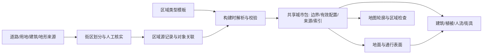

# 27 按道路划分区域与区域基础数据计划

2026-11-11。**状态：规划，尚未创建区域数据、接入生成器或改变场景。**目标是把城市分成可逐块完善的区域：每块有边界、类型、标志性建筑和完整的环境参数；已有对象提供真实细节，区域默认值补齐缺失信息，走到不同地方能看出区别。

本计划负责区域划分、数据组织及模块接入；建筑身份和占道治理继续按 [23 号](23-BUILDING-AND-STREET-PLAN.md)，树木、人流及街区细节复用 [12 号](12-URBAN-FABRIC-PLAN.md) 与 [06 号](06-STREETSCAPE.md)。术语见 [GLOSSARY](../GLOSSARY.md)。不改变正式版九条要求，也不以区域风格掩盖错误建筑、地形或道路。

## 1. 城市怎样圈成一个个区域

采用“道路围合街区 → 街区内部功能区域 → 跨街区场所关联”的结构，另有道路、立交、河流等走廊区域。

- **以路为边**：主干路、次干路和具有明确分隔作用的地面支路优先构成边界；小区内部通道、园路和停车场车道通常保留在区域内部，避免碎成小块。
- **边界沿道路用地外缘**：道路中心线用于推导走廊，道路区域包含车行道、人行道、分隔带和路侧设施；两侧地块从走廊外缘开始。宽度缺失时采用标明来源的估计，与道路生成器共用，不能各画一套。
- **道路不够时补真实边界**：公园围界、河岸、海岸、山体范围、校园/小区边界可以闭合区域。没有证据的空白保留 `unknown`，不为圈满地图虚构围墙、名称或用途。
- **一个街区可有几种用途**：有边界证据时分为商业、住宅、公园等子区域；混合建筑或证据不足时保留 `mixed` 及主次用途，不强行切碎。商圈可以通过同一个 `placeId` 关联多个区域。
- **立交按层处理**：高架跨过地块不自动把地块切开；桥面、桥下地面和匝道分别关联 `surfaceId`。隧道不作为地面围合线，桥梁也不能成为河流的断点。
- **建筑不沿区域线裁切**：优先按核实的场所归属，其次按占地关系分配主区域并记录跨界关联；有歧义进入复核。地标可以被多个区域引用，但只保留一个实体。

地面主区域在适用覆盖范围内无重叠、无未说明空洞，水体、道路和地块各有归属；场所边界和功能子区是关联层，不再重复铺一层地面。不同高度的表面允许投影重叠。双向分隔道路及中央绿带归同一道路走廊管理，避免产生无意义的狭长街区。

边界记录构成它的道路/水岸/围界来源、版本、精度和核实状态。区域 ID 稳定，不由数组序号或实时多边形哈希决定；拆分、合并保留前身 ID 和迁移记录。行政区、区域和空间加载分块分别建索引，现有 `districtAt()` 不改造成区域查询。

## 2. 区域类型及要看见的差别

以下是风貌模板方向，不是对所有真实地点的断言。实际用途、树种、材质和建筑细节有来源时覆盖模板；模板推断保留标记。

| 类型 | 建筑与标志物 | 地面、树木与活动重点 | 地形显示默认方向 |
| --- | --- | --- | --- |
| 商业 `commercial` | 商场、沿街店铺、商业综合体；关联入口和地标 | 石材/砖铺广场、街树、遮阴、座椅；入口与步行街聚集 | 平顺工程地面 |
| 公共设施 `civic` | 政务、文化、体育设施及公共广场 | 大尺度铺装、广场绿化、集散与活动空间 | 平顺，保留台阶和坡道 |
| 办公 `office` | 办公塔楼、裙房、大堂和连桥 | 楼前铺装、树池、工作日出入口活动 | 平顺，入口标高优先 |
| 住宅 `residential` | 高层小区、老住宅、城中村、低层住宅分子类型 | 内路、院落、游乐/健身、围界、早晚活动 | 平顺，保留真实台地 |
| 公园 `park` | 场馆、亭、雕塑等独立对象 | 园路、草地、林地、花坛、活动场和休憩点 | 有可靠起伏才保留，不给平地公园造山 |
| 山地 `mountain` | 山体、观景点、登山设施 | 林地、步道、坡地禁入区、低密度活动 | 保留有来源的自然地形 |
| 道路 `road` | 道路、天桥、公交设施 | 车行道/人行道/骑行道分开；行道树和过街点 | 共用工程表面，保留必要纵坡 |
| 立交 `interchange` | 桥面、匝道、桥墩及桥下空间 | 分层车流、桥下绿地或设施；禁止无连接跨层 | 保留结构高差和连续坡道 |
| 河流/水岸 `river` | 水道、桥、堤岸、水工设施 | 水面、护岸、滨水路径、湿地；人不进入水面 | 保留水位、岸顶和坡岸关系 |
| 教育/医疗 `education` / `medical` | 校园、学校、医院 | 院内路径、入口集散、运动场、访问限制 | 依实际场地，通常平顺 |
| 产业/交通 `industrial` / `transport` | 厂房、园区、车站、枢纽 | 货运/客流分离、停车、服务道路 | 工程面与多层结构分别记录 |
| 湿地/海岸 `wetland` / `coastal` | 滩涂、防护岸、观景设施 | 生态植被、栈道、潮间带和禁入范围 | 保留地貌与水位关系 |
| 混合/施工/未知 `mixed` / `construction` / `unknown` | 按对象事实呈现，施工与建成状态分开 | 使用保守默认；不自动开放所有地面 | 无依据不新增地形或工程结构 |

模板只决定缺失细节的候选范围。住宅不能一律刷相同外墙，商业区也不能自动把全部空地铺成广场；区域内部仍需有铺装、绿地、水面、建筑和通行子范围。

## 3. 每个区域的基础数据

人工源记录可以引用共享模板；构建后生成区域的**完整有效配置**及逐项来源。这样查一个区域就能看到最终值，修改通用树木/铺装规则也不必复制修改成百上千个区域。几何和对象清单可以通过 ID 引用共享表，避免复制体积。

| 字段组 | 需要记录的内容 | 单位与约束 |
| --- | --- | --- |
| `identity` | 稳定 ID、中文名称/别名、类型/子类型、主次用途、场所/行政区关联、状态、版本、前身 ID | 未知名称为空；推断用途与核实用途分开 |
| `boundary` | 多边形及孔洞、边界道路/水岸/围界引用、相邻区域、入口、所属表面 | 源坐标保留；运行时沿用固定原点与米制坐标 |
| `evidence` | 来源清单 ID、对象 ID、采集/生效日期、核实日期、方法、精度、待核问题 | 每项可为 `verified` / `derived` / `estimated` / `unknown`；证据不靠一个总分代替 |
| `landmarks` | 地标 ID、区域内主/次地标、入口及观察点关联 | 位置与模型身份复用 `data/source/landmarks.json`，不手写替代坐标 |
| `buildings` | 对象引用、用途分布、塔楼/裙房/连桥角色、体量与屋顶类型、立面材质、颜色、窗格和细节模板 | 真实轮廓/部件优先；区域规则不新增随机楼、不改已知高度 |
| `heightFallback` | 分用途/部件的样本、平均值、中位数、分布、上下界、样本数、推算方法和来源区域 | 米；楼层数另记，设计高度另记；无样本为空 |
| `ground` | 铺装子范围、材质、色调、粗糙度、纹理尺度/方向、磨损、透水性、草地/裸地比例 | 尺度用米，比例 0–1；覆盖范围不可穿楼或叠水面 |
| `paths` | 人行道、园路、骑行道、过街点、台阶/坡道、入口连接、通行权限和无障碍属性 | 宽度米、坡度无量纲；缺连接不得默认连通 |
| `terrain` | 地面模式、原始地形引用、派生面约束、标高基准、边界锚点、坡岸/挡墙/台地、处理来源 | 高程米；对象高度与绝对高程分开；未知基准不可直接拼接 |
| `vegetation` | 树种/外形候选及权重、树高/冠幅/树龄证据、间距、树池、灌木、草、花、分布区和排除区 | 米、株/公顷；真实点位、推导树列和模拟散布分别标记 |
| `pedestrians` | 模拟密度、容量上限、日程、入口/吸引点、走动/停留比例、候选路径、禁入范围 | 人/千平方米可步行面积、人数、时段；不是现实实时客流 |
| `traffic` | 车流/骑行/服务车辆规则、出入口、停车与装卸、道路图及层级关联 | 复用交通网络，区域不能凭空生成断头路线 |
| `furniture` | 路灯、长椅、垃圾桶、围栏、标牌、公交亭、运动设施等模板及布置范围 | 点位有来源时优先；模拟位置须通过净空和接触检查 |
| `ambience` | 夜间照明、窗灯日程、环境声音、季节/天气响应、活动时段 | 声音渐变范围米；灯光不覆盖已有专模规则 |
| `access` | 公众/受限/禁入子区、开放时间、施工边界、步行/车辆允许模式 | 未知权限不等于允许进入建筑或封闭院落 |
| `renderBudget` | 近中远景细节、树/人/街具上限、优先级、阴影与可见距离 | 区域预算服从 [10 号](10-PERF-QA.md) 全局预算，不能叠加无限扩容 |
| `extensions` | 后续新增字段的命名空间、版本、值、来源、启用状态 | 只存声明式数据，不存可执行 JS 或任意脚本 |

可以继续加入动物、雨后积水、导视、遮阴、公共艺术、施工阶段等元素；必须先声明它影响什么表面、哪种对象和哪个消费者。仅登记字段不代表已经有生成器或画面效果。

## 4. 关键默认规则

### 4.1 没有楼高时怎样补

1. 先沿用现有建筑来源裁决，核实地标/建筑的高度与身份；楼层推算、模型高度、设计高度分别保留来源语义。区域平均值不覆盖任何已被采纳的单体高度。
2. 缺高度时，先找本区域**相同用途和部件角色**的可靠样本，再找有明确相似条件的相邻区域，最后才用明确标注的全局保守模板。
3. 保存平均值方便查看，同时保存中位数、分位数、样本数和离散程度；默认采用能解释的稳健统计，避免一栋超高地标把周围小楼都拉高。地标、异常值、塔楼/裙房混样和此前估计楼不参与普通楼统计。
4. 样本不足门槛及相似条件在实施时由样区验证确定，写入配置；不在本计划中编造深圳各区的平均高度。用分布补全时固定 `regionId + buildingId` 种子，并约束体量合理性。
5. 每栋补全楼仍写 `heightSource: estimate`，附估计方法、区域版本与样本引用；后续获得可靠高度自动替换。没有可用估计时进入缺口报告，不能伪装成已知值。

### 4.2 高低起伏怎样显示

城区商业、办公、住宅和公共设施默认采用**平顺的派生工程地面**，公园/山地按来源保留自然起伏；这落实用户的视觉方向，不把 DSM 上的屋顶和树冠隆起当成街道地形，也不把整座城市压到同一个绝对高度。

- 模式分 `engineered`（工程面）、`natural`（自然地形）、`water`（水体）；桥面、屋顶等结构表面独立关联，不用区域布尔开关统管所有高度。
- 普通城区仍保留必要道路坡度、真实台地、入口台阶、坡道、桥面和河岸高差。平地公园不额外制造起伏，山地不会因为被道路围合就压平。
- 相邻区域共享道路边缘和入口的标高约束，先解共同边界，再生成内部地面；不能每区各取一个平均高程导致接缝断崖。
- 原始 DSM/地形及处理记录保留。来源/基准不明、矛盾无法解开的样段继续隔离复核，不直接用美术值覆盖整城；显示面、碰撞、人物/车轮和街具接触共用同一份派生几何。
- 如需为了可读性夸张山体，另列未来展示模式，默认不启用；1:1 正式场景不暗中夸张高程。

### 4.3 人流和树木怎样分布

人流按**可步行面积和路径容量**计算目标数量，再受区域及全局预算限制；分别记录目标人数、可容纳人数和实际生成数。商圈入口、地铁出口、办公大堂、住宅出入口、公园路径和休息点作为吸引点，按日程改变活动权重，不能在整块区域均匀撒人。缺路径的地方不自动开放通行。

树木区分真实点位、由路侧规则推导的树列和范围内的模拟植被。树种未知时选择标为推断的外形模板，公园建成年份不能当每棵树的树龄。所有布置共用建筑/道路净空、入口、水体、权限和表面检查；跨区域共享排除区，避免边界两边重复种树或堵入口。

## 5. 数据组织与可扩展结构

建议新增以下人工源文件，**本轮只提出路径，不创建空壳数据**：

- `data/source/regions.json`：区域身份、源要素引用、人工核实边界/覆盖值、地标关联和字段证据。
- `data/source/region-profiles.json`：各类型默认风貌及子类型；模板可以继承，但构建时检查循环、类型和单位。
- 边界派生、对象归属、统计和完整有效配置由 `tools/sz/build.py` 生成到共享城市包；原始道路/用地等仍放 `data/raw/`，哈希继续登记 `sources.json`。不另建浏览器逐区联网加载的数据通道。



以下为**不可发布的草稿格式示例**，仅演示结构；不是已核实的深圳区域，也不是现有包格式。缺边界、来源和样本时保持空值，不能靠示例自动补真实数据。

```json
{
  "schemaVersion": 1,
  "id": "draft-region-office-001",
  "status": "draft",
  "name": null,
  "kind": "office",
  "placeId": null,
  "boundary": { "geometryRef": null, "sourceRefs": [], "status": "unknown" },
  "landmarkIds": [],
  "profileRef": "office.default.v1",
  "overrides": {
    "terrain": { "mode": "engineered", "anchorRefs": [] },
    "heightFallback": { "meanM": null, "medianM": null, "sampleCount": 0, "sourceRefs": [] },
    "pedestrians": { "enabled": true, "simulation": true }
  },
  "evidence": {
    "kind": { "status": "estimated", "sourceRefs": [], "checkedAt": null },
    "overrides.terrain.mode": { "status": "derived", "method": "region-policy", "sourceRefs": [] }
  },
  "extensions": {}
}
```

字段解析规则：

- **事实字段**先走各自已有来源裁决，采纳的单体事实优先于任何区域默认；来源冲突保留候选并报告，不用“最后写入者”获胜。
- **风貌默认值**按“区域覆盖 → 子类型模板 → 类型模板 → 全局默认”解析；人工核实的对象属性仍优先。每个有效字段带 `resolvedFrom`，可追溯模板/覆盖/对象事实及证据。
- 缺省字段代表继承；`null` 代表明确未知，不偷偷回退成已知；`enabled: false` 明确关闭；`[]` 是明确空集合。数组整体替换，不隐式拼接产生重复对象。所有缺省和空值语义写入 schema。
- 正式记录必须有有效几何和可用引用；不能发布 `draft`，空几何不得解释为全城。基础必需字段未知时阻止该区域发布；允许缺失的外观细节才使用有标签的默认。
- 新元素注册字段名、版本、类型、单位、默认/空值语义、适用区域、来源要求、消费者和预算。升级提供迁移；未知必需字段报错，未知可选扩展忽略并报告，不能静默启用新几何或新通行规则。
- 输入与输出排序稳定，固定种子；输出包含源快照、模板版本和构建版本。模板变更报告受影响区域，区域拆并时迁移对象关联，避免每次重建全城风貌随机变化。

## 6. 接入现有代码，不复制一套引擎

现有共享包已有 `land`、`water`、`green`、`roads`、`buildings`、`landmarks`、`parks`、`terrainSurface` 等独立数据，没有本计划的统一区域记录。区域作为它们的关联与配置层，来源冲突由管线处理，运行时不重复猜测用途和归属。

| 接入处 | 计划职责 |
| --- | --- |
| `tools/sz/build.py` 及其拆出的区域模块 | 建立地面路网拓扑、围合候选、人工覆盖、对象关联、统计、模板解析与报告 |
| `sz-data-format.js` / `sz-geodata.js` | 一次解码区域表和配置；明确版本兼容，旧包缺区域时维持现有行为；不让各模块自行下载 |
| `sz-spatial.js` | 查询位置/对象/表面对应的区域与相邻区域；跨层查询带 `surfaceId` |
| `sz-ground.js` / `sz-ground-surface.js` / `sz-controller-surfaces.js` | 共用区域地表与结构表面，统一渲染和接触 |
| `sz-building-layout.js` / `sz-buildings.js` / `sz-building-details.js` / `sz-materials.js` | 消费已解析的建筑默认规则，保留真实单体和地标优先级 |
| `sz-streetscape.js` / `sz-trees.js` / `sz-pedestrians.js` / `sz-pedestrian-tracks.js` | 共享布置区、路径、排除区、活动配置与预算，沿用已有树和人生成器 |
| 道路、道路前场和高架模块 | 共用走廊及表面身份，维持匝道、过街与入口连接 |
| `sz-map.js` 与 QA 入口 | 按类型着色区域、显示边界/ID/来源/有效值/缺口；仅调试时显示，文字集中 `sz-strings.js` |

玩家进入区域时不重涂整座城市。物体由自己的区域归属决定外观，跨区移动只影响附近对象的加载/细节及声音等环境过渡；人和车沿连续网络移动，不到边界就销毁重生。软环境可做过渡和迟滞，实体表面不能用视觉混合制造接触不一致。

区域不是加载块：大公园可以跨多个空间块，多个小区也能在一个块中。以固定空间分块执行可见性、缓存和释放，以区域数据决定风貌；材质/树模型按模板共享并实例化，不能每区域复制全部 GPU 资源。

## 7. 实施顺序与验收

先做相邻区域样板，验证边界和接缝后扩展。候选从已有审计的市民中心—福中三路周边选取办公/公共空间和道路，再补住宅、商圈、公园、山地、河道和立交；具体多边形、命名和覆盖范围必须核实，候选名不表示数据已齐。地形 P0 和建筑占道问题仍是可玩样板的前置条件。

| 阶段 | 交付 | 通过条件 |
| --- | --- | --- |
| R1 边界与契约 | 区域 schema、候选圈线、人工核实入口、地图轮廓检查 | 样区能看见相邻地块/道路边界；不存在无法解释的重叠/空洞，跨层和跨界对象归属正确；尚不改外观 |
| R2 基础数据 | 类型模板、区域完整有效配置、逐字段来源及统计报告 | 能查一个区域的所有属性；未知/推断/核实清楚，地标关联正确，缺高度回退不覆盖事实 |
| R3 地面样板 | 铺装、内部路径、绿地、共享标高约束和接触表面 | 城区平顺、公园/山地起伏有依据；步行/驾车跨相邻区域、坡道及桥下无断崖、串层或穿模 |
| R4 风貌样板 | 建筑细节、树木、模拟人流、街具与日夜活动 | 办公/住宅/商业/公园可辨，变化来自数据；树不堵路、人不穿楼、已知地标不变形 |
| R5 扩区与发布 | 更多类型、完整一期覆盖、分块/预算、扩展字段示例 | 数据版本可迁移，固定种子可重现；跨区稳定、资源可释放，达到正式路线与性能预算 |

每阶段做一次与影响范围相符的测试和审查，频率沿用 [25 号](25-FAST-CHECKS.md)。本轮只有文档，不运行游戏全量回归；真正改共享包格式、坐标或公共接触核心时按该文档跑 `full`。不能因为拆成小阶段省略核心改动的集成检查。

重点回归用少量有代表性的行为样例覆盖：道路围合及孔洞、桥下不断区、河流过桥连续、建筑跨界不裁碎、模板继承与空值、未知扩展、已知楼高不被均值覆盖、区域拆并 ID 迁移、地面接缝和跨层通行。无需给每个区域复制相同测试。

画面验收用同一组样区日夜截图，加一条“道路人行道 → 办公前场 → 住宅入口 → 公园路径”的实际路线；另验桥上/桥下和河岸。记录到数据里有、生成器生成、场景接入、画面可见、接触实走各级，不以地图圈出来就宣称区域渲染完成。大版本再按 10 号全量验收，结束恢复普通游玩状态。
