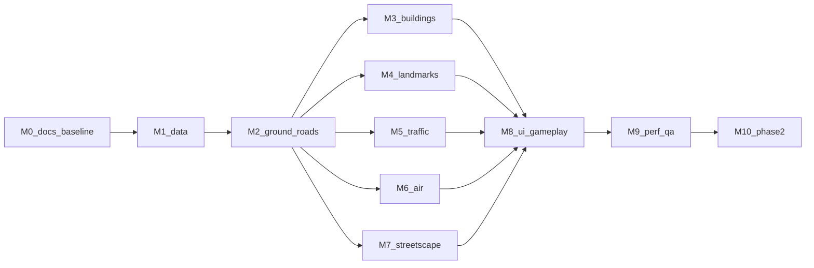

# Slop Shenzhen 文档索引

Slop Shenzhen 是一个在浏览器里漫游深圳关内（南山、福田，二期加罗湖）的 1:1 城市模拟。代码底座是 [mrdoob 的 Slop New York](https://github.com/mrdoob/slop-newyork)，中国城市数据管线和地标做法参考 [Slop Wuhan](https://github.com/LightYearZh/slop-wuhan)。两个参考仓库的只读副本在 `ref/` 下。

## 文档

| 文件 | 内容 |
| --- | --- |
| [HANDOFF.md](HANDOFF.md) | **从这里开始**：当前事实、证据层级、暂停收尾与工作树风险 |
| [REVIEW-FOLLOWUP-2026-11-10.md](REVIEW-FOLLOWUP-2026-11-10.md) | 当前代码审查：已复现问题、优化候选、功能缺口、下一步顺序与验收条件 |
| [NEXT-AGENT-PLAN.md](NEXT-AGENT-PLAN.md) | 下一位执行顺序E0–E6、依赖、并行归属与通过标准 |
| [HANDOFF-HISTORY-2026-11-09.md](HANDOFF-HISTORY-2026-11-09.md) | 历史快照；旧状态不作为当前执行指令 |
| [13-WEBSITE-OPTIMIZATION-PLAN.md](13-WEBSITE-OPTIMIZATION-PLAN.md) | 网站加载、数据表示、分块与性能优化；与另一个13号数据计划区分 |
| [11-MVP.md](11-MVP.md) | MVP 现状、粗糙之处、**正式版九条硬性要求和验收标准** |
| [12-URBAN-FABRIC-PLAN.md](12-URBAN-FABRIC-PLAN.md) | 纽约经验移植：办公/住宅/别墅/高层小区、道路断面、新旧公园与大小树、模拟行人及绿地/地标冲突治理 |
| [13-DATA-DETAIL-PILOT.md](13-DATA-DETAIL-PILOT.md) | 新数据源小范围验证：本地测绘/总图、Overture部件与路网、CMAB、树木公园；样区、字段溯源、分步接入与实际通行验收 |
| [14-CITY-EXPLORATION-PLAN.md](14-CITY-EXPLORATION-PLAN.md) | 后续探索体验：楼栋/小区/场地名称搜索与区域高亮、地铁透视模拟、重点区域建模、人车流、导航与快捷上下车/1秒起降 |
| [15-IMPROVEMENT-PLAN.md](15-IMPROVEMENT-PLAN.md) | 2026-11-09 晚的现状评审：实际画面问题、卡住的原因、改进顺序和文档精简建议 |
| [CONVENTIONS.md](CONVENTIONS.md) | 开发规范：语言、代码风格、坐标、数据、建模、验收、Git |
| [RESEARCH.md](RESEARCH.md) | 前期调研：参考仓库、武汉教训、数据源、APEC、地标核实、检索服务状况 |
| [00-SCOPE.md](00-SCOPE.md) | 场景简报：分期范围、坐标约定、地标清单、暂缓与待确认事项 |
| [01-ARCHITECTURE.md](01-ARCHITECTURE.md) | 纽约原版各模块保留、改造还是替换，以及新增模块 |
| [02-DATA-PIPELINE.md](02-DATA-PIPELINE.md) | 数据源、锁定的快照、处理步骤、楼高规则、许可 |
| [03-ROADS-GROUND.md](03-ROADS-GROUND.md) | 路网、路面、海岸、地形、高架和天桥 |
| [04-BUILDINGS.md](04-BUILDINGS.md) | 普通建筑的挤出方式、立面类型和片区规则 |
| [05-LANDMARKS.md](05-LANDMARKS.md) | 每个地标一张卡片 |
| [06-STREETSCAPE.md](06-STREETSCAPE.md) | 树种、纽约树木生成管线、地铁、天桥、夜景灯光、海湾、远景 |
| [07-VEHICLES.md](07-VEHICLES.md) | 纽约车身生成、深圳蓝色出租车、国产电动车轮廓、绿牌、公交、电单车、声音 |
| [08-AIR.md](08-AIR.md) | 四旋翼载人飞行器、无人机配送航线 |
| [09-UI-GAMEPLAY.md](09-UI-GAMEPLAY.md) | 中文界面、地图、传送、出租车接单 |
| [10-PERF-QA.md](10-PERF-QA.md) | 性能预算、自动检查、浏览器验收路线 |
| [TASKS.md](TASKS.md) | 子任务编号、依赖、产出和验收条件 |

## 里程碑



正式入口和局部驾驶已实现，但M2的地面真实性与全域通行未完成。当前优先12号P0，模型/来源/性能测量可按下一位计划并行，不因图示顺序将其他模块误标未开始。

## 运行

```sh
python3 tools/sz/serve.py --port 8080
```

打开 <http://127.0.0.1:8080/> 运行正式深圳入口；`mvp.html` 是历史预览，不用于正式验收。需要支持 WebGPU 的桌面浏览器（新版 Chrome 或 Edge）。

## 重建数据

```sh
python3 -m venv .venv
.venv/bin/pip install -r tools/sz/requirements.txt
.venv/bin/python tools/sz/build.py          # 生成 js/sz-city.json.gz 和 data/source/build-report.json
```

`tools/sz/fetch.py`（下载并校验原始快照）还没写，现在要按 `data/source/sources.json` 手动下载到 `data/raw/`。

原始大文件放在 `data/raw/`，不进 Git；每份快照的地址、日期和 SHA-256 记在 `data/source/sources.json`。
