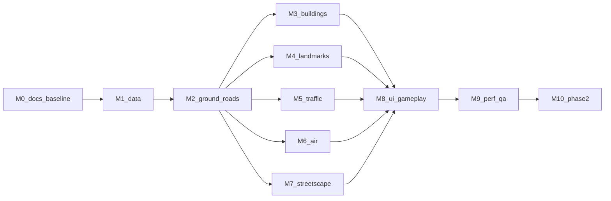

# Slop Shenzhen 文档索引

Slop Shenzhen 是一个在浏览器里漫游深圳关内（南山、福田，二期加罗湖）的 1:1 城市模拟。代码底座是 [mrdoob 的 Slop New York](https://github.com/mrdoob/slop-newyork)，中国城市数据管线和地标做法参考 [Slop Wuhan](https://github.com/LightYearZh/slop-wuhan)。两个参考仓库的只读副本在 `ref/` 下。

## 文档

### 当前状态与执行

| 文件 | 内容 |
| --- | --- |
| [HANDOFF.md](HANDOFF.md) | **从这里开始**：当前状态、已挂进场景的内容、下一步、已知风险 |
| [REVIEW-FOLLOWUP-2026-11-10.md](REVIEW-FOLLOWUP-2026-11-10.md) | 功能缺陷审查：已复现问题、功能缺口、修复顺序与验收条件 |
| [22-OPTIMIZATION-REVIEW.md](22-OPTIMIZATION-REVIEW.md) | 代码优化审查：架构精简、性能、画面，对照纽约和武汉，带执行计划 |
| [TASKS.md](TASKS.md) | 按里程碑的任务清单和勾选状态 |
| [ACCEPTANCE-STATUS.md](ACCEPTANCE-STATUS.md) | 九条硬性要求逐条的验收等级和证据 |
| [NEXT-AGENT-PLAN.md](NEXT-AGENT-PLAN.md) | E0–E6 长期计划、并行分工，以及发给新会话的接续提示 |
| [CONVENTIONS.md](CONVENTIONS.md) | 开发规范：语言、代码风格、坐标、数据、建模、验收、Git |
| [HANDOFF-HISTORY-2026-11-10.md](HANDOFF-HISTORY-2026-11-10.md)、[HANDOFF-HISTORY-2026-11-09.md](HANDOFF-HISTORY-2026-11-09.md) | 交接历史，只作证据，不作当前指令 |

### 模块规格（00–11）

| 文件 | 内容 |
| --- | --- |
| [00-SCOPE.md](00-SCOPE.md) | 场景简报：分期范围、坐标约定、地标清单、暂缓与待确认事项 |
| [01-ARCHITECTURE.md](01-ARCHITECTURE.md) | 纽约原版各模块对应的深圳模块、新增模块、运行时数据流 |
| [02-DATA-PIPELINE.md](02-DATA-PIPELINE.md) | 数据源、锁定的快照、处理步骤、建筑过滤与楼高规则、许可 |
| [03-ROADS-GROUND.md](03-ROADS-GROUND.md) | 路网、路面、派生路面规则、海岸、地形、高架和天桥 |
| [04-BUILDINGS.md](04-BUILDINGS.md) | 普通建筑的挤出方式、立面类型和片区规则 |
| [05-LANDMARKS.md](05-LANDMARKS.md) | 每个地标一张卡片；详细模型卡在 `landmarks/` |
| [06-STREETSCAPE.md](06-STREETSCAPE.md) | 树种、纽约树木生成管线、地铁、天桥、夜景灯光、海湾、远景、环境人群 |
| [07-VEHICLES.md](07-VEHICLES.md) | 车身生成、深圳出租车、国产电动车轮廓、绿牌、公交、电单车、声音 |
| [08-AIR.md](08-AIR.md) | 四旋翼载人飞行器、无人机配送航线；证据在 `research/drone-routes.md` |
| [09-UI-GAMEPLAY.md](09-UI-GAMEPLAY.md) | 中文界面、地图、传送、出租车接单 |
| [10-PERF-QA.md](10-PERF-QA.md) | 性能预算、自动检查、浏览器验收路线 |
| [11-MVP.md](11-MVP.md) | MVP 历史、**正式版九条硬性要求和验收标准** |

### 专项规划（12–19）

| 文件 | 内容 |
| --- | --- |
| [12-URBAN-FABRIC-PLAN.md](12-URBAN-FABRIC-PLAN.md) | 纽约经验移植：办公/住宅/别墅/高层小区、道路断面、公园与树、模拟行人、地面 P0 |
| [13-DATA-DETAIL-PILOT.md](13-DATA-DETAIL-PILOT.md) | 新数据源小范围验证：本地测绘/总图、Overture 部件与路网、CMAB、树木公园 |
| [14-CITY-EXPLORATION-PLAN.md](14-CITY-EXPLORATION-PLAN.md) | 后续探索体验：名称搜索与区域高亮、地铁透视、重点区域建模、导航与快捷上下车 |
| [18-ROAD-BUILDING-CLEARANCE-PLAN.md](18-ROAD-BUILDING-CLEARANCE-PLAN.md) | 道路与建筑净空治理方案 |
| [19-WEBSITE-OPTIMIZATION-PLAN.md](19-WEBSITE-OPTIMIZATION-PLAN.md) | 网站加载、数据格式、分块与发布优化（原 13 号） |

### 审计与参考（16–22）

| 文件 | 内容 |
| --- | --- |
| [16-NY-REFERENCE.md](16-NY-REFERENCE.md) | 纽约原版模块地图：启动顺序、文件、关键函数和行号 |
| [17-WUHAN-REFERENCE.md](17-WUHAN-REFERENCE.md) | 武汉参考模块地图：现行 `js/runtime/` 入口、旧上海运行时、数据管线和关键函数行号 |
| [20-BUILDING-HEIGHT-AUDIT.md](20-BUILDING-HEIGHT-AUDIT.md) | 楼高与公开资料核对、4 栋修正、照片对照和已知缺口（原 16 号） |
| [21-FOOTPRINT-AND-STREET-AUDIT.md](21-FOOTPRINT-AND-STREET-AUDIT.md) | 普通楼来源统计、遥感误检过滤、纯 OSM 模式、街景照片对照（原 17 号） |
| [RESEARCH.md](RESEARCH.md) | 前期调研：参考仓库、武汉教训、数据源、APEC、地标核实、检索服务状况 |

2026-11-10 删除的过期文档：`15-IMPROVEMENT-PLAN.md`（规则并入 02、03 号）、`CODE-REVIEW-2026-11-10.md`（模块说明并入 01 号）、`SLIM-REVIEW-2026-11-10.md`（并入 22 号）、`NEXT-SESSION-PROMPT.md`（接续提示并入 NEXT-AGENT-PLAN）。

文档里指向 `qa/` 的链接是本地证据，`docs/qa/` 不进 Git，克隆的仓库里打不开是预期的。

## 里程碑



正式入口和局部驾驶已实现，但 M2 的地面真实性与全域通行未完成。当前功能修复按 REVIEW-FOLLOWUP 第 4 节推进，优化按 22 号并行推进；不因图示顺序把其他模块误标成未开始。

## 运行

```sh
python3 tools/sz/serve.py --port 8080
```

打开 <http://127.0.0.1:8080/> 运行正式深圳入口；历史 MVP 预览页（`mvp.html`）已于 2026-11-10 删除。需要支持 WebGPU 的桌面浏览器（新版 Chrome 或 Edge）。

## 重建数据

```sh
python3 -m venv .venv
.venv/bin/pip install -r tools/sz/requirements.txt
.venv/bin/python tools/sz/build.py          # 生成 js/sz-city.json.gz 和 data/source/build-report.json
```

`tools/sz/fetch.py`（下载并校验原始快照）还没写，现在要按 `data/source/sources.json` 手动下载到 `data/raw/`。

原始大文件放在 `data/raw/`，不进 Git；每份快照的地址、日期和 SHA-256 记在 `data/source/sources.json`。
