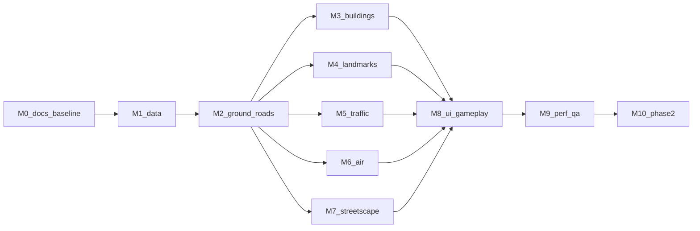

# Slop Shenzhen 文档索引

Slop Shenzhen 是一个在浏览器里漫游深圳关内（南山、福田，二期加罗湖）的 1:1 城市模拟。代码底座是 [mrdoob 的 Slop New York](https://github.com/mrdoob/slop-newyork)，中国城市数据管线和地标做法参考 [Slop Wuhan](https://github.com/LightYearZh/slop-wuhan)。两个参考仓库的只读副本在 `ref/` 下。

## 文档

| 文件 | 内容 |
| --- | --- |
| [HANDOFF.md](HANDOFF.md) | **从这里开始**：现状、下一步、已知的坑、启动提示 |
| [CONVENTIONS.md](CONVENTIONS.md) | 开发规范：语言、代码风格、坐标、数据、建模、验收、Git |
| [RESEARCH.md](RESEARCH.md) | 前期调研：参考仓库、武汉教训、数据源、APEC、地标核实、检索服务状况 |
| [00-SCOPE.md](00-SCOPE.md) | 场景简报：分期范围、坐标约定、地标清单、暂缓与待确认事项 |
| [01-ARCHITECTURE.md](01-ARCHITECTURE.md) | 纽约原版各模块保留、改造还是替换，以及新增模块 |
| [02-DATA-PIPELINE.md](02-DATA-PIPELINE.md) | 数据源、锁定的快照、处理步骤、楼高规则、许可 |
| [03-ROADS-GROUND.md](03-ROADS-GROUND.md) | 路网、路面、海岸、地形、高架和天桥 |
| [04-BUILDINGS.md](04-BUILDINGS.md) | 普通建筑的挤出方式、立面类型和片区规则 |
| [05-LANDMARKS.md](05-LANDMARKS.md) | 每个地标一张卡片 |
| [06-STREETSCAPE.md](06-STREETSCAPE.md) | 树种、地铁、天桥、夜景灯光、海湾、远景 |
| [07-VEHICLES.md](07-VEHICLES.md) | 蓝色出租车、国产车体型、绿牌、公交、电单车、声音 |
| [08-AIR.md](08-AIR.md) | 四旋翼载人飞行器、无人机配送航线 |
| [09-UI-GAMEPLAY.md](09-UI-GAMEPLAY.md) | 中文界面、地图、传送、出租车接单 |
| [10-PERF-QA.md](10-PERF-QA.md) | 性能预算、自动检查、浏览器验收路线 |
| [TASKS.md](TASKS.md) | 子任务编号、依赖、产出和验收条件 |

## 里程碑



M2 是第一个能开车的空城。M2 完成后，M3 到 M7 可以并行推进。

## 运行

```sh
python3 -m http.server 8080
```

打开 <http://127.0.0.1:8080/>。需要支持 WebGPU 的桌面浏览器（新版 Chrome 或 Edge）。

## 重建数据

```sh
python3 -m venv .venv
.venv/bin/pip install -r tools/sz/requirements.txt
.venv/bin/python tools/sz/fetch.py          # 下载并锁定原始快照，写入 data/raw/
.venv/bin/python tools/sz/build.py          # 生成 data/source/build-report.json、js/sz-geodata.json.gz、js/sz-buildings.bin.gz
```

原始大文件放在 `data/raw/`，不进 Git；每份快照的地址、日期和 SHA-256 记在 `data/source/sources.json`。
